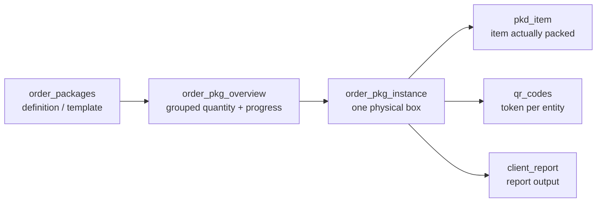

# Database model

Both applications share one Supabase project. This page describes that schema as
far as the repositories can establish it.

<Status
  type="verified"
  date="2026-08-20"
  sources={[
    'website:src/types/supabase.ts',
    'Mobile:supabase/migrations/20250121_add_team_lead_support.sql',
    'website:inspect_rpc.js',
    'website:inspect_instances.js',
    'Supabase project fqynbudvpvpiljdrrvem',
  ]}>
  Repository schema artifacts were checked against read-only live Supabase
  catalog queries. The generated types snapshot is confirmed stale; current
  live counts, RLS, storage and trigger summaries are recorded in
  [Live backend verification](./live-verification).
</Status>

## Inventory

### Generated types snapshot

| Object kind | Count | Source |
| --- | --- | --- |
| Tables | **63** | generated types |
| Views | **3** | generated types |
| Functions | **49** | generated types |
| Enums | **8** | generated types |
| Foreign keys | **188** | generated types |

### Live project

| Object kind | Count | Source |
| --- | ---: | --- |
| Tables | **67** | live Supabase catalog |
| Views | **3** | live Supabase catalog |
| Functions | **83** | live Supabase catalog |
| Enums | **11** | live Supabase catalog |
| Non-internal triggers | **17** | live Supabase catalog |

Used by application code but absent from the generated types and confirmed live:
`order_item_allocation`, `destinations`, `allocation_increase_requests`,
`signatures`.

Used by `Mobile` but **not** found live as a storage bucket or table:
`order_media`.

## The three views

`packer_availability_status`, `task_status_view`, `user_effective_permissions`.

`user_effective_permissions` is notable: no application code reads it directly,
but live RLS and helper functions do use the permission-flag system.

## Enums

The only value sets the database itself constrains:

| Enum | Values |
| --- | --- |
| `project_type` | standard, maintenance, survey |
| `task_status` | in_progress, paused, completed |
| `packer_status` | available, busy, break |
| `maintenance_task_category` | survey, unpack, repack |
| `maintenance_package_type` | defensor, standard_box |
| `request_type` | material, material_variant, supplier_pricing |
| `request_action` | approved, rejected |
| `securing_side` | big_sides, small_sides, lid, base |

Live has three additional enums not present in the generated types:
`MediaCategory`, `maintenance_task_status`, and `material_type`. Live
`request_type` also includes `allocation_increase`.

There is **no role enum**. Roles are rows in a `roles` table — see
[Roles and permissions](/docs/website/roles-and-permissions).

## Order lifecycle: two status columns, neither constrained

`orders` has **no `status` column**. It has two:

```text
orders.production_status   plain string, no enum, no check constraint
orders.commercial_status   plain string, no enum, no check constraint
```

Because both are unconstrained strings, **the database does not enforce the
vocabulary**. Live values observed on 2026-08-20:

| Column | Live values |
| --- | --- |
| `production_status` | `completed`, `in_progress`, `on_hold`, `pending` |
| `commercial_status` | `approved`, `draft`, `invoiced` |

:::warning This mapping is inferred from usage, not declared anywhere

The live vocabulary is now known, but legal transitions are still not declared
anywhere. See [OQ-012](/docs/reference/open-questions#oq-012).

:::

## Key table shapes

Read from the generated types snapshot.

```text
profiles(id, role_id NOT NULL, status NOT NULL, client_id, current_order_id,
         packer_status, username, full_name, phone_number, avatar_url,
         created_at, updated_at)

roles(id, name, can_manage_roles, can_ban_users, can_block_users,
      can_delete_profiles, can_reset_passwords, can_unblock_users,
      created_at, updated_at)

orders(id, client_id, order_name, reference, production_status,
       commercial_status, project_type, project_lead_id, description,
       start_date, completion_date, total_estimated_cost, total_actual_cost,
       total_transportation_cost, created_by, created_at, updated_at)

order_team_members(id, order_id, packer_id, is_team_lead, created_at)

packer_sessions(id, order_id, packer_id, session_active, team_selected,
                attendance_completed, packaging_started,
                order_name, client_name, project_lead_name,
                created_at, updated_at)

attendance_logs(id, order_id, packer_id, log_date, shift_period,
                start_time, end_time, status, is_project_start,
                toolbox_briefing_completed, created_at, updated_at)

temporary_privileges(id, user_id, granted_role_id, granted_by, granted_at,
                     expires_at, is_active, reason, created_at, updated_at)

qr_codes(id, token, entity_type, entity_id, is_active, created_at)

audit_log(id, entity_type, entity_id, action_type, column_name,
          old_value, new_value, changed_by, change_time,
          order_id, order_package_id, is_critical_alert, notes)

media(id, image_url, designation, notes, order_package_id,
      order_pkg_instance_id, package_item_id, pkd_item_id,
      task_log_id, maintenance_task_log_id, created_at)
```

Three things worth internalising:

- **`profiles.current_order_id`** exists, which is how "one active order per
  packer" can be enforced at the row level. Whether a trigger enforces it is
  **unverified**.
- **`media` has six nullable parent columns.** It attaches to whichever entity
  is set — a loose polymorphic pattern with no discriminator column.
- **`packer_sessions` denormalises** `order_name`, `client_name` and
  `project_lead_name`. Those copies can drift from their sources; nothing in
  source shows what keeps them fresh.

## The package model — four distinct layers

Conflating these is the most common source of reporting bugs.



`order_pkg_instance` carries `ipac_reference`, `instance_number`,
`destination`, `tag`, `packed_at` and `packed_by` — verified from
<SourceRef repo="website" path="inspect_instances.js" /> and from the report
conflict log. `packed_at` is the field the reporting date logic hinges on; see
[W6](/docs/workflows/w6-packing-evidence).

## Relationships

188 foreign keys are declared. The most-referenced parents indicate where the
schema's gravity lies:

| Parent | Inbound FKs |
| --- | --- |
| `profiles` | 28 |
| `order_packages` | 16 |
| `orders` | 12 |
| `clients` | 7 |
| `material_variants` | 6 |
| `client_report` | 6 |
| `units_of_measure` | 6 |

`profiles` being the most-referenced table, and being read by both applications
on every sign-in, makes it the highest-risk table in the system to change.

## Functions

49 are declared. **24 of them are called by neither application:**

`approve_material_variant_request`, `approve_supplier_pricing_request`,
`can_be_project_lead`, `complete_assignments_for_packers`,
`count_order_team_leads`, `deactivate_expired_privileges`, `debug_user_info`,
`decrement_item_packed_qty`, `delete_tasks_for_order_packages`,
`get_active_tasks_for_packers`, `get_busy_packers`, `get_order_progress`,
`get_order_team_leads`, `get_user_role`, `increment_item_packed_qty`,
`mark_order_package_packed`, `order_has_team_lead`,
`packer_needs_daily_attendance`, `refresh_order_pkg_overview_rollup`,
`remove_self_from_order`, `unpack_order_package`, `user_assigned_to_order`,
`user_has_permission`, `validate_box_completion`.

Some are plausibly trigger bodies or scheduled jobs — `deactivate_expired_privileges`
and `refresh_order_pkg_overview_rollup` read that way. **This is inference, not
evidence.** Their status is [OQ-013](/docs/reference/open-questions#oq-013).

Source-era signature, from <SourceRef repo="website" path="inspect_rpc.js" />:

```text
fetch_report_instances(p_client_id, p_order_ids, p_date_from, p_date_to,
                       p_date_mode, p_destinations, p_has_items_only, p_tag_ids)
```

The live project has three overloads. The newest overload adds `p_tag_ids` and
uses `COALESCE(order_pkg_instance.packed_at, MAX(pkd_item.created_at))` for
completion-style date modes. `item_packed_at` is retained as a legacy alias for
completion; `packing_started_at` uses the first packed item timestamp. See
[Live backend verification](./live-verification#report-date-logic).

## The only RLS and functions written down anywhere

From <SourceRef repo="Mobile" path="supabase/migrations/20250121_add_team_lead_support.sql" />
— exact, and the only such evidence in either repository:

**Schema:** `order_team_members.is_team_lead BOOLEAN DEFAULT FALSE`, plus a
partial index `idx_order_team_members_team_lead (order_id, packer_id) WHERE is_team_lead = TRUE`.
An `ON CONFLICT (order_id, packer_id)` clause implies a unique constraint on
that pair.

**Three `SECURITY DEFINER` functions**, each `GRANT EXECUTE ... TO authenticated`:
`is_team_lead_for_order`, `assign_team_lead`, `can_user_mark_attendance`.

`can_user_mark_attendance` grants when the caller's role is `admin` or
`director` **and** `profiles.status = 'active'`, or when the caller is team lead
for that order.

**RLS policies for two tables** — `attendance_logs` and `packer_sessions`:
manage for admin/director/team-lead, `SELECT` own rows for packers.

:::warning The source policy differs from production

The `packer_sessions` manage policy is predicated on
`orders.status IN ('pending','in_progress')`. `orders` has no `status` column in
the schema snapshot, and no application code reads one. Live verification shows
production differs from the file: the live policy uses
`orders.production_status IN ('pending','in_progress')`.

This proves the repository migration is not the full source of truth for RLS.
Before changing packer session behaviour, read
[Live backend verification](./live-verification#high-signal-live-policy-facts).

:::

## What is deliberately not on this page

No table-by-table column reference and no full policy body catalogue. Those would
rot quickly if copied into prose. Regenerating them from the database is the right
answer — see [Schema provenance](./schema-provenance).
