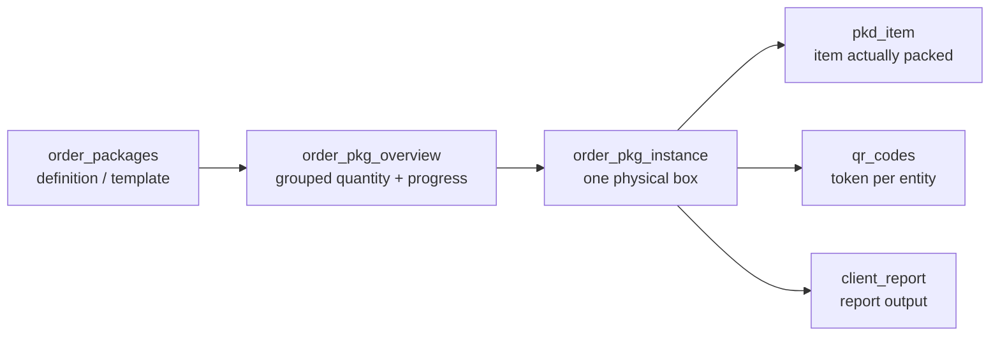

# Database model

Both applications share one Supabase project. This page describes that schema as
far as the repositories can establish it.

<Status
  type="partial"
  date="2026-08-19"
  sources={[
    'website:src/types/supabase.ts',
    'Mobile:supabase/migrations/20250121_add_team_lead_support.sql',
    'website:inspect_rpc.js',
    'website:inspect_instances.js',
  ]}>
  Object inventories, column shapes, enums and foreign keys were read from the
  generated types snapshot, which is **known to be stale** — see
  [Schema provenance](./schema-provenance). Nothing here was verified against the
  live database. Triggers, RLS coverage, grants and storage configuration are
  **not** in this page because no repository contains them.
</Status>

## Inventory

### VERIFIED FROM SOURCE

| Object kind | Count | Source |
| --- | --- | --- |
| Tables | **63** | generated types |
| Views | **3** | generated types |
| Functions | **49** | generated types |
| Enums | **8** | generated types |
| Foreign keys | **188** | generated types |

Plus, used by application code but **absent** from the snapshot: 5 further
tables (`order_item_allocation`, `destinations`, `allocation_increase_requests`,
`signatures`, `order_media`) and 8 further functions. So the real counts are
higher than the table above.

### REQUIRES LIVE DATABASE VERIFICATION

- The current number of tables, views and functions. An older internal document
  recorded 67 tables; the snapshot declares 63. Neither figure is current.
- The trigger inventory. **No repository contains any trigger definition.**
- RLS coverage. Policies exist in source for exactly **two** tables.
- Which of the 49+ functions are `SECURITY DEFINER`. Only three are provable.
- Storage bucket configuration and policies.
- `GRANT`s on any function except the three in the migration.

## The three views

`packer_availability_status`, `task_status_view`, `user_effective_permissions`.

`user_effective_permissions` is notable: it exists, and **no application code
reads it**. Its purpose is unverified.

## Enums

The only value sets the database itself constrains:

| Enum | Values |
| --- | --- |
| `project_type` | standard, maintenance, survey |
| `task_status` | in_progress, paused, completed |
| `packer_status` | available, busy, break |
| `maintenance_task_category` | survey, unpack, repack |
| `maintenance_package_type` | defensor, standard_box |
| `request_type` | material, material_variant, supplier_pricing |
| `request_action` | approved, rejected |
| `securing_side` | big_sides, small_sides, lid, base |

There is **no role enum**. Roles are rows in a `roles` table — see
[Roles and permissions](/docs/website/roles-and-permissions).

## Order lifecycle: two status columns, neither constrained

`orders` has **no `status` column**. It has two:

```text
orders.production_status   plain string, no enum, no check constraint
orders.commercial_status   plain string, no enum, no check constraint
```

Because both are unconstrained strings, **the database does not enforce the
vocabulary**. The permitted values exist only as literals in application code.
Values observed across both repositories:

| Column (by usage context) | Values seen in code |
| --- | --- |
| production-side | `pending`, `in_progress`, `completed`, `on_hold`, `cancelled`, `delivered` |
| commercial-side | `draft`, `invoiced`, `paid` |

:::warning This mapping is inferred from usage, not declared anywhere

Which value belongs to which column, and which transitions are legal, is **not
established by any source**. Do not treat the split above as authoritative. See
[OQ-012](/docs/reference/open-questions#oq-012).

:::

## Key table shapes

Read from the generated types snapshot.

```text
profiles(id, role_id NOT NULL, status NOT NULL, client_id, current_order_id,
         packer_status, username, full_name, phone_number, avatar_url,
         created_at, updated_at)

roles(id, name, can_manage_roles, can_ban_users, can_block_users,
      can_delete_profiles, can_reset_passwords, can_unblock_users,
      created_at, updated_at)

orders(id, client_id, order_name, reference, production_status,
       commercial_status, project_type, project_lead_id, description,
       start_date, completion_date, total_estimated_cost, total_actual_cost,
       total_transportation_cost, created_by, created_at, updated_at)

order_team_members(id, order_id, packer_id, is_team_lead, created_at)

packer_sessions(id, order_id, packer_id, session_active, team_selected,
                attendance_completed, packaging_started,
                order_name, client_name, project_lead_name,
                created_at, updated_at)

attendance_logs(id, order_id, packer_id, log_date, shift_period,
                start_time, end_time, status, is_project_start,
                toolbox_briefing_completed, created_at, updated_at)

temporary_privileges(id, user_id, granted_role_id, granted_by, granted_at,
                     expires_at, is_active, reason, created_at, updated_at)

qr_codes(id, token, entity_type, entity_id, is_active, created_at)

audit_log(id, entity_type, entity_id, action_type, column_name,
          old_value, new_value, changed_by, change_time,
          order_id, order_package_id, is_critical_alert, notes)

media(id, image_url, designation, notes, order_package_id,
      order_pkg_instance_id, package_item_id, pkd_item_id,
      task_log_id, maintenance_task_log_id, created_at)
```

Three things worth internalising:

- **`profiles.current_order_id`** exists, which is how "one active order per
  packer" can be enforced at the row level. Whether a trigger enforces it is
  **unverified**.
- **`media` has six nullable parent columns.** It attaches to whichever entity
  is set — a loose polymorphic pattern with no discriminator column.
- **`packer_sessions` denormalises** `order_name`, `client_name` and
  `project_lead_name`. Those copies can drift from their sources; nothing in
  source shows what keeps them fresh.

## The package model — four distinct layers

Conflating these is the most common source of reporting bugs.



`order_pkg_instance` carries `ipac_reference`, `instance_number`,
`destination`, `tag`, `packed_at` and `packed_by` — verified from
<SourceRef repo="website" path="inspect_instances.js" /> and from the report
conflict log. `packed_at` is the field the reporting date logic hinges on; see
[W6](/docs/workflows/w6-packing-evidence).

## Relationships

188 foreign keys are declared. The most-referenced parents indicate where the
schema's gravity lies:

| Parent | Inbound FKs |
| --- | --- |
| `profiles` | 28 |
| `order_packages` | 16 |
| `orders` | 12 |
| `clients` | 7 |
| `material_variants` | 6 |
| `client_report` | 6 |
| `units_of_measure` | 6 |

`profiles` being the most-referenced table, and being read by both applications
on every sign-in, makes it the highest-risk table in the system to change.

## Functions

49 are declared. **24 of them are called by neither application:**

`approve_material_variant_request`, `approve_supplier_pricing_request`,
`can_be_project_lead`, `complete_assignments_for_packers`,
`count_order_team_leads`, `deactivate_expired_privileges`, `debug_user_info`,
`decrement_item_packed_qty`, `delete_tasks_for_order_packages`,
`get_active_tasks_for_packers`, `get_busy_packers`, `get_order_progress`,
`get_order_team_leads`, `get_user_role`, `increment_item_packed_qty`,
`mark_order_package_packed`, `order_has_team_lead`,
`packer_needs_daily_attendance`, `refresh_order_pkg_overview_rollup`,
`remove_self_from_order`, `unpack_order_package`, `user_assigned_to_order`,
`user_has_permission`, `validate_box_completion`.

Some are plausibly trigger bodies or scheduled jobs — `deactivate_expired_privileges`
and `refresh_order_pkg_overview_rollup` read that way. **This is inference, not
evidence.** Their status is [OQ-013](/docs/reference/open-questions#oq-013).

Verified signature, from <SourceRef repo="website" path="inspect_rpc.js" />:

```text
fetch_report_instances(p_client_id, p_order_ids, p_date_from, p_date_to,
                       p_date_mode, p_destinations, p_has_items_only, p_tag_ids)
```

`p_date_mode` accepts at least `item_packed_at`.

## The only RLS and functions written down anywhere

From <SourceRef repo="Mobile" path="supabase/migrations/20250121_add_team_lead_support.sql" />
— exact, and the only such evidence in either repository:

**Schema:** `order_team_members.is_team_lead BOOLEAN DEFAULT FALSE`, plus a
partial index `idx_order_team_members_team_lead (order_id, packer_id) WHERE is_team_lead = TRUE`.
An `ON CONFLICT (order_id, packer_id)` clause implies a unique constraint on
that pair.

**Three `SECURITY DEFINER` functions**, each `GRANT EXECUTE ... TO authenticated`:
`is_team_lead_for_order`, `assign_team_lead`, `can_user_mark_attendance`.

`can_user_mark_attendance` grants when the caller's role is `admin` or
`director` **and** `profiles.status = 'active'`, or when the caller is team lead
for that order.

**RLS policies for two tables** — `attendance_logs` and `packer_sessions`:
manage for admin/director/team-lead, `SELECT` own rows for packers.

:::danger One policy references a column that does not exist

The `packer_sessions` manage policy is predicated on
`orders.status IN ('pending','in_progress')`. `orders` has no `status` column in
the schema snapshot, and no application code reads one. Either this migration
never applied, or the live policy differs from the file.

The migration `DROP POLICY IF EXISTS`es three policies before creating the new
ones, so a failed `CREATE` would leave `packer_sessions` with RLS enabled and no
manage policy at all. **Live verification required before touching packer
session behaviour** —
[OQ-014](/docs/reference/open-questions#oq-014).

:::

## What is deliberately not on this page

No table-by-table column reference, no policy catalogue, no trigger list. Those
would have to be written from the live database, would rot immediately, and
would be indistinguishable from invention if written from the stale snapshot.
Regenerating them from the database is the right answer — see
[Schema provenance](./schema-provenance).
