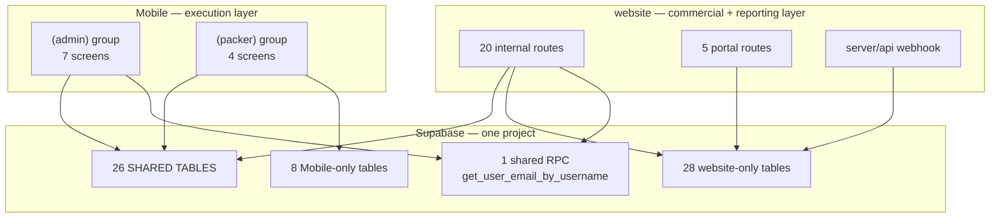
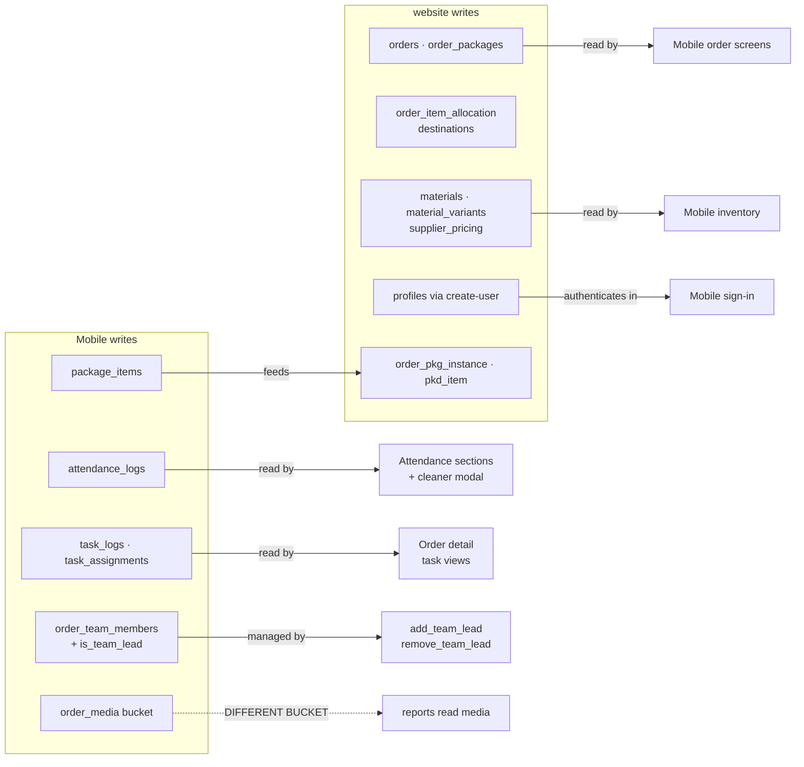

# Cross-application architecture

Two applications, one Supabase project, and **no interface between them**. They
coordinate by writing and reading each other's rows. This page enumerates that
coupling precisely, because it is the part of IPAC most likely to break.

<Status
  type="verified"
  date="2026-08-20"
  sources={[
    'website:src/',
    'website:server/',
    'Mobile:app/',
    'Mobile:components/',
    'Mobile:utils/',
    'Supabase project fqynbudvpvpiljdrrvem',
  ]}>
  Table, RPC and storage usage was extracted by scanning every `.ts`/`.tsx` file
  in both repositories for Supabase client calls, including multi-line calls. The
  inventories below are complete for source and key live object mismatches were
  checked read-only; see
  [Live backend verification](/docs/backend/live-verification).
</Status>

## The shape of the coupling

**There is exactly one shared function contract.** Everything else is shared
state. That is the single most important fact for change safety: there is no
versioned interface to protect either side, so nothing fails loudly when one
application changes an assumption the other depends on.

## The 26 shared tables

Both applications read or write every table below.

| Domain | Shared tables |
| --- | --- |
| Orders | `orders`, `order_packages`, `package_info`, `package_items`, `packing_types` |
| Team | `order_team_members`, `profiles`, `roles` |
| Execution | `attendance_logs`, `task_logs`, `task_assignments`, `task_packages` |
| Materials | `materials`, `material_variants`, `material_tags`, `material_variant_tags`, `order_package_materials`, `units_of_measure` |
| Securing | `beam`, `securing_template`, `order_package_securing` |
| Suppliers | `suppliers`, `supplier_pricing` |
| Reference | `clients`, `app_settings`, `tags` |

## Application-exclusive surface

| | Count | Notable |
| --- | --- | --- |
| `Mobile` only | 8 | `packer_sessions`, `tasks`, `order_media`, `packer_availability_status`, `task_status_view`, `user_effective_permissions` |
| `website` only | 28 | the whole allocation subsystem, the package-instance and packed-item layer, `qr_codes`, reporting tables, `client_portal_settings`, request/approval tables, `supplier_email_messages`, `signatures`, `items_db`, `media` |

The division of labour is real and worth naming: **`Mobile` owns execution**
(who is on site, what they did, when) and **`website` owns commerce and
reporting** (what was allocated, what was packed into which box, what the client
is shown).

## The single shared RPC

`get_user_email_by_username` — called by both applications during sign-in, to
translate a username into an email before `signInWithPassword`.

- <SourceRef repo="Mobile" path="utils/api/supabase.ts" symbol="auth.getUserByUsername" />
- <SourceRef repo="website" path="src/lib/supabase.ts" symbol="auth.signInWithUsername" />

Mobile's own comment states it *"bypasses RLS policies since it runs with
elevated privileges"* — strong evidence it is `SECURITY DEFINER`, though its
definition is in no repository. Because it is the only shared function, **it is
also the only single point of failure that would break sign-in in both
applications at once.**

## Directional data flows

### Mobile produces, website consumes

| Data | Produced by | Consumed by | Confidence |
| --- | --- | --- | --- |
| `attendance_logs` rows | Mobile packer attendance screen | website attendance section, attendance cleaner modal | VERIFIED |
| `task_logs` / `task_assignments` state | Mobile pause/resume/complete RPCs | website order detail | VERIFIED |
| `order_team_members` + `is_team_lead` | Mobile assignment RPCs | website team-lead management, `get_packer_assignment_status` | VERIFIED |
| `package_items` | Mobile packing screens | website package/report views | VERIFIED |
| Package photos | Mobile → bucket `order_media` | website reads bucket `media` — **mismatch, see below** | VERIFIED as divergence |

### website produces, Mobile consumes

| Data | Produced by | Consumed by | Confidence |
| --- | --- | --- | --- |
| `orders`, `order_packages` | website order creation | Mobile admin and packer screens | VERIFIED |
| `materials`, `material_variants`, `supplier_pricing` | website approval RPCs | Mobile inventory screens | VERIFIED |
| `profiles` rows | website via the `create-user` Edge Function | Mobile sign-in and role routing | VERIFIED |
| Allocation state | website allocation RPCs | Mobile reads `orders`/`order_packages` downstream of it | PARTIAL |

## Shared business rules

Rules that both applications depend on but neither owns:

| Rule | Where it lives | Confidence |
| --- | --- | --- |
| Username sign-in resolves through one RPC | database function, called by both | VERIFIED |
| Role name decides application access | duplicated in four places, inconsistently | VERIFIED — see [Roles and permissions](/docs/website/) |
| Team-lead status is **per order**, not a global role | `order_team_members.is_team_lead` | VERIFIED |
| Team leads may manage attendance for their order | `can_user_mark_attendance`, `SECURITY DEFINER` | VERIFIED |
| A packer has at most one active order | live `order_team_members` trigger `trigger_enforce_single_active_order_for_packer` | VERIFIED |
| Packed date must not move when a box is reworked | live `fetch_report_instances` prefers `order_pkg_instance.packed_at` for completion modes | VERIFIED — see [W6](/docs/workflows/w6-packing-evidence) |

## Breaking-change hotspots

Ranked by how much breaks if you change them.

### 1. `profiles` — highest risk in the system

28 inbound foreign keys, read by both applications on **every** sign-in, and the
carrier of `role_id`, `status`, `client_id`, `current_order_id` and
`packer_status`. A change here can lock every user out of both applications
simultaneously.

### 2. `roles.name` values

Four independent hardcoded role checks depend on these strings: website page
access, Mobile route guards, the `create-user` Edge Function, and at least one
`SECURITY DEFINER` function. Renaming a role breaks all four, in different ways,
with no compile-time error anywhere.

### 3. `orders`

12 inbound foreign keys, and two unconstrained status strings whose vocabulary
lives only in application code. Adding a status value that one application does
not recognise is silent.

### 4. `order_team_members`

Written by Mobile, managed by website, and the basis of the team-lead
authorization path. It also has a unique constraint on `(order_id, packer_id)`
that an `ON CONFLICT` clause depends on.

### 5. `attendance_logs` and `task_logs`

Mobile writes, website reads and remediates. Live RLS exists on both tables; the
source migration for `packer_sessions` is stale and differs from production.

### 6. The two storage buckets

:::danger Divergent buckets

`website` reads and writes bucket **`media`** (6 call sites). `Mobile` uploads
package photos to bucket **`order_media`** (1 call site,
<SourceRef repo="Mobile" path="utils/api/supabase.ts" />), then derives a public
URL for them.

Only `media` appears in the schema snapshot, and live Supabase has no
`order_media` bucket. Mobile-uploaded imagery is therefore not aligned with the
website report path.

:::

## Before you change anything shared

Work through the
[cross-application impact checklist](./cross-app-impact-checklist). The short
version: name every object you touch, grep for it in **both** repositories, and
state the cross-application impact in your pull request — because nothing else
in the system will tell you.
