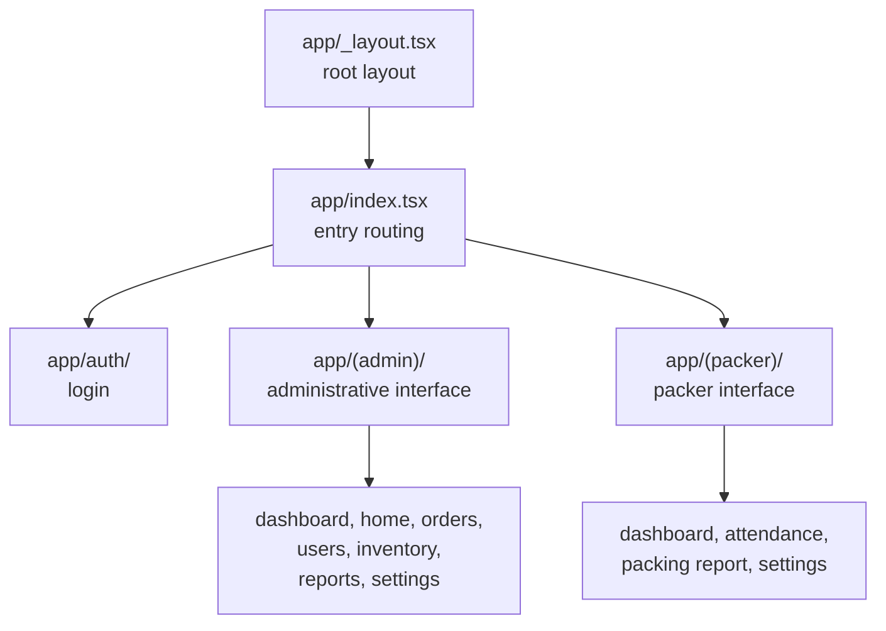

# Mobile architecture

A React Native application built with Expo, used on site by field operators.

<Status
  type="verified"
  date="2026-08-19"
  sources={[
    'Mobile:package.json',
    'Mobile:app.json',
    'Mobile:app/',
    'Mobile:components/',
    'Mobile:utils/',
    'Mobile:supabase/',
    'Mobile:eas.json',
  ]}>
  Structure and configuration were read directly from the repository. Runtime
  behaviour of individual screens was not exercised. Repository ownership is
  unresolved — see [OQ-001](/docs/reference/open-questions#oq-001).
</Status>

## Stack

React Native 0.81 with Expo 54 and React 19. Expo Router 6 provides file-based
routing, NativeWind 4 provides Tailwind-style styling, Supabase JS handles
backend access, React context handles state, and AsyncStorage provides
persistence. Charts, QR code rendering, image picking, gesture handling and
reanimated are all present as dependencies.

`expo-dev-client` is a dependency, so the application requires a native
development build. Expo Go cannot run it. The new React Native architecture is
disabled in configuration.

## Route groups

Three route groups divide the application: authentication, an administrative
interface, and a packer interface. The entry route decides which interface a
signed-in user lands in.

The two interfaces target different form factors — the administrative screens
are described as desktop-oriented and the packer screens as tablet-oriented — so
a change to a shared component needs checking on both.

:::warning Older admin screens may be legacy

The existing architecture document warns that older mobile administrative
screens still exist and that current usage should be verified before treating
them as intended architecture. Some of this application's administrative surface
overlaps with `website`'s. Confirm which is authoritative for a given
workflow before building on it.

:::

## State

Context providers under `utils/` rather than a state library:

| Provider | Concern |
| --- | --- |
| `AuthContext` | Authentication and session |
| `PackerSessionContext` | Packer session state |
| `TextSizeContext` | Text size, for on-site legibility |

Backend access lives under `utils/api/`, with additional caching and storage
helpers alongside. `PackerNavigation` handles packer-specific navigation.

Note that packer session state is not purely a client concern: session,
attendance and packer status also exist in the database and are affected by
triggers. See [Trigger-driven behaviour](./trigger-driven-behaviour).

## Components

Grouped by area under `components/`: administrative, packer, packing, inventory,
shared UI, and debug helpers.

## Backend assets in this repository

The repository carries its own `supabase/` directory containing a migration and
the source of an edge function for user creation. Because migrations exist in
both repositories, neither is a complete schema history —
[The shared backend model](./shared-backend-model) explains why that matters.

## Builds

EAS with three profiles — development, preview and production — all producing
Android APKs for internal distribution. App version numbering comes from EAS
rather than the repository. Android package identity and iOS tablet support are
declared in `app.json`.

## Scale

Measured 2026-08-19: **106 TypeScript files, 23,793 lines**. The data layer is
concentrated in three files — <SourceRef repo="Mobile" path="utils/api/supabase.ts" />
(2,139 lines), `utils/api/inventory.ts` (819) and `utils/api/teamLead.ts` (80).

Backend surface: **31 tables, 17 RPCs**, one storage bucket (`order_media`).

## There is no offline support

Worth stating plainly, because "field application" implies otherwise. Source
contains **no** connectivity detection — no NetInfo, no `isConnected` check, no
write queue, no sync layer. What exists is:

- a TTL cache over AsyncStorage (`utils/cache/simpleCache.ts`) for read
  acceleration
- a persistent profile cache so sign-in survives a slow network
- two ad-hoc conflict retries, on `securing_template` and `beam` updates

Losing connectivity mid-task therefore fails the write. How operators cope with
this in the field is not documented anywhere.

## Error handling

183 `Alert.alert` call sites, 120 `console.error`, 70 `console.log` and 21
`console.warn`. No error boundary, and no error-reporting service. Logging ships
in release builds.

## Gaps worth knowing

- **No lint, typecheck or test script** is defined in `package.json`, despite
  TypeScript being present, and **no CI workflow exists** in this repository.
  There is no automated safety net comparable to `website`'s.
- **Configuration precedence is a trap.** `app.json` commits Supabase settings
  under `extra`, and the client reads those **first**, falling back to
  `EXPO_PUBLIC_*` only if absent. Editing `.env` therefore has no effect. See
  [Build and release](/docs/mobile/build-and-release#configuration-precedence--a-trap).
- **An unused SMS-OTP auth path** is wired into `AuthContext` and reachable from
  no screen — [OQ-017](/docs/reference/open-questions#oq-017).

## Build and release

EAS with three Android-APK profiles, no CI, and version numbers owned by EAS.
Full detail, including the identifier warning, at
[Build and release](/docs/mobile/build-and-release).
