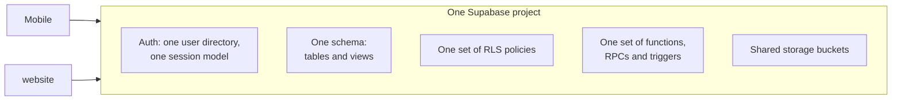

# The shared backend model

One Supabase project serves both applications. This is the single most
consequential fact about IPAC's architecture, and most of the system's risk
follows from it.

<Status
  type="verified"
  date="2026-08-20"
  sources={[
    'website:src/lib/supabase.ts',
    'Mobile:utils/api/',
    'Mobile:app.json',
    'website:docs/ARCHITECTURE.md',
    'Supabase project fqynbudvpvpiljdrrvem',
  ]}>
  The shared-project relationship was confirmed from both applications' Supabase
  client configuration. Specific live backend object counts and policy summaries
  were verified read-only on 2026-08-20; see
  [Live backend verification](/docs/backend/live-verification).
</Status>

## What is shared

There is no per-application schema. No application-specific policy set. No
staging isolation between them documented in either repository. Both
applications authenticate against the same user directory and read the same rows
through the same policies.

## What this means in practice

**A change for one screen can alter the other application.** Adding a column with
a default, tightening a policy, changing a function's return shape, or adding a
trigger changes behaviour for both clients at once. The application that was not
being worked on has no protection.

**Row level security is the real authorization boundary.** Client-side route
guards decide what a user is shown; policies decide what a user can actually
read and write. A frontend guard is a usability feature, not a security control.

**Privileged work happens server-side, deliberately.** User creation runs through
an edge function using a service-role key, because a service-role key bypasses
row level security entirely and must never be shipped to a client. Any new
privileged workflow belongs in that same server-side category.

**Schema history is not versioned in one complete place.** `Mobile` contains one
migration file and `website` has no `supabase/` directory. Neither repository is
a complete record, so reading one and assuming you have seen the schema's history
is a mistake.

## Rules that follow

1. **Before changing any shared object, check both applications.** Tables,
   views, functions, RPCs, policies, triggers, auth behaviour and storage are
   all shared. Work through the
   [cross-application impact checklist](./cross-app-impact-checklist).
2. **Treat the database as production infrastructure.** There is no local
   database in either repository; local development runs against the shared
   hosted project. Database work is read-only by default.
3. **Expect indirect state changes.** Triggers modify state as a side effect of
   writes. See [Trigger-driven behaviour](./trigger-driven-behaviour).
4. **Never place a service-role or secret key in client-visible configuration.**
   See [Environment variables](/docs/guides/getting-started/environment-variables).
5. **Verify before trusting older documentation.** Both applications' documents
   contain claims contradicted by the code — the register is at
   [Open questions](/docs/reference/open-questions).
