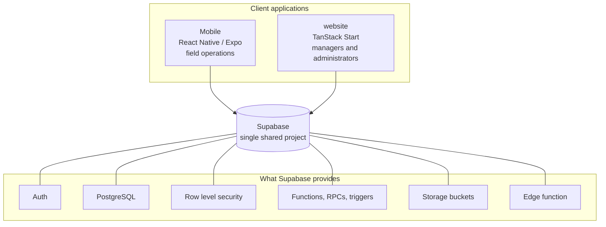
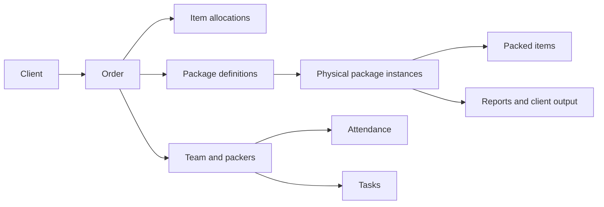

# System architecture

IPAC is two applications over one backend.

<Status
  type="partial"
  date="2026-08-19"
  sources={[
    'website:package.json',
    'website:src/routes/',
    'website:server/api/',
    'Mobile:app/',
    'Mobile:package.json',
    'website:docs/ARCHITECTURE.md',
  ]}>
  Application stacks, route inventories and directory structures were checked
  directly in both repositories. **Live backend figures** — table counts, views,
  buckets, trigger locations — are inherited from
  `website/docs/ARCHITECTURE.md`, which recorded them on 2026-08-08. They
  were not re-queried. See
  [OQ-008](/docs/reference/open-questions#oq-008).
</Status>

## The two applications

### Mobile

React Native with Expo, used on site. Expo Router provides file-based routing,
and the route groups divide the application into an administrative interface, a
packer interface, and authentication. State is held in React context, with
AsyncStorage for persistence, and NativeWind for styling.

Because `expo-dev-client` is a dependency, this application requires a native
development build. See
[`Mobile` architecture](./mobile-architecture).

### website

A TanStack Start web application: React 19, TanStack Router and Query, Vite,
Nitro with the `vercel` preset. It covers internal operations — orders, clients,
inventory, users, requests, reports, settings, data import — and also serves a
restricted client portal with scan, item, package and project views.

It has a small server surface as well: an inbound webhook route for supplier
email. See [`website` architecture](./website-architecture).

## The backend is shared, and it is not passive

Both applications use the **same** Supabase project. Two consequences follow, and
they shape everything else in this documentation:

1. **A backend change made for one application affects the other.** There is no
   per-application schema, no separate policy set, no isolation. See
   [The shared backend model](./shared-backend-model).
2. **Business logic lives in the database.** Row level security decides what a
   user can see, database functions perform privileged work, and triggers change
   state as a side effect of writes. Reading the application code alone will not
   tell you what happens. See
   [Trigger-driven behaviour](./trigger-driven-behaviour).

As recorded on 2026-08-08 in `website`'s architecture document, the
project's public schema had row level security enabled on every table, with at
least one policy each, alongside public views, two storage buckets, and one
active edge function performing privileged user creation with a service-role
key. Those figures need re-verification before being relied upon —
[OQ-008](/docs/reference/open-questions#oq-008).

## The domain, at the highest level

The central entity is the **order**. Most records in the system connect back to
one.

One distinction matters more than any other, and conflating its layers is a
recurring source of bugs: a **package definition** is a template, a **package
overview** is grouped quantity and progress, a **physical package instance** is
one real box, and a **packed item** is what actually went into an instance.
Reporting, QR flows, packing progress and allocation reconciliation all depend on
keeping those four apart.

Connected domains named in the existing architecture document include materials
and suppliers, securing structures — which are modelled separately from ordinary
materials — requests and approvals, audit, the client portal, maintenance, users
and roles, and media and signatures.

## Verified backend surface

A source audit on 2026-08-19 established the following. Counts come from a
generated schema snapshot that is **known to be stale**, so treat them as a lower
bound — see [Schema provenance](/docs/backend/schema-provenance).

| | |
| --- | --- |
| Tables | 63 declared, plus 5 more used by code but undeclared |
| Views | 3 |
| Functions | 49 declared, plus 8 more used by code; **24 called by neither application** |
| Enums | 8 |
| Foreign keys | 188 |
| Tables shared by both applications | **26** |
| RPCs shared by both applications | **1** — `get_user_email_by_username` |
| Storage buckets in use | `media` (website), `order_media` (Mobile) — **divergent** |

The one-shared-RPC figure is the important one: the applications coordinate
through table state, not a versioned interface. See
[Cross-application architecture](./cross-app).

## Where to go next

| To understand | Read |
| --- | --- |
| The database | [Database model](/docs/backend/database-model) |
| How much schema knowledge can be trusted | [Schema provenance](/docs/backend/schema-provenance) |
| How the two applications couple | [Cross-application architecture](./cross-app) |
| How authorization works | [Security model](/docs/security/model) |
| Where it does not work | [Security findings](/docs/security/findings) |
| The role divergence | [Roles and permissions](/docs/website/roles-and-permissions) |
| End-to-end processes | [Workflows](/docs/workflows/overview) |

:::note Some sections are still deliberately absent

There is no RLS page, no storage page and no per-feature documentation yet,
because writing them honestly requires live database access. The two most
complete legacy sources remain `website/docs/WORKFLOWS.md` and
`website/docs/ARCHITECTURE.md` — read them alongside
[Open questions](/docs/reference/open-questions), because several of their claims
are contradicted by source.

:::

## Access control is layered, and role names do not settle it

Effective access depends on more than a role: frontend route policy, mobile
layout guards, row level security, database functions, order assignment, team
membership, team-lead status, packer session state, and attendance can all
participate.

**Do not infer access from a role name.** The live role set is contradicted
across three existing sources, which is recorded as
[OQ-002](/docs/reference/open-questions#oq-002) and is why this site does not yet
describe the role model.
