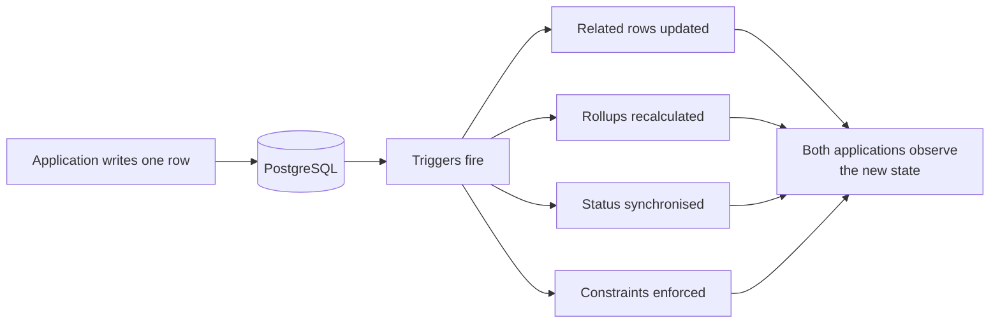

# Trigger-driven behaviour

In IPAC, writing a row can change other rows. Database triggers modify state as a
side effect, so the application code that issued a write does not fully describe
what happened.

<Status
  type="partial"
  date="2026-08-19"
  sources={['website:docs/ARCHITECTURE.md', 'website:CLAUDE.md']}>
  This page is **inherited**, not independently verified. The trigger locations
  and effects below were recorded in `website/docs/ARCHITECTURE.md` on
  2026-08-08 from the live project. They were **not re-queried** while writing
  this site. Treat the list as a starting point for inspection, never as a
  current inventory — see
  [OQ-008](/docs/reference/open-questions#oq-008).
</Status>

## Why this page exists

A developer reading a mutation in either application will see one write. The
actual outcome may include several. Effects recorded in the existing
architecture document include:

- packer status synchronisation
- enforcement of a single active order
- package overview rollups
- allocation packed-quantity synchronisation
- report number assignment
- `updated_at` maintenance

None of these are visible in application code. Some of them enforce business
rules that a frontend change could appear to contradict — and lose.

## Where triggers were recorded

As of 2026-08-08, the existing document recorded live triggers on tables covering
application settings, client reports, maintenance task assignments and logs,
package instances, package overviews, order team members, orders, packed items,
and profiles.

Two things follow. First, the tables carrying triggers are exactly the ones at
the centre of the order, packing, team and reporting workflows — that is, the
tables you are most likely to want to change. Second, this list is weeks old.

## What to do about it

**Before changing any mutation near those tables, inspect the live triggers and
the functions they call.** Not the documentation — the database. The existing
guidance is explicit that Supabase work is read-only by default, so inspection is
the normal, expected activity.

**Do not implement a rule in the frontend that the database already enforces.**
You will produce two sources of truth that disagree under concurrency, and the
database will win.

**Do not assume quantities are frontend-owned.** Packed quantities are
recalculated through database functions and triggers, so computing them
client-side and writing the result can be overwritten or can conflict.

**Expect state to change without a corresponding client call.** Packer status,
active order, and report numbering can all move because something else was
written.

:::note This page will be replaced by verified content

A backend section describing triggers, functions, row level security and storage
in detail is not published yet, precisely because it must be written from a live
query rather than from restated prose. Resolving
[OQ-008](/docs/reference/open-questions#oq-008) is the prerequisite.

:::
