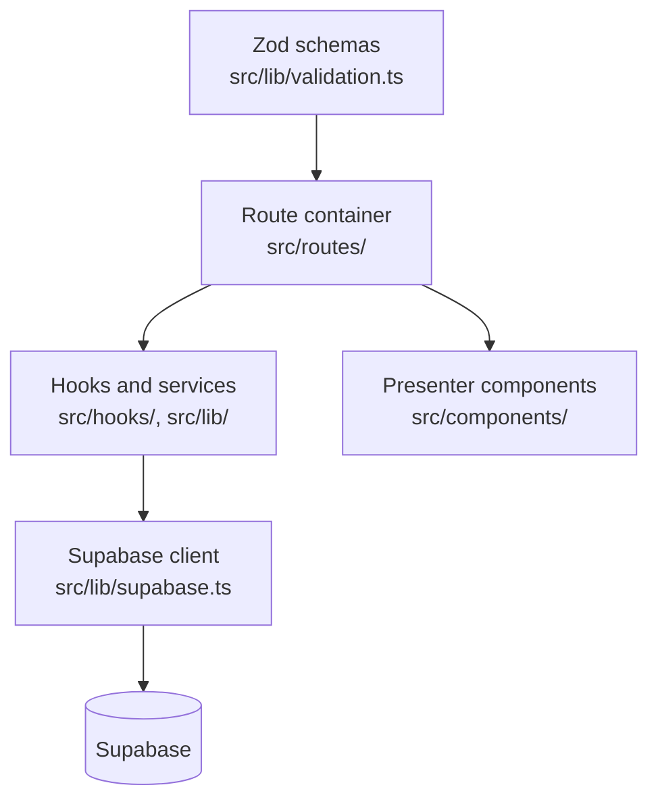

# website architecture

A TanStack Start web application for managers, administrators, and restricted
client access.

<Status
  type="verified"
  date="2026-08-19"
  sources={[
    'website:package.json',
    'website:src/routes/',
    'website:src/',
    'website:server/api/',
    'website:CLAUDE.md',
    'website:docs/ARCHITECTURE.md',
  ]}>
  Structure, route inventory and dependencies were read directly from the
  repository. Layering conventions are reproduced from the repository's own
  engineering guidance, which remains their authority.
</Status>

## Stack

React 19 and TypeScript, TanStack Start with TanStack Router and TanStack Query,
Vite 7, Nitro using the `vercel` preset, Supabase JS, Tailwind CSS 4 with
DaisyUI and Radix primitives, Zod for validation, Vitest for tests, Biome for
lint and format.

The application was rebuilt on this stack to replace an earlier Expo Web
implementation whose bundle size made it unusably slow. That decision, its stated
rationale and its lasting consequences are recorded in
[ADR-0001](/docs/adr/adr-0001-website-framework) — it explains why the web
application shares no code with the React Native application.

## Layering

Four rules govern this structure, and they are enforced in review:

- **Route containers own data access.** All query and mutation hooks live in the
  container. Tab and section components below them are pure presenters receiving
  data and callbacks as props.
- **Server state lives in TanStack Query only.** No manual fetching inside
  components, and no copying server state into local state. Mutations invalidate
  queries on success.
- **Layer boundaries hold.** Presentational UI, container orchestration, service
  and API access, and schema validation are separate; services do not import UI.
- **Validation is Zod at form level.**

## Routing

File-based routing under `src/routes/`. The surface divides into internal
operations and a client portal:

| Area | Routes |
| --- | --- |
| Internal operations | dashboard, orders and order detail, my-orders, clients and client detail, inventory, inventory duplicates, users, requests, reports, settings, data import |
| Client portal | portal login, projects, item detail, package detail, scan by token |
| Authentication | login |

The client portal being part of the same application matters: external client
access and internal operations share one deployment, one auth system, and one
policy set.

## Data access

- The Supabase client is centralised in a single module —
  <SourceRef repo="website" path="src/lib/supabase.ts" /> — configured with
  PKCE and a dedicated auth storage key, clearing corrupted sessions on load.
- Authentication is consumed through a hook rather than directly.
- Username-based login resolves a username to an email through a database
  function before the password sign-in, so login is not a pure client concern.
- Nested Supabase relations are flattened in mappers. Deep nesting is fetched as
  two batched queries rather than nested selects, to avoid N+1 query patterns.

## Server surface

Small but real: an inbound webhook route for supplier email at
<SourceRef repo="website" path="server/api/webhooks/resend/inbound.post.ts" />.
It is verified with a webhook secret, which must remain server-side. Supplier
communication features consume it.

## Styling

Colours come from a semantic scale defined in the application's stylesheet —
raw Tailwind palette classes are disabled in the theme configuration and emit no
CSS. A class name like a raw colour utility will look correct in a diff and do
nothing at runtime. Change colours by editing the theme, not by reaching for a
palette class.

## Quality gates

`npm run validate` runs typecheck then build, and is expected before a pull
request. Vitest covers tests, Biome handles lint and format, and a GitHub Actions
workflow validates pull requests. Deployment is a separate workflow that builds
and deploys to Vercel using the prebuilt flow.

## Module sizes

Measured 2026-08-19. Useful because they show where the complexity actually is:

| Feature module | Files | Lines |
| --- | --- | --- |
| `features/reports` | 20 | **12,186** |
| `features/orders` | 36 | 5,449 |
| `features/requests` | 14 | 2,444 |
| `features/inventory-communications` | 8 | 924 |
| `features/settings` | 2 | 131 |

Reporting is by far the largest and least-tested area of the system.

:::warning The repository's own size limits are widely exceeded

`website/CLAUDE.md` sets a 300-line soft and 400-line hard limit. Actual:
`src/types/supabase.ts` 4,218 · `features/reports/components/PackingListPage.tsx`
3,595 · `routes/inventory.tsx` 2,765 · `components/orders/create/OrderCreateDialog.tsx`
1,735 · `routes/clients/$clientId.tsx` 1,269 · `routes/users.tsx` 1,247.

:::

## Authorization: client-side only

Page access is decided by <SourceRef repo="website" path="src/lib/access.ts" />
and enforced by a `useEffect` redirect in `useRequirePageAccess`. That means the
protected component **mounts and renders before the redirect fires**, and there is
no server-side route authorization anywhere in this application. RLS is the real
boundary.

13 of the protected routes call the guard. **`/inventory` does not** — see
[H1](/docs/security/findings#h1). Full detail at
[Roles and permissions](/docs/website/roles-and-permissions).

## Testing reality

Two test files exist, both covering Excel/package parsing
(`parsePackageRows.test.ts`, `utils.test.ts`). There are **no** tests for
authentication, access control, or the data layer. The production workflow runs
tests with `continue-on-error: true`, so tests do not gate deployment — the
effective gate is lint, typecheck and build.

:::note Per-feature detail is not published yet

Documentation for orders, inventory, reports, requests and the client portal is
not written. The route files are the current authority, and `website/CLAUDE.md`
holds the code-level conventions.

:::
