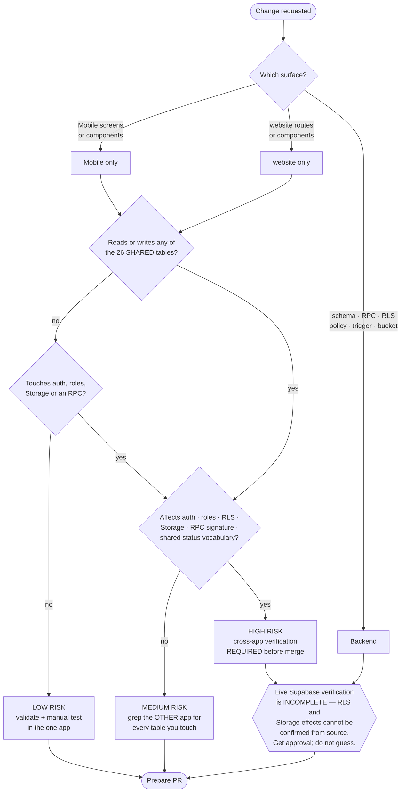

# Your first change

This page assumes you can already run both applications
([website](./website-setup), [Mobile](./mobile-setup)) and that you know how to use
git. It exists to answer the question git cannot: **what does this change actually
touch, and what breaks if I get it wrong?**

<Status
  type="verified"
  date="2026-08-19"
  sources={[
    'website:package.json',
    'website:.github/workflows/',
    'website:src/lib/access.ts',
    'Mobile:package.json',
    'Mobile:components/',
    'website:AGENTS.md',
  ]}>
  Every command, path and risk level below was read from the repositories. The
  database-impact guidance is bounded by a real limitation, stated in
  [step 5](#step-5): **live Supabase verification has not been done**, so RLS and
  storage effects cannot be confirmed from source.
</Status>

## The one thing to internalise first

**Both applications share one Supabase project.** 26 tables are read or written by
both, and there is exactly **one** shared RPC — so the applications coordinate
through database *state*, not through a versioned interface. Nothing fails loudly
when one application changes an assumption the other depends on.

That single fact determines the risk of everything you do. See
[Cross-application architecture](/docs/guides/architecture/cross-app).

## Decide the shape of your change



## Step 1–2 — Which application, and is it shared? {#step-1}

Answer these two before writing code.

| Where you are editing | Surface |
| --- | --- |
| `Mobile/app/`, `Mobile/components/`, `Mobile/utils/` | Mobile |
| `website/src/routes/`, `website/src/components/`, `website/src/features/` | website |
| `website/server/api/` | website server |
| Anything in Supabase — schema, function, policy, trigger, bucket | **Backend** |

Then check whether the data is shared. The 26 shared tables are listed in
[Cross-application architecture](/docs/guides/architecture/cross-app#the-26-shared-tables).
The ones you are most likely to meet: `orders`, `order_packages`, `profiles`,
`roles`, `order_team_members`, `attendance_logs`, `task_logs`, `materials`.

## Step 3 — Find the relevant code {#step-3}

Both applications use file-based routing, so the screen name maps to a file.

**website** follows a container–presenter split: the route container owns every
`useQuery`/`useMutation`; components below it are pure presenters receiving data and
callbacks as props.

```text
src/routes/orders/$orderId.tsx              ← container: all data hooks live here
src/components/orders/orderId/tabs/         ← presenters
src/components/orders/orderId/sections/     ← presenters
src/lib/supabase.ts                         ← all Supabase access
```

**Mobile** concentrates data access in three files, not per-feature:

```text
app/(admin)/ · app/(packer)/ · app/auth/    ← screens, by route group
components/{admin,packer,packing,inventory,ui}/
utils/api/supabase.ts                       ← 2,139 lines: most queries
utils/api/inventory.ts · utils/api/teamLead.ts
utils/AuthContext.tsx · utils/PackerSessionContext.tsx
```

:::tip Mobile has platform-split components

Several UI primitives exist as `.native.tsx` **and** `.web.tsx` pairs —
<SourceRef repo="Mobile" path="components/ui/Card.native.tsx" />,
`Card.web.tsx`, `Avatar.*`, `Badge.*`. Changing one and not the other produces a
bug that only appears on the platform you did not test.

:::

## Step 4 — Check database impact {#step-4}

Name every table, view, function and bucket your change reads or writes. If you
cannot list them, you do not yet know what your change does.

Then, for each one:

```bash
# is the other application using it too?
grep -rn "your_table_name" /path/to/Mobile/{app,components,utils}
grep -rn "your_table_name" /path/to/website/{src,server}
```

:::danger Do not casually change any of these

Because the backend is shared, each of the following breaks the *other*
application with no compile-time error and no test failure:

| Never change casually | Why |
| --- | --- |
| **Table structure** | 188 foreign keys; `profiles` alone has 28 inbound |
| **RPC signatures** | The calling application fails at runtime only |
| **RLS policies** | The real authorization boundary — and it is barely documented |
| **Role names** | **Four** independent hardcoded checks depend on the strings |
| **Storage bucket behaviour** | The two apps already use *different* buckets |
| **Shared status values** | `production_status`/`commercial_status` are unconstrained strings; an unrecognised value passes silently |

There is a further, structural reason for caution: **the database is not
reproducible from the repositories.** One migration file covers 67 live tables, and
`website` has no migrations directory at all. There is no reviewable history and no
reliable revert path. Read
[Schema provenance](/docs/backend/schema-provenance) before proposing any schema
change.

:::

Reference material: [Database model](/docs/backend/database-model) ·
[Schema provenance](/docs/backend/schema-provenance) ·
[Cross-application architecture](/docs/guides/architecture/cross-app)

`website/AGENTS.md` carries the repository's own rule, and it applies to people as
much as to tools: **Supabase access is read-only by default.** Inspecting schema and
querying data is fine. Mutating data, DDL, policies, grants, auth users, storage
objects or Edge Functions requires **explicit approval** — and it has a documented
six-step change process.

## Step 5 — Check authorization and RLS impact {#step-5}

:::warning This is where source-based reasoning needs live data

RLS policies exist in the repositories for **two** of 67 live tables. Everything
else lives only in the live database. This documentation now includes a
read-only live matrix, but that matrix is not a substitute for reviewing the
specific policy bodies before changing authorization.

So you can establish what the *clients* allow from source, and you must establish
what the *database* allows from Supabase. Start with
[Live backend verification](/docs/backend/live-verification), then query the
specific objects touched by the change.

:::

What you *can* check from source: four independent authorization points, which
already disagree with each other.

| Layer | File |
| --- | --- |
| website page access | <SourceRef repo="website" path="src/lib/access.ts" /> |
| Mobile route guards | <SourceRef repo="Mobile" path="app/index.tsx" /> plus the two group layouts |
| Privileged writes | <SourceRef repo="Mobile" path="supabase/functions/create-user/index.ts" /> |
| Database capability | <SourceRef repo="Mobile" path="supabase/migrations/20250121_add_team_lead_support.sql" /> |

**Do not "fix" a role in one layer only.** Read
[Roles and permissions](/docs/website/roles-and-permissions) first — an `executive`
already has full website access and is locked out of Mobile entirely, and that is
current behaviour, not a bug you just found.

Client-side route guards are `useEffect` redirects: the page renders, *then*
redirects. They hide pages; they do not protect data.

## Step 6 — Implement the smallest safe change {#step-6}

Make the smallest change that solves the problem. Specifically:

- **Do not reimplement a rule the database already enforces.** You will create two
  sources of truth that disagree under concurrency, and the database wins.
- **Do not compute a value the database recalculates** — packed quantities are one
  documented case.
- **website: obey the layering.** Data hooks in the container, presenters pure,
  services free of UI imports, Zod at the form level.
- **website: colours come from the semantic scale only.** Raw Tailwind palette
  classes are disabled in the theme and emit **no CSS** — a plausible class name will
  look right in the diff and do nothing at runtime.
- **Respect the file-size limits** in `website/CLAUDE.md` (300 soft / 400 hard).
  Several files already exceed them badly; do not make that worse.

## Step 7 — Validate locally {#step-7}

These are the **actual** scripts. Nothing here is invented.

### website

```bash
npm run typecheck    # tsc --noEmit
npm run lint         # biome check --write ./src   ← MODIFIES YOUR FILES
npm run test         # vitest run
npm run build        # vite build
npm run validate     # typecheck + build  (NOTE: does NOT include lint)
```

`npm run dev` serves on port 3000 and **does not typecheck** — which is why type
errors surface only at build time.

### Mobile

:::warning Mobile has no automated quality gates at all

`package.json` defines exactly four scripts: `start`, `android`, `ios`, `web`.

There is **no `lint` script, no `typecheck` script, no `test` script, no tests, and
no CI workflow.** Nothing automated would catch a regression in this application.

:::

```bash
npm start                # Expo dev server (Metro)
npm run android          # expo run:android — native dev build
npm run ios
npm run web              # quick inspection only, not a substitute for a device

# TypeScript IS installed and there is a tsconfig.json, so you can invoke the
# compiler directly even though no script wraps it:
npx tsc --noEmit
```

For Mobile, **manual verification on a device is the quality gate.** Test both
interfaces if you touched anything shared — the admin and packer surfaces target
different form factors.

### ipac-documentation

```bash
npm run validate     # typecheck + build
npm run build
```

Broken internal links and broken anchors **fail** the documentation build. That is
deliberate.

## Step 8 — Test cross-application impact {#step-8}

Skip this only if your change touches no shared table, no RPC, no auth, and no
storage.

| Your change | Verify in the other application |
| --- | --- |
| Wrote to `attendance_logs` | website order detail attendance section still reads it |
| Changed `order_team_members` or team-lead logic | website team-lead controls; and the database capability function that grants attendance rights |
| Changed `orders` / `order_packages` | Mobile admin and packer order screens |
| Changed `materials` / `material_variants` / `supplier_pricing` | Mobile inventory screens |
| Changed anything on `profiles` or `roles` | **sign-in in both applications** — this is the highest-risk table in the system |

Work through the full
[cross-application impact checklist](/docs/guides/architecture/cross-app-impact-checklist)
before merging a shared change.

## Step 9 — Repository quality gates and CI reality {#step-9}

:::danger A green pull request does not mean a deployable change

`website`'s two workflows differ, and both differences can let a failure through to
production:

| | PR validation | Production |
| --- | --- | --- |
| Node | **22.x** | **24.x** |
| Lint | **not run** | **run** |
| Typecheck | run | run |
| Tests | run | run with `continue-on-error: true` |

So a lint violation is invisible until the production deploy, and production builds
on a different Node major from the one that validated your change.

**Run `npm run lint` yourself before merging.** See
[website W4](/docs/troubleshooting/website#w4) and
[OQ-006](/docs/reference/open-questions#oq-006).

:::

`Mobile` has no CI at all. Releases are built manually with EAS —
[Build and release](/docs/mobile/build-and-release).

## Step 10 — Prepare the pull request {#step-10}

Use **Conventional Commits** — `type(scope): summary`, imperative, about 72
characters. This is not cosmetic in `website`: its deployment workflow derives the
release type from the commit message (`feat` → minor, `fix` → patch,
`BREAKING CHANGE` or `!:` → major).

State in the description: what changed, why, which screens and workflows are
affected, database impact, cross-application impact, and how you validated it. If
the answer to cross-application impact is "none", say why you are confident.

## Step 11 — Does documentation need to change? {#step-11}

### The documentation rule

**If your PR changes architecture, setup, a workflow, a database contract,
authorization, deployment, or troubleshooting knowledge — the documentation is
reviewed as part of the same change.**

Trivial implementation details need no documentation change. Renaming a local
variable, adjusting spacing, refactoring inside a component: no.

| Your change | Update |
| --- | --- |
| New or changed table, column, RPC | [Database model](/docs/backend/database-model) |
| Role, permission or guard behaviour | [Roles and permissions](/docs/website/roles-and-permissions) |
| A step in a business process | the relevant [workflow](/docs/workflows/overview) page |
| Setup, env vars, or scripts | [Getting started](./overview) |
| Build, release or CI | [Build and release](/docs/mobile/build-and-release) or the deployment notes |
| A bug that was hard to diagnose | a `Trail/` entry, then [Troubleshooting](/docs/troubleshooting/overview) |
| Something you could not verify | an entry in [Open questions](/docs/reference/open-questions) |
| Architecture, a shared contract, the auth model, RLS strategy, deployment, or a migration strategy | a new [ADR](/docs/adr/overview) |

**Never resolve a contradiction by guessing.** If two sources disagree, record it as
an open question. That rule is why this documentation is usable — see
[Documentation status](/docs/reference/documentation-status).

## Worked examples, by risk level

Real files from the repositories, ordered by how much can go wrong.

### LOW — Mobile UI-only change

*Example: adjust layout or wording in `components/packer/EndWork.tsx`, or a text-size
behaviour consumed by `app/(packer)/settings.tsx`.*

No shared data, no auth. **But:** no typecheck or test will catch a mistake, and
platform-split components (`.native.tsx` / `.web.tsx`) can leave one platform
broken. Verify on a device.

### LOW–MEDIUM — website presenter change

*Example: a component under `src/components/orders/orderId/sections/`.*

Presenters take data as props, so a change is contained. Lint, typecheck and build
gate it. Risk rises the moment you move a data hook out of the route container.

### MEDIUM — surfacing an existing database-backed field

*Example: displaying `order_pkg_instance.ipac_reference` or `destination` in a
website view.*

Reading an existing column is safe. **Adding** a column is not — that is a schema
change on a shared backend with no migration history. And if the field feeds
reporting, check the packed-date rule first: live report semantics use
`order_pkg_instance.packed_at` for completion modes when present
([W6](/docs/workflows/w6-packing-evidence#the-report-date-rule)).

### HIGH — role or permission change

*Example: granting a role access to a website page in
<SourceRef repo="website" path="src/lib/access.ts" />.*

**Four** places enforce authorization and they already disagree. Editing one
creates a fifth divergence. The live role set is known, and it confirms the
source mismatch: `director` is checked in code but is not a live role row. RLS is
the layer that actually protects data, so role changes require policy review, not
just validation.

### HIGH — shared workflow change

*Example: anything touching attendance or team-lead assignment.*

`Mobile` writes `attendance_logs`; `website` reads and remediates it. A
`SECURITY DEFINER` database function grants attendance rights based on per-order
team-lead status. The source `packer_sessions` policy is stale and differs from
production. Read
[W2](/docs/workflows/w2-packer-team-assignment) and
[W3](/docs/workflows/w3-attendance) before touching this.

## When something breaks

Do not debug from first principles — several of these are already diagnosed:

| Symptom | Entry |
| --- | --- |
| Cannot sign in; session or profile problems | [Authentication](/docs/troubleshooting/authentication) |
| Android build fails on Reanimated/Worklets | [Mobile M1](/docs/troubleshooting/mobile#m1) |
| NativeWind styles not applying | [Mobile M3](/docs/troubleshooting/mobile#m3) |
| Editing `.env` has no effect on Mobile | [Configuration C1](/docs/troubleshooting/configuration#c1) |
| Node version behaving differently than CI | [Configuration C5](/docs/troubleshooting/configuration#c5) |
| website build fails on lint or TypeScript | [website W1](/docs/troubleshooting/website#w1) |
| Green PR, failed production deploy | [website W4](/docs/troubleshooting/website#w4) |

Everything else: [Troubleshooting](/docs/troubleshooting/overview).

## PR checklist

Copy this into your pull request and answer every line.

```text
[ ] Which application(s) does this affect?
[ ] Does this touch shared Supabase data?
[ ] Could this break the other application?
[ ] Does this affect auth / roles / RLS?
[ ] Does this affect Storage?
[ ] Does this change an RPC or database function?
[ ] Were the available validation commands run?
    website: typecheck, lint, test, build
    Mobile:  npx tsc --noEmit + manual device test (no scripts exist)
[ ] Was the relevant workflow manually tested?
[ ] Does documentation need updating?
[ ] Are any assumptions still unverified?
```

The last line is the one people skip. If your change rests on an assumption about
RLS, storage, a role name, or a status value that source cannot confirm — say so in
the PR and open an
[open question](/docs/reference/open-questions). An unverified assumption stated
out loud is a normal engineering trade-off. An unverified assumption presented as
fact is how this system became hard to hand over.
