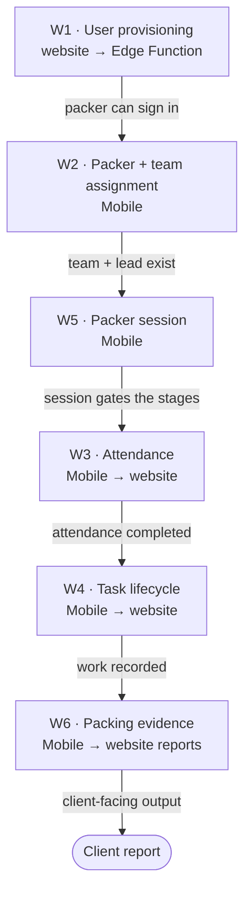

# Workflows

Six workflows are documented here. Each one **crosses both applications** —
either an actor in one produces state the other consumes, or the same table is
written by one and remediated by the other. These are the processes nobody can
reconstruct from a single repository.

<Status
  type="partial"
  date="2026-08-19"
  sources={[
    'Mobile:utils/api/supabase.ts',
    'Mobile:utils/PackerSessionContext.tsx',
    'Mobile:supabase/functions/create-user/index.ts',
    'website:src/features/orders/',
    'website:src/features/reports/',
    'website:Trail/packed-date-report-conflict-log.md',
  ]}>
  Each workflow is reconstructed from the database calls both applications
  actually make. **Actors are inferred from route guards**, which is source
  evidence, not a statement of company process. Where a business rule is asserted,
  it is cited. Nothing here describes intent that source does not show.
</Status>

## How to read these pages

Every workflow page uses the same six-part structure:

```text
Actor      →  who initiates it, per the route guards that let them in
Application→  which app the action happens in
Action     →  what the user does
Database   →  tables and RPCs touched
Result     →  the business outcome
Cross-app  →  what the other application now sees, and what can break
```

## The chain



`W5` is the spine on the Mobile side: the packer session tracks which stage of the
day a packer is in, and the other Mobile workflows advance it.

## The six workflows

| | Workflow | Actor | Direction |
| --- | --- | --- | --- |
| [W1](./w1-user-provisioning) | User provisioning | admin / director | website → backend → Mobile |
| [W2](./w2-packer-team-assignment) | Packer and team assignment | admin / director / sales | Mobile ↔ website |
| [W3](./w3-attendance) | Attendance | packer, team lead | Mobile → website |
| [W4](./w4-task-lifecycle) | Task lifecycle | packer | Mobile → website |
| [W5](./w5-packer-session) | Packer session | packer | Mobile (website can force-release) |
| [W6](./w6-packing-evidence) | Packing evidence and report dates | packer, then reporting user | Mobile → website |

## Workflows deliberately not documented yet

These exist in source but are **website-only** and were not part of this pass:
item allocation, package instances and packed items, the client portal and QR
scanning, material/pricing request approvals, and supplier email ingestion.

Also absent, and **not to be written without live verification or product input**:
the maintenance subsystem (its tables and enums exist but neither application
calls them), cost calculation, and the `transportation`, `services` and
`report_batch` tables.
