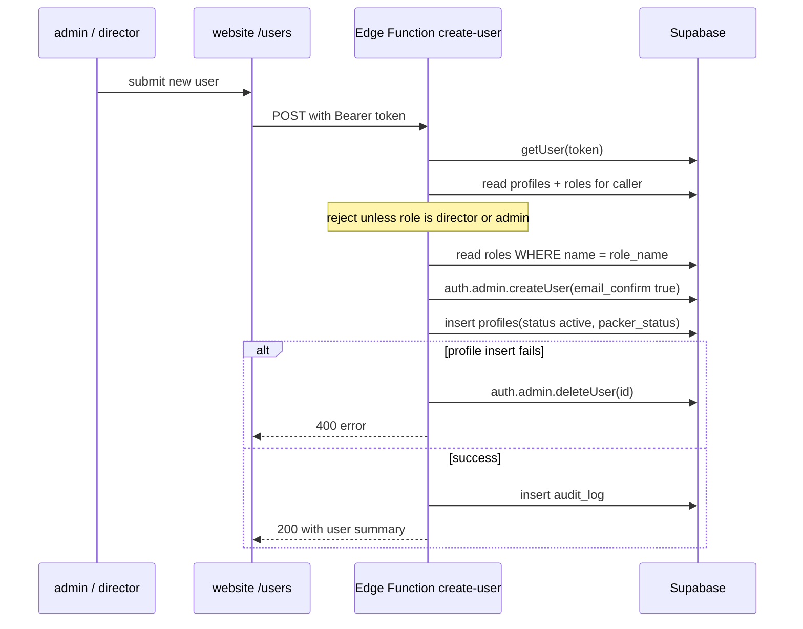

# W1 — User provisioning

The only workflow that creates the identity both applications depend on.

<Status
  type="verified"
  date="2026-08-19"
  sources={[
    'Mobile:supabase/functions/create-user/index.ts',
    'website:src/routes/users.tsx',
    'Mobile:Trail/login-hashir-1.md',
  ]}>
  The Edge Function was read line by line. The failure mode documented at the
  bottom is reproduced from an incident log written by the developer who
  diagnosed it.
</Status>

## The flow

| Step | Detail |
| --- | --- |
| **Actor** | `admin` or `director` — enforced by the Edge Function, not just the UI |
| **Application** | `website`, `/users` |
| **Action** | Submit a new user: email, password, full name, username, phone number, role name |
| **Database** | Edge Function `create-user` using a **service-role key**: `auth.admin.createUser` → `profiles` insert → `audit_log` insert. Reads `roles` to resolve the role name to an id |
| **Result** | An account that can sign in to either application, with a role that determines where it lands |
| **Cross-app** | The new `profiles` row is immediately authoritative for **both** applications. A packer created here can sign in to Mobile with no further step |

## What the function sets

- `email_confirm: true` — no verification email; the account is usable immediately.
- `profiles.status = 'active'`.
- `profiles.packer_status = 'available'` when the role is `packer`, otherwise null.
- An `audit_log` row with `entity_type: 'profile'`, `action_type: 'INSERT'`,
  `changed_by` = the caller, and a note naming the creating user.

## Authorization

The function permits **`director` or `admin` only**. Notably it also selects
`roles.can_manage_roles` and then **never uses it** — the decision is a hardcoded
role-name comparison. See
[Roles and permissions](/docs/website/roles-and-permissions#permission-flags-are-database-side-only).

Any role name present in the `roles` table can be **assigned**, because the
function looks the name up rather than validating against a list. Live assignable
roles are `admin`, `client`, `executive`, `packer`, and `sales`; `director` is
checked as a creator role in source but does not exist as a live role row.

## Direct SQL provisioning breaks sign-in {#direct-sql-provisioning-breaks-sign-in}

:::danger Do not create users with raw SQL

An account created by inserting directly into `auth.users` **will fail to sign
in**, with the misleading error `Database error querying schema` — and only when
the *correct* username is used. A wrong username still returns "invalid
credentials", which makes it look like a password problem rather than a malformed
account.

:::

The root cause is a missing `auth.identities` row plus two columns left `NULL`
where GoTrue requires empty strings. The full diagnosis, the fix that worked, and
the fixes to avoid are documented as a troubleshooting entry:

**→ [Troubleshooting A1 — Login fails with "Database error querying schema"](/docs/troubleshooting/authentication#a1)**

The point for this workflow is narrower: **use the Edge Function.** It is the only
path that applies the role check and writes `audit_log`.

## Why this matters beyond one incident

Provisioning outside the Edge Function skips its role check **and** its
`audit_log` write. `audit_log` therefore cannot be trusted as a complete record
of user creation — at least one account is known to have bypassed it. Recorded as
[H5](/docs/security/findings#h5)
and [OQ-019](/docs/reference/open-questions#oq-019).

## Next action

A newly created packer cannot do anything until assigned to an order —
[W2](./w2-packer-team-assignment).
