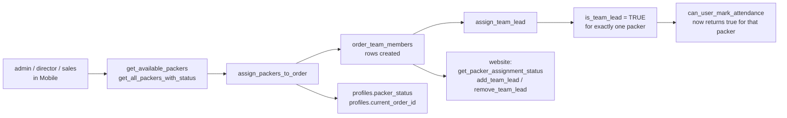

# W2 — Packer and team assignment

<Status
  type="verified"
  date="2026-08-19"
  sources={[
    'Mobile:utils/api/supabase.ts',
    'Mobile:utils/api/teamLead.ts',
    'Mobile:supabase/migrations/20250121_add_team_lead_support.sql',
    'website:src/features/orders/',
  ]}>
  RPC names and the team-lead mechanism were read from both applications and from
  the migration, which contains the full function bodies.
</Status>

## The flow

| Step | Detail |
| --- | --- |
| **Actor** | `admin`, `director` or `sales` — the roles Mobile's admin group admits |
| **Application** | `Mobile`, admin group |
| **Action** | Select available packers for an order; designate one as team lead |
| **Database** | RPCs `get_available_packers`, `get_all_packers_with_status`, `get_order_packers`, `assign_packers_to_order`, `assign_team_lead`, `update_project_lead_with_status`. Writes `order_team_members`; affects `profiles.packer_status` and `profiles.current_order_id` |
| **Result** | The order has a team, and exactly one team lead |
| **Cross-app** | `website` reads assignment via `get_packer_assignment_status` and can change the lead with `add_team_lead` / `remove_team_lead`. Team-lead status **grants attendance rights** in the database |



## Team lead is per order, not a role

This is the most misunderstood concept in the system, and the migration is
explicit about it. The column comment reads:

```text
Temporary team lead status for this packer on this specific order
```

`assign_team_lead(order_uuid, packer_uuid)` is `SECURITY DEFINER` and does three
things in one transaction:

1. Clears `is_team_lead` for every member of that order.
2. Sets `is_team_lead = TRUE` for the named packer.
3. If that packer is not yet a member, inserts them —
   `ON CONFLICT (order_id, packer_id) DO UPDATE SET is_team_lead = TRUE`.

So **one lead per order is enforced by the function**, not by a constraint. The
`ON CONFLICT` clause also tells us `(order_id, packer_id)` is unique.

A packer can be team lead on one order and an ordinary member on another.
`team_lead` is **not** a value in `roles` — see
[Roles and permissions](/docs/website/).

## What team-lead status unlocks

`can_user_mark_attendance(order_uuid)` returns true for `admin`/`director` with an
active profile, **or** for the order's team lead. That is a real, database-enforced
capability grant — the only place in IPAC where per-order state confers a
privilege. See [W3](./w3-attendance).

## Single active order

`profiles.current_order_id` exists, and `update_project_lead_with_status` combines
a lead change with a status change, implying the two are coupled. `website` has an
`admin_force_release_packer` RPC, which only makes sense if a packer can become
stuck attached to an order.

Live verification shows single-active-order enforcement is handled by an enabled
`order_team_members` trigger, `trigger_enforce_single_active_order_for_packer`,
backed by function `enforce_single_active_order_for_packer`. Related triggers
sync `profiles.current_order_id` and packer status.

## Breaking-change note

`order_team_members` is written by `Mobile`, managed by `website`, and read by a
`SECURITY DEFINER` function that grants a privilege. A change to this table
touches all three. Its unique constraint is load-bearing for `assign_team_lead`.

## Next action

With a team and a lead in place, the packer opens a session — [W5](./w5-packer-session) —
and attendance can be recorded — [W3](./w3-attendance).
