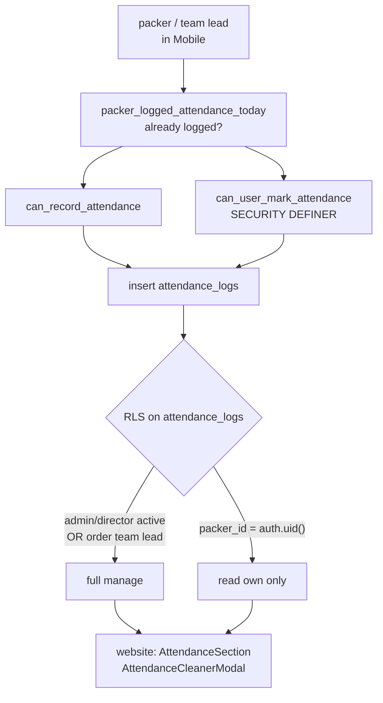

# W3 — Attendance

The clearest Mobile-produces / website-consumes workflow, and the only one whose
RLS policy is written down anywhere.

<Status
  type="partial"
  date="2026-08-19"
  sources={[
    'Mobile:utils/api/supabase.ts',
    'Mobile:app/(packer)/attendance.tsx',
    'Mobile:supabase/migrations/20250121_add_team_lead_support.sql',
    'website:src/components/orders/orderId/sections/AttendanceSection.tsx',
    'website:src/components/orders/orderId/modals/AttendanceCleanerModal.tsx',
  ]}>
  RPCs, table columns and the RLS policy are verified from source. **Whether the
  policy in the migration is the policy that is live is unverified** — see
  [H3](/docs/security/findings#h3).
</Status>

## The flow

| Step | Detail |
| --- | --- |
| **Actor** | `packer` for their own attendance; team lead or `admin`/`director` to manage the order's |
| **Application** | `Mobile`, `(packer)/attendance` |
| **Action** | Record attendance for the day/shift, including toolbox briefing |
| **Database** | Capability checks via `can_record_attendance`, `can_user_mark_attendance`, `packer_logged_attendance_today`; writes `attendance_logs` |
| **Result** | A dated attendance record per packer per shift, feeding productivity reporting |
| **Cross-app** | `website` reads `attendance_logs` in the order detail attendance section, and has an **attendance cleaner** modal to remediate bad data |

`attendance_logs` columns (verified): `order_id`, `packer_id`, `log_date`,
`shift_period`, `start_time`, `end_time`, `status`, `is_project_start`,
`toolbox_briefing_completed`.

`status` is used with the value `present` in Mobile.

## Two overlapping capability functions

Mobile calls **both** `can_record_attendance` and `can_user_mark_attendance`.

Only the second has a body in any repository. The first is declared in the
generated types and its logic is unknown. Which is authoritative, whether they can
disagree, and why both are called, is **not established** —
[OQ-021](/docs/reference/open-questions#oq-021).

Do not remove either call before that question is answered.

## The verified RLS policy

From the migration, for `attendance_logs`:

- **Manage (`FOR ALL`)** — role `admin` or `director` **and**
  `profiles.status = 'active'`, **or** `is_team_lead_for_order(auth.uid(), order_id)`.
- **Read own (`FOR SELECT`)** — `packer_id = auth.uid()`.

Note the `profiles.status = 'active'` condition: a suspended admin loses
attendance management at the database level, not just in the UI. That is a real
business rule, enforced where it counts.

## The attendance cleaner is a signal

`website` ships an `AttendanceCleanerModal`. A remediation tool existing in
production is evidence that attendance data goes wrong in practice — most likely
duplicate or orphaned rows. **What it corrects, and why the bad data occurs, is
not documented in source.** Worth a conversation with operations before writing
more here.

## Next action

Attendance completion advances the packer session — [W5](./w5-packer-session) —
after which packing tasks can begin — [W4](./w4-task-lifecycle).
