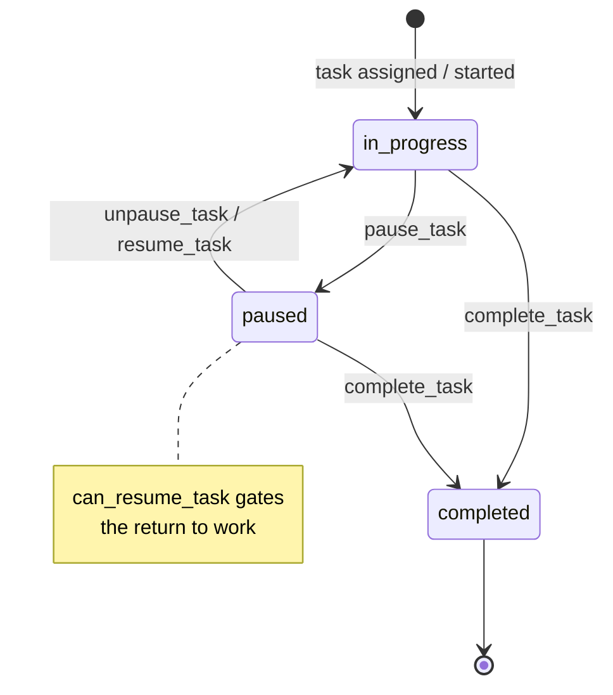

# W4 — Task lifecycle

<Status
  type="partial"
  date="2026-08-19"
  sources={[
    'Mobile:utils/api/supabase.ts',
    'website:src/types/supabase.ts',
    'website:src/features/orders/',
  ]}>
  The RPC set and the `task_status` enum are verified from source. **The state
  machine below is reconstructed from RPC names and the enum**, not from a
  function body — no task function has its definition in any repository.
</Status>

## The flow

| Step | Detail |
| --- | --- |
| **Actor** | `packer` |
| **Application** | `Mobile`, packer group |
| **Action** | Start work on a task, pause it, resume it, complete it |
| **Database** | RPCs `pause_task`, `unpause_task`, `resume_task`, `complete_task`, guarded by `can_resume_task`. Touches `tasks`, `task_logs`, `task_assignments`, `task_packages`, and the `task_status_view` |
| **Result** | A time-stamped record of who worked on what and for how long |
| **Cross-app** | `website` reads `task_logs` in order detail and end-task flows. Task time does **not** drive the report packed date — see [W6](./w6-packing-evidence) |

## The state machine

`task_status` is a real database enum with exactly three values:

```text
in_progress · paused · completed
```



:::warning Three RPCs for two transitions

`pause_task`, `unpause_task` **and** `resume_task` all exist and are all called
from Mobile. Two names for leaving the paused state suggests either a distinction
this documentation cannot see, or historical duplication.

Because no function body exists in source, **the difference between `unpause_task`
and `resume_task` is unknown**. Do not assume they are interchangeable —
[OQ-022](/docs/reference/open-questions#oq-022).

:::

## Related functions nothing calls

`get_active_tasks_for_packers`, `complete_assignments_for_packers` and
`delete_tasks_for_order_packages` are declared in the schema but called by
**neither** application. They may be internal helpers, trigger bodies, or dead
code — [OQ-013](/docs/reference/open-questions#oq-013).

`website` has an end-task modal, so task completion is reachable from both
applications. Whether both paths use the same RPC is **unverified**.

## Deliberate design decision worth knowing

The reporting layer **does not** use `task_logs.end_time` as the packed date. That
choice is explicit and documented, with the reason: reopening or reworking a box
must not move its original packed date. See
[W6](./w6-packing-evidence#the-report-date-rule).

This is the one place in IPAC where a business rule is recorded together with its
rationale. Preserve it.

## Next action

Completed task work is evidenced by packed items and photographs —
[W6](./w6-packing-evidence).
