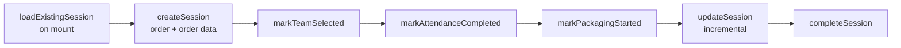

# W5 — Packer session

The spine of the Mobile packer experience: a session record that advances through
stages as the day progresses.

<Status
  type="verified"
  date="2026-08-19"
  sources={[
    'Mobile:utils/PackerSessionContext.tsx',
    'website:src/types/supabase.ts',
  ]}>
  The stage functions were read directly from the context provider, and the table
  columns from the schema snapshot. The two correspond exactly.
</Status>

## The flow

| Step | Detail |
| --- | --- |
| **Actor** | `packer` |
| **Application** | `Mobile`, packer group |
| **Action** | Open a session against the assigned order, then advance it stage by stage |
| **Database** | `packer_sessions` — `session_active`, `team_selected`, `attendance_completed`, `packaging_started`, plus denormalised `order_name`, `client_name`, `project_lead_name` |
| **Result** | The application knows which stage of the day the packer is in, and can resume correctly after a restart |
| **Cross-app** | `website` can call `admin_force_release_packer` to break a stuck session |

## The six stages

From <SourceRef repo="Mobile" path="utils/PackerSessionContext.tsx" />:

Each `mark*` function sets one boolean, so the session doubles as a checklist: a
packer who restarts the app resumes at the stage they reached rather than starting
over.

## Denormalised fields drift

`packer_sessions` stores copies of `order_name`, `client_name` and
`project_lead_name` alongside `order_id`. These are snapshots taken at session
creation.

**Nothing in source shows what keeps them in step with their sources.** If an
order is renamed or a project lead changes mid-session, the session's copy is
presumably stale. Whether a trigger refreshes them is
[OQ-023](/docs/reference/open-questions#oq-023). Prefer joining through `order_id`
over trusting the copies.

## Sessions get stuck

`website` provides `admin_force_release_packer`. A force-release tool existing in
production is evidence that packers do become stuck attached to an order — most
plausibly when a session is left `session_active` while `profiles.current_order_id`
still points at the order.

**The stuck-session failure mode and its correct remedy are not documented in
source.** This is high-value operational knowledge and a strong candidate for the
first Troubleshooting page once someone who has fixed it can describe it.

## RLS caveat

`packer_sessions` is one of only two tables whose RLS policy appears in any
repository — and its manage policy is predicated on `orders.status`, a column that
does not exist. Until that is verified live, **do not assume you know who can
write to this table**. See
[H3](/docs/security/findings#h3).

## Next action

`markPackagingStarted` opens the packing work itself — [W4](./w4-task-lifecycle)
and [W6](./w6-packing-evidence).
