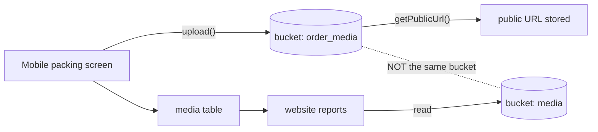

# W6 — Packing evidence and report dates

The workflow with the most business consequence, the only documented business
rule with a stated rationale, and one verified defect.

<Status
  type="partial"
  date="2026-08-19"
  sources={[
    'Mobile:utils/api/supabase.ts',
    'website:Trail/packed-date-report-conflict-log.md',
    'website:inspect_rpc.js',
    'website:inspect_instances.js',
    'website:src/features/reports/',
  ]}>
  The bucket mismatch, the RPC signature and the instance columns are **verified**.
  The report-date rule is verified **as authored intent** from an incident log —
  but that log records the change being **reverted**, so **which logic is live
  today requires live verification**.
</Status>

## The flow

| Step | Detail |
| --- | --- |
| **Actor** | `packer` produces evidence; a reporting user generates output |
| **Application** | `Mobile` for evidence, `website` for the report |
| **Action** | Add packed items and photograph the package; later, generate a packing list for a client, order, destination and date range |
| **Database** | Mobile writes `package_items` and uploads to bucket `order_media`. website reads `order_pkg_instance`, `pkd_item`, `media`, `qr_codes` via `fetch_report_instances` and `fetch_instance_items` |
| **Result** | A client-facing packing list |
| **Cross-app** | This is where Mobile's field work becomes the client deliverable — and where the bucket mismatch bites |

## The four package layers

Conflating these is the most common source of reporting bugs:

```text
order_packages      definition / template
order_pkg_overview  grouped quantity and progress
order_pkg_instance  ONE physical box
pkd_item            an item actually packed into that box
```

`order_pkg_instance` carries `ipac_reference`, `instance_number`, `destination`,
`tag`, `packed_at` and `packed_by`.

## The report date rule {#the-report-date-rule}

This is the single most valuable business rule recovered in the audit, because it
comes with its reason.

**Report packed date, as authored:**

```sql
COALESCE(order_pkg_instance.packed_at, MAX(pkd_item.created_at))
```

**Previously, and after the revert:**

```sql
MAX(pkd_item.created_at)
```

:::info Why `task_logs.end_time` is deliberately not used

Quoting the incident log directly:

> The migration intentionally does not use `task_logs.end_time`, because
> reopening/reworking a box should not move the original packed date.

A box that is reopened and repacked must keep the date it was **first** packed.
Task time would move it. This is a real business rule with a stated rationale —
preserve it.

:::

**The matching UI rule**, in the packing list page:

```text
If status becomes packed AND packed_at is empty  → set packed_at = now
If packed_at already exists                      → keep it
If status changes away from packed               → do NOT clear packed_at
```

The behaviour it replaced was
`packed_at: status === "packed" ? new Date().toISOString() : null`, which **cleared
the original packed date** whenever a box moved out of `packed`. That is the bug the
rule exists to prevent.

### The measured impact

For one client order filtered to one destination and a two-week window:

| Report date logic | Boxes shown |
| --- | --- |
| `MAX(pkd_item.created_at)` | **11** |
| `COALESCE(instance.packed_at, MAX(pkd_item.created_at))` | **22** |

A date-logic change doubled a client-facing report. This is why the rule matters
and why the reasoning must stay written down.

:::warning Which logic is live is unverified

The log states that both the data backfill and the RPC change were **reverted on
2026-08-08**, restoring `MAX(pkd_item.created_at)`. A further migration named
`add_packing_start_completion_date_modes` exists as an **uncommitted** file in an
older checkout, suggesting additional date modes were explored after that.

**Do not rely on either formula being current.** Verify against the live function
before changing report behaviour. The full history, including client code committed
*after* the revert, is recorded in
[ADR-0003](/docs/adr/adr-0003-report-packed-date) —
[OQ-024](/docs/reference/open-questions#oq-024).

:::

## Verified RPC signature

From <SourceRef repo="website" path="inspect_rpc.js" />:

```text
fetch_report_instances(p_client_id, p_order_ids, p_date_from, p_date_to,
                       p_date_mode, p_destinations, p_has_items_only, p_tag_ids)
```

`p_date_mode` accepts at least `item_packed_at`. The full set of modes is
unverified.

## The storage bucket mismatch



:::danger Two buckets, one workflow

`Mobile` uploads package photographs to **`order_media`**, then derives a public
URL. `website` reads and writes **`media`** in six places. Only `media` appears in
the schema snapshot.

Consequences, if `order_media` is genuinely separate:

- photographs taken in the field may not appear in client reports
- `getPublicUrl` on a public bucket makes client cargo imagery readable by anyone
  holding the URL

**Verify both buckets before documenting this workflow as working** —
[OQ-015](/docs/reference/open-questions#oq-015) and
[H2](/docs/security/findings#h2).

:::

Note that Mobile also writes an `order_media` **table**, distinct from `website`'s
`media` table. Neither appears in the other application's code.

## Manual remediation happens

`website/Trail/` contains a JSON snapshot taken *"before redo"* of a production
order, recording box counts per filter — 488 boxes under one status filter for a
single order. Together with the packed-date backfill of 19 rows, this shows report
discrepancies are sometimes resolved by **editing production data directly**, with
hand-rolled backups.

That practice is real, is not covered by any runbook, and is the strongest argument
for the versioning work in
[Schema provenance](/docs/backend/schema-provenance#restoring-reproducibility).
