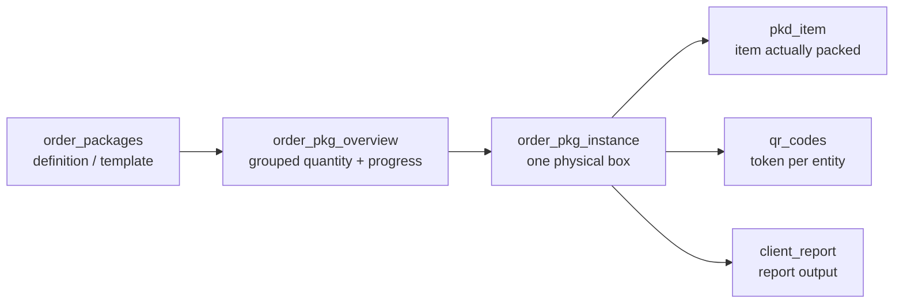

# قاعدة البيانات model {#database-model}

Both التطبيقات share one Supabase project. This page describes that schema as
far as ال المستودعات يمكن establish it.

<Status
  type="verified"
  date="2026-08-20"
  sources={[
    'website:src/types/supabase.ts',
    'Mobile:supabase/migrations/20250121_add_team_lead_support.sql',
    'website:inspect_rpc.js',
    'website:inspect_instances.js',
    'Supabase project fqynbudvpvpiljdrrvem',
  ]}>
  المستودع schema artifacts تم تم التحقق against read-only live Supabase
  catalog queries. ال generated types snapshot هو confirmed stale; الحالي
  live counts, RLS, Storage و trigger summaries هي recorded في
  [Live backend verification](./live-verification).
</Status>

## Inventory {#inventory}

### Generated types snapshot {#generated-types-snapshot}

| Object kind | Count | المصدر |
| --- | --- | --- |
| Tables | **63** | generated types |
| Views | **3** | generated types |
| Functions | **49** | generated types |
| Enums | **8** | generated types |
| Foreign keys | **188** | generated types |

### Live project {#live-project}

| Object kind | Count | المصدر |
| --- | ---: | --- |
| Tables | **67** | live Supabase catalog |
| Views | **3** | live Supabase catalog |
| Functions | **83** | live Supabase catalog |
| Enums | **11** | live Supabase catalog |
| Non-internal triggers | **17** | live Supabase catalog |

مستخدم بواسطة التطبيق code but absent من ال generated types و confirmed live:
`order_item_allocation`, `destinations`, `allocation_increase_requests`,
`signatures`.

مستخدم بواسطة `Mobile` but **لا** found live as a Storage bucket أو table:
`order_media`.

## ال three views {#the-three-views}

`packer_availability_status`, `task_status_view`, `user_effective_permissions`.

`user_effective_permissions` هو notable: no التطبيق code يقرأ it directly,
but live RLS و helper functions do use ال permission-flag system.

## Enums {#enums}

ال only value sets ال قاعدة البيانات itself constrains:

| Enum | Values |
| --- | --- |
| `project_type` | standard, maintenance, survey |
| `task_status` | in_progress, paused, completed |
| `packer_status` | available, busy, break |
| `maintenance_task_category` | survey, unpack, repack |
| `maintenance_package_type` | defensor, standard_box |
| `request_type` | material, material_variant, supplier_pricing |
| `request_action` | approved, rejected |
| `securing_side` | big_sides, small_sides, lid, base |

Live has three additional enums لا present في ال generated types:
`MediaCategory`, `maintenance_task_status`, و `material_type`. Live
`request_type` also يتضمن `allocation_increase`.

There هو **no role enum**. Roles هي rows في a `roles` table — see
[Roles و permissions](/docs/website/roles-and-permissions).

## Order lifecycle: two الحالة columns, neither constrained {#order-lifecycle-two-status-columns-neither-constrained}

`orders` has **no `status` column**. It has two:

```text
orders.production_status   plain string, no enum, no check constraint
orders.commercial_status   plain string, no enum, no check constraint
```

لأن both هي unconstrained strings, **ال قاعدة البيانات does لا enforce ال
vocabulary**. Live values observed on 2026-08-20:

| Column | Live values |
| --- | --- |
| `production_status` | `completed`, `in_progress`, `on_hold`, `pending` |
| `commercial_status` | `approved`, `draft`, `invoiced` |

:::warning هذه المطابقة مستنتجة من الاستخدام وليست مصرحا بها في مكان واحد

ال live vocabulary هو now المعروف, but legal transitions هي still لا declared
anywhere. See [OQ-012](/docs/reference/open-questions#oq-012).

:::

## Key table shapes {#key-table-shapes}

قراءة من ال generated types snapshot.

```text
profiles(id, role_id NOT NULL, status NOT NULL, client_id, current_order_id,
         packer_status, username, full_name, phone_number, avatar_url,
         created_at, updated_at)

roles(id, name, can_manage_roles, can_ban_users, can_block_users,
      can_delete_profiles, can_reset_passwords, can_unblock_users,
      created_at, updated_at)

orders(id, client_id, order_name, reference, production_status,
       commercial_status, project_type, project_lead_id, description,
       start_date, completion_date, total_estimated_cost, total_actual_cost,
       total_transportation_cost, created_by, created_at, updated_at)

order_team_members(id, order_id, packer_id, is_team_lead, created_at)

packer_sessions(id, order_id, packer_id, session_active, team_selected,
                attendance_completed, packaging_started,
                order_name, client_name, project_lead_name,
                created_at, updated_at)

attendance_logs(id, order_id, packer_id, log_date, shift_period,
                start_time, end_time, status, is_project_start,
                toolbox_briefing_completed, created_at, updated_at)

temporary_privileges(id, user_id, granted_role_id, granted_by, granted_at,
                     expires_at, is_active, reason, created_at, updated_at)

qr_codes(id, token, entity_type, entity_id, is_active, created_at)

audit_log(id, entity_type, entity_id, action_type, column_name,
          old_value, new_value, changed_by, change_time,
          order_id, order_package_id, is_critical_alert, notes)

media(id, image_url, designation, notes, order_package_id,
      order_pkg_instance_id, package_item_id, pkd_item_id,
      task_log_id, maintenance_task_log_id, created_at)
```

Three things worth internalising:

- **`profiles.current_order_id`** exists, which هو how "one active order per
  packer" يمكن be enforced at ال row level. Whether a trigger enforces it هو
  **unverified**.
- **`media` has six nullable parent columns.** It attaches إلى whichever entity
  هو set — a loose polymorphic pattern مع no discriminator column.
- **`packer_sessions` denormalises** `order_name`, `client_name` و
  `project_lead_name`. Those copies يمكن drift من their المصادر; nothing في
  المصدر shows what keeps them fresh.

## ال package model — four distinct layers {#the-package-model-four-distinct-layers}

Conflating these هو ال most common المصدر من reporting bugs.



`order_pkg_instance` carries `ipac_reference`, `instance_number`,
`destination`, `tag`, `packed_at` و `packed_by` — تم التحقق من
<SourceRef repo="website" path="inspect_instances.js" /> and from the report
conflict log. `packed_at` هو ال field ال reporting date logic hinges on; see
[W6](/docs/workflows/w6-packing-evidence).

## Relationships {#relationships}

188 foreign keys هي declared. ال most-referenced parents indicate where ال
schema's gravity lies:

| Parent | Inbound FKs |
| --- | --- |
| `profiles` | 28 |
| `order_packages` | 16 |
| `orders` | 12 |
| `clients` | 7 |
| `material_variants` | 6 |
| `client_report` | 6 |
| `units_of_measure` | 6 |

`profiles` being ال most-referenced table, و being قراءة بواسطة both التطبيقات
on every sign-في, makes it ال highest-risk table في ال system إلى change.

## Functions {#functions}

49 هي declared. **24 من them هي called بواسطة neither التطبيق:**

`approve_material_variant_request`, `approve_supplier_pricing_request`,
`can_be_project_lead`, `complete_assignments_for_packers`,
`count_order_team_leads`, `deactivate_expired_privileges`, `debug_user_info`,
`decrement_item_packed_qty`, `delete_tasks_for_order_packages`,
`get_active_tasks_for_packers`, `get_busy_packers`, `get_order_progress`,
`get_order_team_leads`, `get_user_role`, `increment_item_packed_qty`,
`mark_order_package_packed`, `order_has_team_lead`,
`packer_needs_daily_attendance`, `refresh_order_pkg_overview_rollup`,
`remove_self_from_order`, `unpack_order_package`, `user_assigned_to_order`,
`user_has_permission`, `validate_box_completion`.

Some هي plausibly trigger bodies أو scheduled jobs — `deactivate_expired_privileges`
و `refresh_order_pkg_overview_rollup` قراءة that way. **This هو inference, لا
الدليل.** Their الحالة هو [OQ-013](/docs/reference/open-questions#oq-013).

Source-era signature, من <SourceRef repo="website" path="inspect_rpc.js" />:

```text
fetch_report_instances(p_client_id, p_order_ids, p_date_from, p_date_to,
                       p_date_mode, p_destinations, p_has_items_only, p_tag_ids)
```

ال live project has three overloads. ال newest overload adds `p_tag_ids` و
يستخدم `COALESCE(order_pkg_instance.packed_at, MAX(pkd_item.created_at))` لـ
completion-style date modes. `item_packed_at` هو retained as a legacy alias لـ
completion; `packing_started_at` يستخدم ال first packed item timestamp. See
[Live backend verification](./live-verification#report-date-logic).

## ال only RLS و functions written down anywhere {#the-only-rls-and-functions-written-down-anywhere}

من <SourceRef repo="Mobile" path="supabase/migrations/20250121_add_team_lead_support.sql" />
— exact, و ال only such الدليل في either المستودع:

**Schema:** `order_team_members.is_team_lead BOOLEAN DEFAULT FALSE`, plus a
partial index `idx_order_team_members_team_lead (order_id, packer_id) WHERE is_team_lead = TRUE`.
An `ON CONFLICT (order_id, packer_id)` clause implies a unique constraint on
that pair.

**Three `SECURITY DEFINER` functions**, each `GRANT EXECUTE ... TO authenticated`:
`is_team_lead_for_order`, `assign_team_lead`, `can_user_mark_attendance`.

`can_user_mark_attendance` grants عندما ال caller's role هو `admin` أو
`director` **و** `profiles.status = 'active'`, أو عندما ال caller هو team lead
لـ that order.

**RLS policies لـ two tables** — `attendance_logs` و `packer_sessions`:
manage لـ admin/director/team-lead, `SELECT` own rows لـ packers.

:::warning تختلف policy المصدر عن الإنتاج

ال `packer_sessions` manage policy هو predicated on
`orders.status IN ('pending','in_progress')`. `orders` has no `status` column في
ال schema snapshot, و no التطبيق code يقرأ one. Live verification shows
الإنتاج differs من ال ملف: ال live policy يستخدم
`orders.production_status IN ('pending','in_progress')`.

This proves ال المستودع migration هو لا ال full المصدر من truth لـ RLS.
قبل changing packer session behaviour, قراءة
[Live backend verification](./live-verification#high-signal-live-policy-facts).

:::

## What هو deliberately لا on this page {#what-is-deliberately-not-on-this-page}

No table-بواسطة-table column reference و no full policy body catalogue. Those would
rot quickly إذا copied into prose. Regenerating them من ال قاعدة البيانات هو ال right
answer — see [Schema provenance](./schema-provenance).

