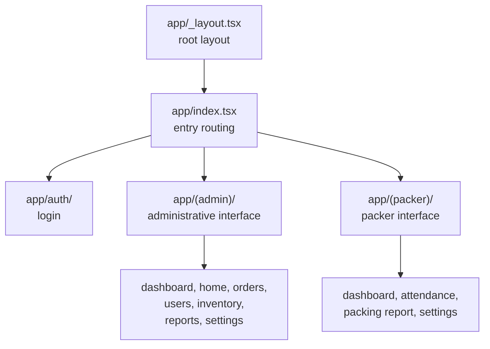

# Mobile الهندسة {#mobile-architecture}

A React Native التطبيق built مع Expo, مستخدم on site بواسطة field مشغلون.

<Status
  type="verified"
  date="2026-08-19"
  sources={[
    'Mobile:package.json',
    'Mobile:app.json',
    'Mobile:app/',
    'Mobile:components/',
    'Mobile:utils/',
    'Mobile:supabase/',
    'Mobile:eas.json',
  ]}>
  Structure و الإعداد تم قراءة directly من ال المستودع. Runtime
  behaviour من individual screens تم لا exercised. المستودع ownership هو
  unresolved — see [OQ-001](/docs/reference/open-questions#oq-001).
</Status>

## Stack {#stack}

React Native 0.81 مع Expo 54 و React 19. Expo Router 6 provides file-based
routing, NativeWind 4 provides Tailwind-style styling, Supabase JS handles
backend access, React context handles state, و AsyncStorage provides
persistence. Charts, QR code rendering, image picking, gesture handling و
reanimated هي all present as dependencies.

`expo-dev-client` هو a dependency, so ال التطبيق requires a native
development build. Expo Go cannot run it. ال new React Native الهندسة هو
disabled في الإعداد.

## Route groups {#route-groups}

Three route groups divide ال التطبيق: المصادقة, an administrative
interface, و a packer interface. ال entry route decides which interface a
signed-في مستخدم lands في.

ال two interfaces target مختلف form factors — ال administrative screens
هي described as desktop-oriented و ال packer screens as tablet-oriented — so
a change إلى a مشترك component needs checking on both.

:::warning Older admin screens may be legacy

ال الموجود الهندسة document warns that older mobile administrative
screens still exist و that الحالي usage ينبغي be تم التحقق قبل treating
them as intended الهندسة. Some من this التطبيق administrative surface
overlaps مع `website`'s. تأكيد which هو authoritative لـ a given
workflow قبل building on it.

:::

## State {#state}

Context providers under `utils/` rather than a state library:

| Provider | Concern |
| --- | --- |
| `AuthContext` | المصادقة و session |
| `PackerSessionContext` | Packer session state |
| `TextSizeContext` | Text size, لـ on-site legibility |

Backend access lives under `utils/api/`, مع additional caching و Storage
helpers alongside. `PackerNavigation` handles packer-specific navigation.

Note that packer session state هو لا purely a client concern: session,
attendance و packer الحالة also exist في ال قاعدة البيانات و هي affected بواسطة
triggers. See [Trigger-driven behaviour](./trigger-driven-behaviour).

## Components {#components}

Grouped بواسطة area under `components/`: administrative, packer, packing, inventory,
مشترك UI, و debug helpers.

## Backend assets في this المستودع {#backend-assets-in-this-repository}

ال المستودع carries its own `supabase/` directory containing a migration و
ال المصدر من an edge function لـ مستخدم creation. لأن migrations exist في
both المستودعات, neither هو a complete schema history —
[ال مشترك backend model](./shared-backend-model) explains why that matters.

## Builds {#builds}

EAS مع three profiles — development, preview و الإنتاج — all producing
Android APKs لـ internal distribution. App version numbering comes من EAS
rather than ال المستودع. Android package identity و iOS tablet support هي
declared في `app.json`.

## Scale {#scale}

Measured 2026-08-19: **106 TypeScript ملفات, 23,793 lines**. ال data layer هو
concentrated في three ملفات — <SourceRef repo="Mobile" path="utils/api/supabase.ts" />
(2,139 lines), `utils/api/inventory.ts` (819) و `utils/api/teamLead.ts` (80).

Backend surface: **31 tables, 17 RPCs**, one Storage bucket (`order_media`).

## There هو no offline support {#there-is-no-offline-support}

Worth stating plainly, لأن "field التطبيق" implies otherwise. المصدر
يحتوي **no** connectivity detection — no NetInfo, no `isConnected` check, no
كتابة queue, no sync layer. What exists هو:

- a TTL cache over AsyncStorage (`utils/cache/simpleCache.ts`) لـ قراءة
  acceleration
- a persistent profile cache so sign-في survives a slow network
- two ad-hoc conflict retries, on `securing_template` و `beam` updates

Losing connectivity mid-task therefore fails ال كتابة. How مشغلون cope مع
this في ال field هو لا documented anywhere.

## Error handling {#error-handling}

183 `Alert.alert` call sites, 120 `console.error`, 70 `console.log` و 21
`console.warn`. No error boundary, و no error-reporting service. Logging ships
في release builds.

## Gaps worth knowing {#gaps-worth-knowing}

- **No lint, typecheck أو test script** هو defined في `package.json`, despite
  TypeScript being present, و **no CI workflow exists** في this المستودع.
  There هو no automated safety net comparable إلى `website`'s.
- **الإعداد precedence هو a trap.** `app.json` commits Supabase settings
  under `extra`, و ال client يقرأ those **first**, falling back إلى
  `EXPO_PUBLIC_*` only إذا absent. Editing `.env` therefore has no effect. See
  [Build و release](/docs/mobile/build-and-release#configuration-precedence--a-trap).
- **An unused SMS-OTP auth مسار** هو wired into `AuthContext` و reachable من
  no screen — [OQ-017](/docs/reference/open-questions#oq-017).

## Build و release {#build-and-release}

EAS مع three Android-APK profiles, no CI, و version numbers owned بواسطة EAS.
Full detail, including ال identifier تحذير, at
[Build و release](/docs/mobile/build-and-release).

