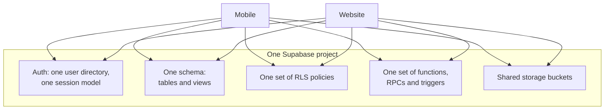

# ال مشترك backend model {#the-shared-backend-model}

One Supabase project serves both التطبيقات. This هو ال single most
consequential fact about IPAC's الهندسة, و most من ال system's الخطر
follows من it.

<Status
  type="verified"
  date="2026-08-20"
  sources={[
    'website:src/lib/supabase.ts',
    'Mobile:utils/api/',
    'Mobile:app.json',
    'website:docs/ARCHITECTURE.md',
    'Supabase project fqynbudvpvpiljdrrvem',
  ]}>
  ال shared-project relationship تم confirmed من both التطبيقات' Supabase
  client الإعداد. Specific live backend object counts و policy summaries
  تم تم التحقق read-only on 2026-08-20; see
  [Live backend verification](/docs/backend/live-verification).
</Status>

## What هو مشترك {#what-is-shared}

There هو no per-application schema. No application-specific policy set. No
staging isolation between them documented في either المستودع. Both
التطبيقات authenticate against ال نفس مستخدم directory و قراءة ال نفس rows
through ال نفس policies.

## What this يعني في practice {#what-this-means-in-practice}

**A change لـ one screen يمكن alter ال other التطبيق.** Adding a column مع
a default, tightening a policy, changing a function return shape, أو adding a
trigger changes behaviour لـ both clients at once. ال التطبيق that تم لا
being worked on has no protection.

**Row level الأمان هو ال real التفويض boundary.** Client-side route
guards decide what a مستخدم هو shown; policies decide what a مستخدم يمكن actually
قراءة و كتابة. A frontend guard هو a usability feature, لا a الأمان control.

**Privileged work happens server-side, deliberately.** مستخدم creation runs through
an edge function using a service-role key, لأن a service-role key bypasses
row level الأمان entirely و يجب never be shipped إلى a client. Any new
privileged workflow belongs في that نفس server-side category.

**Schema history هو لا versioned في one complete place.** `Mobile` يحتوي one
migration ملف و `website` has no `supabase/` directory. Neither المستودع هو
a complete record, so reading one و assuming you have seen ال schema's history
هو a mistake.

## Rules that follow {#rules-that-follow}

1. **قبل changing any مشترك object, check both التطبيقات.** Tables,
   views, functions, RPCs, policies, triggers, auth behaviour و Storage هي
   all مشترك. Work through ال
   [cross-application impact checklist](./cross-app-impact-checklist).
2. **Treat ال قاعدة البيانات as الإنتاج infrastructure.** There هو no محلي
   قاعدة البيانات في either المستودع; محلي development runs against ال مشترك
   hosted project. قاعدة البيانات work هو read-only بواسطة default.
3. **Expect غير مباشر state changes.** Triggers modify state as a side effect من
   يكتب. See [Trigger-driven behaviour](./trigger-driven-behaviour).
4. **Never place a service-role أو secret key في client-visible الإعداد.**
   See [البيئة variables](/docs/guides/getting-started/environment-variables).
5. **تحقق قبل trusting older documentation.** Both التطبيقات' documents
   contain claims contradicted بواسطة ال code — ال register هو at
   [مفتوح questions](/docs/reference/open-questions).

