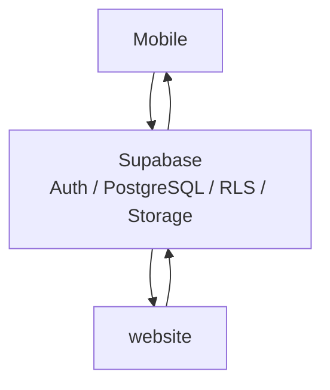

<header>
# هندسة النظام
</header>

<Status type="verified" date="2026-08-19">
  تحافظ هذه الصفحة على الرسوم والمعرفات التقنية كما هي.
</Status>

يجمع IPAC بين عميلين تطبيقيين وbackend مشترك في Supabase:

| الطبقة | المسؤولية |
| --- | --- |
| Mobile | عمليات الميدان وشاشات admin وpacker. |
| website | الإدارة والعروض المقيدة للعميل. |
| Supabase | Auth وPostgreSQL وRLS وStorage وRPC / Functions. |

الbackend المشترك هو القيد المعماري الرئيسي. أي تغيير في schema أو RLS أو RPC أو Storage أو roles يعامل كتغيير cross-app افتراضيا.

