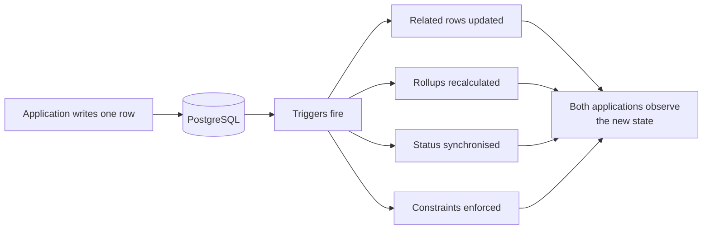

# Trigger-driven behaviour {#trigger-driven-behaviour}

في IPAC, writing a row يمكن change other rows. قاعدة البيانات triggers modify state as a
side effect, so ال التطبيق code that issued a كتابة does لا fully describe
what happened.

<Status
  type="verified"
  date="2026-08-20"
  sources={[
    'website:docs/ARCHITECTURE.md',
    'website:CLAUDE.md',
    'Supabase project fqynbudvpvpiljdrrvem',
  ]}>
  Trigger behaviour guidance comes من المصدر governance و legacy docs. ال
  live trigger inventory تم re-queried read-only on 2026-08-20 و هو listed في
  [Live backend verification](/docs/backend/live-verification#triggers).
</Status>

## Why this page exists {#why-this-page-exists}

A developer reading a mutation في either التطبيق سوف see one كتابة. ال
actual outcome may include several. Effects recorded في ال الموجود
الهندسة document include:

- packer الحالة synchronisation
- enforcement من a single active order
- package overview rollups
- allocation packed-quantity synchronisation
- تقرير number assignment
- `updated_at` maintenance

None من these هي visible في التطبيق code. Some من them enforce business
rules that a frontend change could appear إلى contradict — و lose.

## Where triggers تم recorded {#where-triggers-were-recorded}

As من ال 2026-08-20 live query, enabled triggers exist on التطبيق settings,
client تقارير, maintenance task assignments و logs, package instances,
package overviews, order team members, orders, packed items, و profiles.

ال tables carrying triggers هي exactly ال ones at ال centre من ال order,
packing, team و reporting workflows — that هو, ال tables you هي most likely
إلى want إلى change.

## What إلى do about it {#what-to-do-about-it}

**قبل changing any mutation near those tables, inspect ال live triggers و
ال functions they call.** لا ال documentation — ال قاعدة البيانات. ال الموجود
guidance هو explicit that Supabase work هو read-only بواسطة default, so inspection هو
ال normal, expected activity.

**Do لا implement a rule في ال frontend that ال قاعدة البيانات already enforces.**
You سوف produce two المصادر من truth that disagree under concurrency, و ال
قاعدة البيانات سوف win.

**Do لا assume quantities هي frontend-owned.** Packed quantities هي
recalculated through قاعدة البيانات functions و triggers, so computing them
client-side و writing ال result يمكن be overwritten أو يمكن conflict.

**Expect state إلى change without a corresponding client call.** Packer الحالة,
active order, و تقرير numbering يمكن all move لأن something else تم
written.

:::note Where ال full list lives

This page explains why trigger-driven behaviour matters. ال الحالي trigger
inventory هو maintained في
[Live backend verification](/docs/backend/live-verification#triggers).

:::

