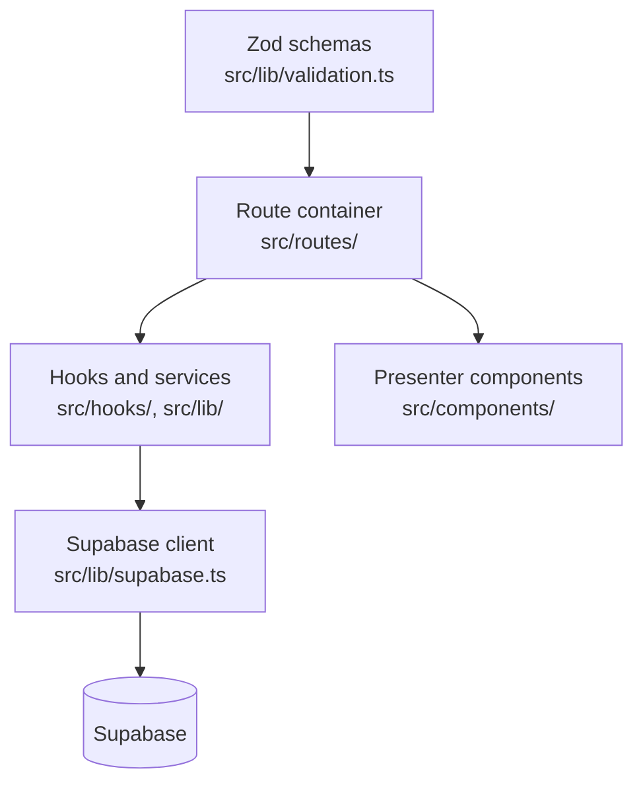

# website الهندسة {#website-architecture}

A TanStack Start web التطبيق لـ managers, administrators, و restricted
client access.

<Status
  type="verified"
  date="2026-08-19"
  sources={[
    'website:package.json',
    'website:src/routes/',
    'website:src/',
    'website:server/api/',
    'website:CLAUDE.md',
    'website:docs/ARCHITECTURE.md',
  ]}>
  Structure, route inventory و dependencies تم قراءة directly من ال
  المستودع. Layering conventions هي reproduced من ال المستودع own
  engineering guidance, which remains their authority.
</Status>

## Stack {#stack}

React 19 و TypeScript, TanStack Start مع TanStack Router و TanStack Query,
Vite 7, Nitro using ال `vercel` preset, Supabase JS, Tailwind CSS 4 مع
DaisyUI و Radix primitives, Zod لـ validation, Vitest لـ tests, Biome لـ
lint و format.

ال التطبيق تم rebuilt on this stack إلى replace an earlier Expo Web
implementation whose bundle size made it unusably slow. That decision, its stated
rationale و its lasting consequences هي recorded في
[ADR-0001](/docs/adr/adr-0001-website-framework) — it explains why ال web
التطبيق shares no code مع ال React Native التطبيق.

## Layering {#layering}

Four rules govern this structure, و they هي enforced في review:

- **Route containers own data access.** All query و mutation hooks live في ال
  container. Tab و section components below them هي pure presenters receiving
  data و callbacks as props.
- **Server state lives في TanStack Query only.** No manual fetching inside
  components, و no copying server state into محلي state. Mutations invalidate
  queries on success.
- **Layer boundaries hold.** Presentational UI, container orchestration, service
  و API access, و schema validation هي separate; services do لا import UI.
- **Validation هو Zod at form level.**

## Routing {#routing}

File-based routing under `src/routes/`. ال surface divides into internal
operations و a client portal:

| Area | Routes |
| --- | --- |
| Internal operations | dashboard, orders و order detail, my-orders, clients و client detail, inventory, inventory duplicates, مستخدمون, requests, تقارير, settings, data import |
| Client portal | portal login, projects, item detail, package detail, scan بواسطة token |
| المصادقة | login |

ال client portal being part من ال نفس التطبيق matters: external client
access و internal operations share one النشر, one auth system, و one
policy set.

## Data access {#data-access}

- ال Supabase client هو centralised في a single module —
  <SourceRef repo="website" path="src/lib/supabase.ts" /> — configured with
  PKCE و a dedicated auth Storage key, clearing corrupted sessions on load.
- المصادقة هو consumed through a hook rather than directly.
- Username-based login resolves a username إلى an email through a قاعدة البيانات
  function قبل ال password sign-في, so login هو لا a pure client concern.
- Nested Supabase relations هي flattened في mappers. Deep nesting هو fetched as
  two batched queries rather than nested selects, إلى avoid N+1 query patterns.

## Server surface {#server-surface}

Small but real: an inbound webhook route لـ supplier email at
<SourceRef repo="website" path="server/api/webhooks/resend/inbound.post.ts" />.
It هو تم التحقق مع a webhook secret, which يجب remain server-side. Supplier
communication features consume it.

## Styling {#styling}

Colours come من a semantic scale defined في ال التطبيق stylesheet —
raw Tailwind palette classes هي disabled في ال theme الإعداد و emit no
CSS. A class name like a raw colour utility سوف look correct في a diff و do
nothing at runtime. Change colours بواسطة editing ال theme, لا بواسطة reaching لـ a
palette class.

## Quality gates {#quality-gates}

`npm run validate` runs typecheck then build, و هو expected قبل a pull
request. Vitest covers tests, Biome handles lint و format, و a GitHub Actions
workflow validates pull requests. النشر هو a separate workflow that builds
و deploys إلى Vercel using ال prebuilt flow.

## Module sizes {#module-sizes}

Measured 2026-08-19. Useful لأن they show where ال complexity actually هو:

| Feature module | ملفات | Lines |
| --- | --- | --- |
| `features/reports` | 20 | **12,186** |
| `features/orders` | 36 | 5,449 |
| `features/requests` | 14 | 2,444 |
| `features/inventory-communications` | 8 | 924 |
| `features/settings` | 2 | 131 |

Reporting هو بواسطة far ال largest و least-tested area من ال system.

:::warning ال المستودع own size limits هي widely exceeded

`website/CLAUDE.md` sets a 300-line soft و 400-line hard limit. Actual:
`src/types/supabase.ts` 4,218 · `features/reports/components/PackingListPage.tsx`
3,595 · `routes/inventory.tsx` 2,765 · `components/orders/create/OrderCreateDialog.tsx`
1,735 · `routes/clients/$clientId.tsx` 1,269 · `routes/users.tsx` 1,247.

:::

## التفويض: client-side only {#authorization-client-side-only}

Page access هو decided بواسطة <SourceRef repo="website" path="src/lib/access.ts" />
و enforced بواسطة a `useEffect` redirect في `useRequirePageAccess`. That يعني ال
protected component **mounts و renders قبل ال redirect fires**, و there هو
no server-side route التفويض anywhere في this التطبيق. RLS هو ال real
boundary.

13 من ال protected routes call ال guard. **`/inventory` does لا** — see
[H1](/docs/security/findings#h1). Full detail at
[Roles و permissions](/docs/website/roles-and-permissions).

## Testing reality {#testing-reality}

Two test ملفات exist, both covering Excel/package parsing
(`parsePackageRows.test.ts`, `utils.test.ts`). There هي **no** tests لـ
المصادقة, access control, أو ال data layer. ال الإنتاج workflow runs
tests مع `continue-on-error: true`, so tests do لا gate النشر — ال
effective gate هو lint, typecheck و build.

:::note Per-feature detail هو لا published yet

Documentation لـ orders, inventory, تقارير, requests و ال client portal هو
لا written. ال route ملفات هي ال الحالي authority, و `website/CLAUDE.md`
holds ال code-level conventions.

:::

