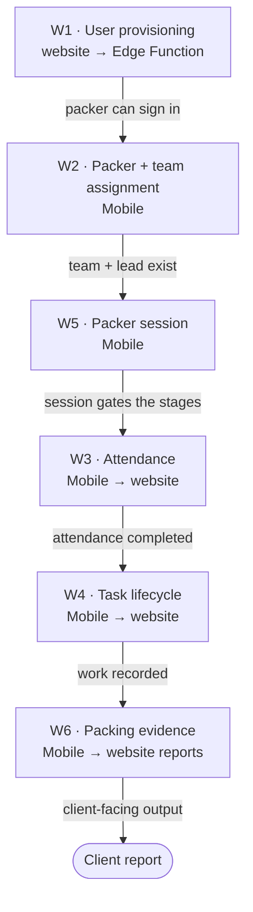

# Workflows {#workflows}

Six workflows هي documented here. Each one **crosses both التطبيقات** —
either an actor في one produces state ال other consumes, أو ال نفس table هو
written بواسطة one و remediated بواسطة ال other. These هي ال processes nobody يمكن
reconstruct من a single المستودع.

<Status
  type="partial"
  date="2026-08-19"
  sources={[
    'Mobile:utils/api/supabase.ts',
    'Mobile:utils/PackerSessionContext.tsx',
    'Mobile:supabase/functions/create-user/index.ts',
    'website:src/features/orders/',
    'website:src/features/reports/',
    'website:Trail/packed-date-report-conflict-log.md',
  ]}>
  Each workflow هو reconstructed من ال قاعدة البيانات calls both التطبيقات
  actually make. **Actors هي inferred من route guards**, which هو المصدر
  الدليل, لا a statement من company process. Where a business rule هو asserted,
  it هو cited. Nothing here describes intent that المصدر does لا show.
</Status>

## How إلى قراءة these pages {#how-to-read-these-pages}

Every workflow page يستخدم ال نفس six-part structure:

```text
Actor      →  who initiates it, per the route guards that let them in
Application→  which app the action happens in
Action     →  what the user does
Database   →  tables and RPCs touched
Result     →  the business outcome
Cross-app  →  what the other application now sees, and what can break
```

## ال chain {#the-chain}



`W5` هو ال spine on ال Mobile side: ال packer session tracks which stage من ال
day a packer هو في, و ال other Mobile workflows advance it.

## ال six workflows {#the-six-workflows}

| | Workflow | Actor | Direction |
| --- | --- | --- | --- |
| [W1](./w1-user-provisioning) | مستخدم provisioning | admin / director | website → backend → Mobile |
| [W2](./w2-packer-team-assignment) | Packer و team assignment | admin / director / sales | Mobile ↔ website |
| [W3](./w3-attendance) | Attendance | packer, team lead | Mobile → website |
| [W4](./w4-task-lifecycle) | Task lifecycle | packer | Mobile → website |
| [W5](./w5-packer-session) | Packer session | packer | Mobile (website يمكن force-release) |
| [W6](./w6-packing-evidence) | Packing الدليل و تقرير dates | packer, then reporting مستخدم | Mobile → website |

## Workflows deliberately لا documented yet {#workflows-deliberately-not-documented-yet}

These exist في المصدر but هي **website-only** و تم لا part من this pass:
item allocation, package instances و packed items, ال client portal و QR
scanning, material/pricing request approvals, و supplier email ingestion.

Also absent, و **لا إلى be written without live verification أو product input**:
ال maintenance subsystem (its tables و enums exist but neither التطبيق
calls them), cost calculation, و ال `transportation`, `services` و
`report_batch` tables.

