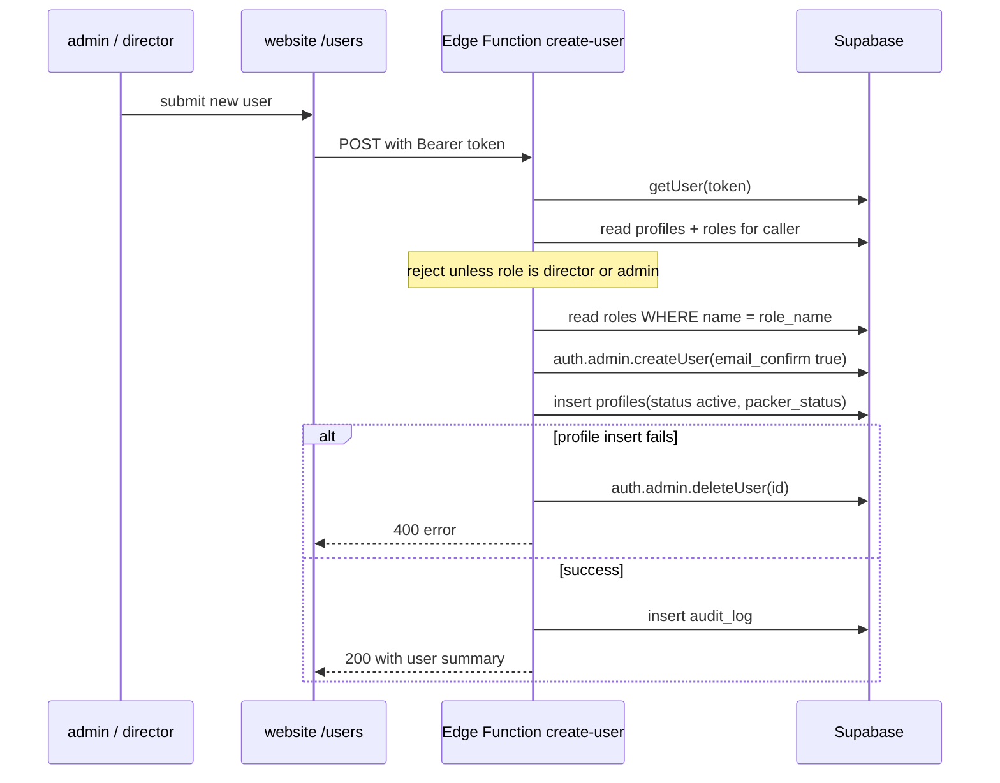

# W1 — مستخدم provisioning {#w1-user-provisioning}

ال only workflow that creates ال identity both التطبيقات depend on.

<Status
  type="verified"
  date="2026-08-19"
  sources={[
    'Mobile:supabase/functions/create-user/index.ts',
    'website:src/routes/users.tsx',
    'Mobile:Trail/login-hashir-1.md',
  ]}>
  ال Edge Function تم قراءة line بواسطة line. ال failure mode documented at ال
  bottom هو reproduced من an incident log written بواسطة ال developer who
  diagnosed it.
</Status>

## ال flow {#the-flow}

| Step | Detail |
| --- | --- |
| **Actor** | `admin` أو `director` — enforced بواسطة ال Edge Function, لا just ال UI |
| **التطبيق** | `website`, `/users` |
| **Action** | Submit a new مستخدم: email, password, full name, username, phone number, role name |
| **قاعدة البيانات** | Edge Function `create-user` using a **service-role key**: `auth.admin.createUser` → `profiles` insert → `audit_log` insert. يقرأ `roles` إلى resolve ال role name إلى an id |
| **Result** | An account that يمكن sign في إلى either التطبيق, مع a role that determines where it lands |
| **Cross-app** | ال new `profiles` row هو immediately authoritative لـ **both** التطبيقات. A packer أنشئ here يمكن sign في إلى Mobile مع no further step |

## What ال function sets {#what-the-function-sets}

- `email_confirm: true` — no verification email; ال account هو usable immediately.
- `profiles.status = 'active'`.
- `profiles.packer_status = 'available'` عندما ال role هو `packer`, otherwise null.
- An `audit_log` row مع `entity_type: 'profile'`, `action_type: 'INSERT'`,
  `changed_by` = ال caller, و a note naming ال creating مستخدم.

## التفويض {#authorization}

ال function permits **`director` أو `admin` only**. Notably it also selects
`roles.can_manage_roles` و then **never يستخدم it** — ال decision هو a hardcoded
role-name comparison. See
[Roles و permissions](/docs/website/roles-and-permissions#permission-flags-are-database-side-only).

Any role name present في ال `roles` table يمكن be **assigned**, لأن ال
function looks ال name up rather than validating against a list. Live assignable
roles هي `admin`, `client`, `executive`, `packer`, و `sales`; `director` هو
تم التحقق as a creator role في المصدر but does لا exist as a live role row.

## مباشر SQL provisioning breaks sign-في {#direct-sql-provisioning-breaks-sign-in}

:::danger Do لا create مستخدمون مع raw SQL

An account أنشئ بواسطة inserting directly into `auth.users` **سوف fail إلى sign
في**, مع ال misleading error `Database error querying schema` — و only عندما
ال *correct* username هو مستخدم. A wrong username still returns "invalid
credentials", which makes it look like a password problem rather than a malformed
account.

:::

ال root cause هو a المفقود `auth.identities` row plus two columns left `NULL`
where GoTrue requires empty strings. ال full diagnosis, ال fix that worked, و
ال fixes إلى avoid هي documented as a استكشاف الأخطاء entry:

**→ [استكشاف الأخطاء A1 — Login fails مع "قاعدة البيانات error querying schema"](/docs/troubleshooting/authentication#a1)**

ال point لـ this workflow هو narrower: **use ال Edge Function.** It هو ال only
مسار that applies ال role check و يكتب `audit_log`.

## Why this matters beyond one incident {#why-this-matters-beyond-one-incident}

Provisioning outside ال Edge Function skips its role check **و** its
`audit_log` كتابة. `audit_log` therefore cannot be trusted as a complete record
من مستخدم creation — at least one account هو المعروف إلى have bypassed it. Recorded as
[H5](/docs/security/findings#h5)
و [OQ-019](/docs/reference/open-questions#oq-019).

## Next action {#next-action}

A newly أنشئ packer cannot do anything until assigned إلى an order —
[W2](./w2-packer-team-assignment).

