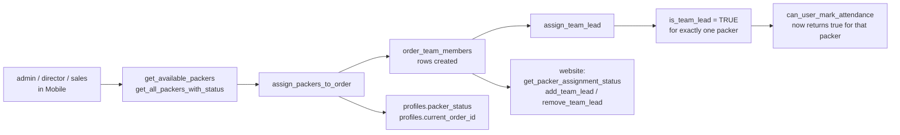

# W2 — Packer و team assignment {#w2-packer-and-team-assignment}

<Status
  type="verified"
  date="2026-08-19"
  sources={[
    'Mobile:utils/api/supabase.ts',
    'Mobile:utils/api/teamLead.ts',
    'Mobile:supabase/migrations/20250121_add_team_lead_support.sql',
    'website:src/features/orders/',
  ]}>
  RPC names و ال team-lead mechanism تم قراءة من both التطبيقات و من
  ال migration, which يحتوي ال full function bodies.
</Status>

## ال flow {#the-flow}

| Step | Detail |
| --- | --- |
| **Actor** | `admin`, `director` أو `sales` — ال roles Mobile's admin group admits |
| **التطبيق** | `Mobile`, admin group |
| **Action** | Select available packers لـ an order; designate one as team lead |
| **قاعدة البيانات** | RPCs `get_available_packers`, `get_all_packers_with_status`, `get_order_packers`, `assign_packers_to_order`, `assign_team_lead`, `update_project_lead_with_status`. يكتب `order_team_members`; affects `profiles.packer_status` و `profiles.current_order_id` |
| **Result** | ال order has a team, و exactly one team lead |
| **Cross-app** | `website` يقرأ assignment via `get_packer_assignment_status` و يمكن change ال lead مع `add_team_lead` / `remove_team_lead`. Team-lead الحالة **grants attendance rights** في ال قاعدة البيانات |



## Team lead هو per order, لا a role {#team-lead-is-per-order-not-a-role}

This هو ال most misunderstood concept في ال system, و ال migration هو
explicit about it. ال column comment يقرأ:

```text
Temporary team lead status for this packer on this specific order
```

`assign_team_lead(order_uuid, packer_uuid)` هو `SECURITY DEFINER` و does three
things في one transaction:

1. Clears `is_team_lead` لـ every member من that order.
2. Sets `is_team_lead = TRUE` لـ ال named packer.
3. إذا that packer هو لا yet a member, inserts them —
   `ON CONFLICT (order_id, packer_id) DO UPDATE SET is_team_lead = TRUE`.

So **one lead per order هو enforced بواسطة ال function**, لا بواسطة a constraint. ال
`ON CONFLICT` clause also tells us `(order_id, packer_id)` هو unique.

A packer يمكن be team lead on one order و an ordinary member on another.
`team_lead` هو **لا** a value في `roles` — see
[Roles و permissions](/docs/website/).

## What team-lead الحالة unlocks {#what-team-lead-status-unlocks}

`can_user_mark_attendance(order_uuid)` returns true لـ `admin`/`director` مع an
active profile, **أو** لـ ال order team lead. That هو a real, database-enforced
capability grant — ال only place في IPAC where per-order state confers a
privilege. See [W3](./w3-attendance).

## Single active order {#single-active-order}

`profiles.current_order_id` exists, و `update_project_lead_with_status` combines
a lead change مع a الحالة change, implying ال two هي coupled. `website` has an
`admin_force_release_packer` RPC, which only makes sense إذا a packer يمكن become
stuck attached إلى an order.

Live verification shows single-active-order enforcement هو handled بواسطة an enabled
`order_team_members` trigger, `trigger_enforce_single_active_order_for_packer`,
backed بواسطة function `enforce_single_active_order_for_packer`. Related triggers
sync `profiles.current_order_id` و packer الحالة.

## Breaking-change note {#breaking-change-note}

`order_team_members` هو written بواسطة `Mobile`, managed بواسطة `website`, و قراءة بواسطة a
`SECURITY DEFINER` function that grants a privilege. A change إلى this table
touches all three. Its unique constraint هو load-bearing لـ `assign_team_lead`.

## Next action {#next-action}

مع a team و a lead في place, ال packer opens a session — [W5](./w5-packer-session) —
و attendance يمكن be recorded — [W3](./w3-attendance).

