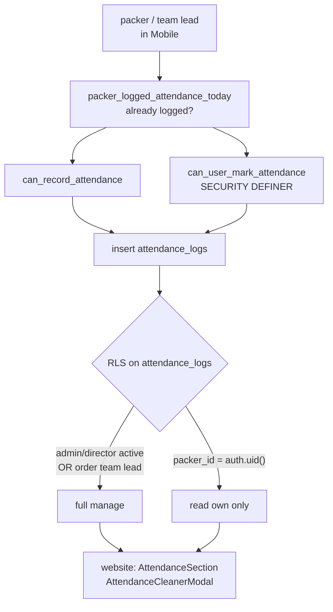

# W3 — Attendance {#w3-attendance}

ال clearest Mobile-produces / website-consumes workflow, و ال only one whose
RLS policy هو written down anywhere.

<Status
  type="partial"
  date="2026-08-20"
  sources={[
    'Mobile:utils/api/supabase.ts',
    'Mobile:app/(packer)/attendance.tsx',
    'Mobile:supabase/migrations/20250121_add_team_lead_support.sql',
    'website:src/components/orders/orderId/sections/AttendanceSection.tsx',
    'website:src/components/orders/orderId/modals/AttendanceCleanerModal.tsx',
    'Supabase project fqynbudvpvpiljdrrvem',
  ]}>
  RPCs, table columns و المصدر RLS تم تم التحقق من المصدر; live policy
  shape تم تم التحقق read-only. ال live `packer_sessions` policy differs من
  ال migration, but `attendance_logs` keeps ال نفس core manage/own-read shape.
</Status>

## ال flow {#the-flow}

| Step | Detail |
| --- | --- |
| **Actor** | `packer` لـ their own attendance; team lead أو `admin`/`director` إلى manage ال order |
| **التطبيق** | `Mobile`, `(packer)/attendance` |
| **Action** | Record attendance لـ ال day/shift, including toolbox briefing |
| **قاعدة البيانات** | Capability checks via `can_record_attendance`, `can_user_mark_attendance`, `packer_logged_attendance_today`; يكتب `attendance_logs` |
| **Result** | A dated attendance record per packer per shift, feeding productivity reporting |
| **Cross-app** | `website` يقرأ `attendance_logs` في ال order detail attendance section, و has an **attendance cleaner** modal إلى remediate bad data |

`attendance_logs` columns (تم التحقق): `order_id`, `packer_id`, `log_date`,
`shift_period`, `start_time`, `end_time`, `status`, `is_project_start`,
`toolbox_briefing_completed`.

`status` هو مستخدم مع ال value `present` في Mobile.

## Two overlapping capability functions {#two-overlapping-capability-functions}

Mobile calls **both** `can_record_attendance` و `can_user_mark_attendance`.

Only ال second has a body في any المستودع. ال first هو declared في ال
generated types و its logic هو غير معروف. Which هو authoritative, whether they يمكن
disagree, و why both هي called, هو **لا established** —
[OQ-021](/docs/reference/open-questions#oq-021).

Do لا remove either call قبل that سؤال هو answered.

## ال تم التحقق RLS policy {#the-verified-rls-policy}

من ال migration, لـ `attendance_logs`:

- **Manage (`FOR ALL`)** — role `admin` أو `director` **و**
  `profiles.status = 'active'`, **أو** `is_team_lead_for_order(auth.uid(), order_id)`.
- **قراءة own (`FOR SELECT`)** — `packer_id = auth.uid()`.

Note ال `profiles.status = 'active'` condition: a suspended admin loses
attendance management at ال قاعدة البيانات level, لا just في ال UI. That هو a real
business rule, enforced where it counts.

## ال attendance cleaner هو a signal {#the-attendance-cleaner-is-a-signal}

`website` ships an `AttendanceCleanerModal`. A remediation tool الموجود في
الإنتاج هو الدليل that attendance data goes wrong في practice — most likely
duplicate أو orphaned rows. **What it corrects, و why ال bad data occurs, هو
لا documented في المصدر.** Worth a conversation مع operations قبل writing
more here.

## Next action {#next-action}

Attendance completion advances ال packer session — [W5](./w5-packer-session) —
بعد which packing tasks يمكن begin — [W4](./w4-task-lifecycle).

