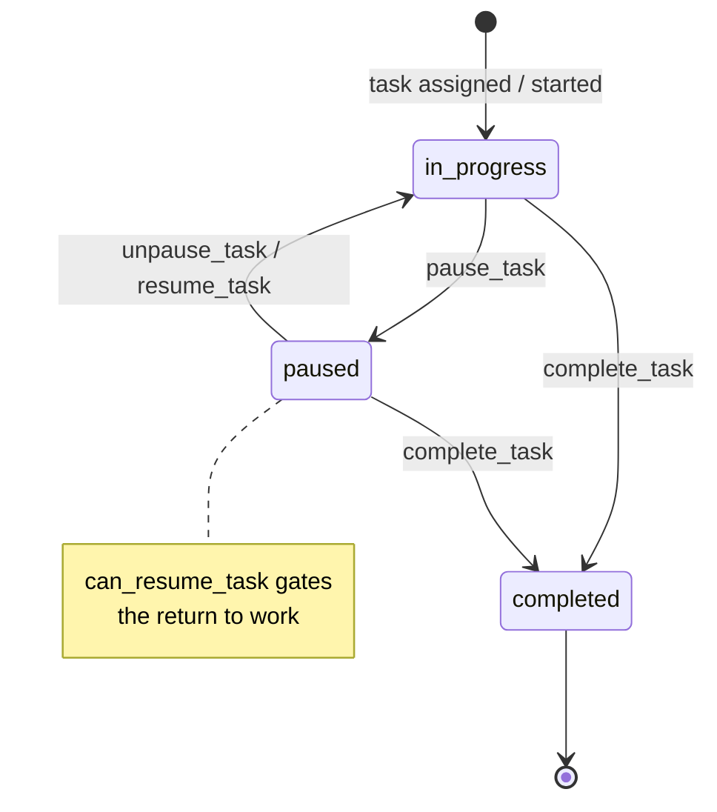

# W4 — Task lifecycle {#w4-task-lifecycle}

<Status
  type="partial"
  date="2026-08-19"
  sources={[
    'Mobile:utils/api/supabase.ts',
    'website:src/types/supabase.ts',
    'website:src/features/orders/',
  ]}>
  ال RPC set و ال `task_status` enum هي تم التحقق من المصدر. **ال state
  machine below هو reconstructed من RPC names و ال enum**, لا من a
  function body — no task function has its definition في any المستودع.
</Status>

## ال flow {#the-flow}

| Step | Detail |
| --- | --- |
| **Actor** | `packer` |
| **التطبيق** | `Mobile`, packer group |
| **Action** | Start work on a task, pause it, resume it, complete it |
| **قاعدة البيانات** | RPCs `pause_task`, `unpause_task`, `resume_task`, `complete_task`, guarded بواسطة `can_resume_task`. Touches `tasks`, `task_logs`, `task_assignments`, `task_packages`, و ال `task_status_view` |
| **Result** | A time-stamped record من who worked on what و لـ how long |
| **Cross-app** | `website` يقرأ `task_logs` في order detail و end-task flows. Task time does **لا** drive ال تقرير packed date — see [W6](./w6-packing-evidence) |

## ال state machine {#the-state-machine}

`task_status` هو a real قاعدة البيانات enum مع exactly three values:

```text
in_progress · paused · completed
```



:::warning Three RPCs لـ two transitions

`pause_task`, `unpause_task` **و** `resume_task` all exist و هي all called
من Mobile. Two names لـ leaving ال paused state suggests either a distinction
this documentation cannot see, أو historical duplication.

لأن no function body exists في المصدر, **ال difference between `unpause_task`
و `resume_task` هو غير معروف**. Do لا assume they هي interchangeable —
[OQ-022](/docs/reference/open-questions#oq-022).

:::

## Related functions nothing calls {#related-functions-nothing-calls}

`get_active_tasks_for_packers`, `complete_assignments_for_packers` و
`delete_tasks_for_order_packages` هي declared في ال schema but called بواسطة
**neither** التطبيق. They may be internal helpers, trigger bodies, أو dead
code — [OQ-013](/docs/reference/open-questions#oq-013).

`website` has an end-task modal, so task completion هو reachable من both
التطبيقات. Whether both مسارات use ال نفس RPC هو **unverified**.

## Deliberate design decision worth knowing {#deliberate-design-decision-worth-knowing}

ال reporting layer **does لا** use `task_logs.end_time` as ال packed date. That
choice هو explicit و documented, مع ال reason: reopening أو reworking a box
يجب لا move its original packed date. See
[W6](./w6-packing-evidence#the-report-date-rule).

This هو ال one place في IPAC where a business rule هو recorded together مع its
rationale. Preserve it.

## Next action {#next-action}

Completed task work هو evidenced بواسطة packed items و photographs —
[W6](./w6-packing-evidence).

