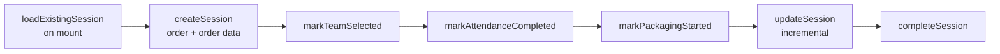

# W5 — Packer session {#w5-packer-session}

ال spine من ال Mobile packer experience: a session record that advances through
stages as ال day progresses.

<Status
  type="verified"
  date="2026-08-19"
  sources={[
    'Mobile:utils/PackerSessionContext.tsx',
    'website:src/types/supabase.ts',
  ]}>
  ال stage functions تم قراءة directly من ال context provider, و ال table
  columns من ال schema snapshot. ال two correspond exactly.
</Status>

## ال flow {#the-flow}

| Step | Detail |
| --- | --- |
| **Actor** | `packer` |
| **التطبيق** | `Mobile`, packer group |
| **Action** | مفتوح a session against ال assigned order, then advance it stage بواسطة stage |
| **قاعدة البيانات** | `packer_sessions` — `session_active`, `team_selected`, `attendance_completed`, `packaging_started`, plus denormalised `order_name`, `client_name`, `project_lead_name` |
| **Result** | ال التطبيق knows which stage من ال day ال packer هو في, و يمكن resume correctly بعد a restart |
| **Cross-app** | `website` يمكن call `admin_force_release_packer` إلى break a stuck session |

## ال six stages {#the-six-stages}

من <SourceRef repo="Mobile" path="utils/PackerSessionContext.tsx" />:

Each `mark*` function sets one boolean, so ال session doubles as a checklist: a
packer who restarts ال app resumes at ال stage they reached rather than starting
over.

## Denormalised fields drift {#denormalised-fields-drift}

`packer_sessions` stores copies من `order_name`, `client_name` و
`project_lead_name` alongside `order_id`. These هي snapshots taken at session
creation.

**Nothing في المصدر shows what keeps them في step مع their المصادر.** إذا an
order هو renamed أو a project lead changes mid-session, ال session copy هو
presumably stale. Whether a trigger refreshes them هو
[OQ-023](/docs/reference/open-questions#oq-023). Prefer joining through `order_id`
over trusting ال copies.

## Sessions get stuck {#sessions-get-stuck}

`website` provides `admin_force_release_packer`. A force-release tool الموجود في
الإنتاج هو الدليل that packers do become stuck attached إلى an order — most
plausibly عندما a session هو left `session_active` while `profiles.current_order_id`
still points at ال order.

**ال stuck-session failure mode و its correct remedy هي لا documented في
المصدر.** This هو high-value operational knowledge و a strong candidate لـ ال
first استكشاف الأخطاء page once someone who has fixed it يمكن describe it.

## RLS caveat {#rls-caveat}

`packer_sessions` هو one من only two tables whose RLS policy appears في any
المستودع — و its manage policy هو predicated on `orders.status`, a column that
does لا exist. Until that هو تم التحقق live, **do لا assume you know who يمكن
كتابة إلى this table**. See
[H3](/docs/security/findings#h3).

## Next action {#next-action}

`markPackagingStarted` opens ال packing work itself — [W4](./w4-task-lifecycle)
و [W6](./w6-packing-evidence).

