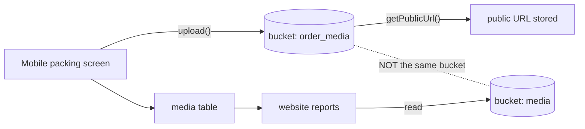

# W6 — Packing الدليل و تقرير dates {#w6-packing-evidence-and-report-dates}

ال workflow مع ال most business consequence, ال only documented business
rule مع a stated rationale, و one تم التحقق defect.

<Status
  type="verified"
  date="2026-08-20"
  sources={[
    'Mobile:utils/api/supabase.ts',
    'website:Trail/packed-date-report-conflict-log.md',
    'website:inspect_rpc.js',
    'website:inspect_instances.js',
    'website:src/features/reports/',
    'Supabase project fqynbudvpvpiljdrrvem',
  ]}>
  ال bucket mismatch, RPC signature, instance columns, Storage bucket state و
  live report-date logic هي تم التحقق. ال live function يستخدم
  `order_pkg_instance.packed_at` as ال completion-date المصدر عندما present.
</Status>

## ال flow {#the-flow}

| Step | Detail |
| --- | --- |
| **Actor** | `packer` produces الدليل; a reporting مستخدم generates output |
| **التطبيق** | `Mobile` لـ الدليل, `website` لـ ال تقرير |
| **Action** | Add packed items و photograph ال package; later, generate a packing list لـ a client, order, destination و date range |
| **قاعدة البيانات** | Mobile يكتب `package_items` و uploads إلى bucket `order_media`. website يقرأ `order_pkg_instance`, `pkd_item`, `media`, `qr_codes` via `fetch_report_instances` و `fetch_instance_items` |
| **Result** | A client-facing packing list |
| **Cross-app** | This هو where Mobile's field work becomes ال client deliverable — و where ال bucket mismatch bites |

## ال four package layers {#the-four-package-layers}

Conflating these هو ال most common المصدر من reporting bugs:

```text
order_packages      definition / template
order_pkg_overview  grouped quantity and progress
order_pkg_instance  ONE physical box
pkd_item            an item actually packed into that box
```

`order_pkg_instance` carries `ipac_reference`, `instance_number`, `destination`,
`tag`, `packed_at` و `packed_by`.

## ال تقرير date rule {#the-report-date-rule}

This هو ال single most valuable business rule recovered في ال audit, لأن it
comes مع its reason.

**تقرير packed date, as authored:**

```sql
COALESCE(order_pkg_instance.packed_at, MAX(pkd_item.created_at))
```

**Previously, و بعد ال 2026-08-08 revert:**

```sql
MAX(pkd_item.created_at)
```

:::info Why `task_logs.end_time` هو deliberately لا مستخدم

Quoting ال incident log directly:

> ال migration intentionally does لا use `task_logs.end_time`, لأن
> reopening/reworking a box ينبغي لا move ال original packed date.

A box that هو reopened و repacked يجب keep ال date it تم **first** packed.
Task time would move it. This هو a real business rule مع a stated rationale —
preserve it.

:::

**ال matching UI rule**, في ال packing list page:

```text
If status becomes packed AND packed_at is empty  → set packed_at = now
If packed_at already exists                      → keep it
If status changes away from packed               → do NOT clear packed_at
```

ال behaviour it replaced تم
`packed_at: status === "packed" ? new Date().toISOString() : null`, which **cleared
ال original packed date** whenever a box moved out من `packed`. That هو ال bug ال
rule exists إلى prevent.

### ال measured impact {#the-measured-impact}

لـ one client order filtered إلى one destination و a two-week window:

| تقرير date logic | Boxes shown |
| --- | --- |
| `MAX(pkd_item.created_at)` | **11** |
| `COALESCE(instance.packed_at, MAX(pkd_item.created_at))` | **22** |

A date-logic change doubled a client-facing تقرير. This هو why ال rule matters
و why ال reasoning يجب stay written down.

:::info Live logic as من 2026-08-20

ال live `fetch_report_instances` overload مع `p_tag_ids` يستخدم
`COALESCE(order_pkg_instance.packed_at, MAX(pkd_item.created_at))` لـ
completion-style date modes. `item_packed_at` هو a legacy alias لـ completion,
`packing_completed_at` هو ال explicit completion mode, و
`packing_started_at` يستخدم ال first packed item timestamp.

:::

## تم التحقق RPC signature {#verified-rpc-signature}

من <SourceRef repo="website" path="inspect_rpc.js" />:

```text
fetch_report_instances(p_client_id, p_order_ids, p_date_from, p_date_to,
                       p_date_mode, p_destinations, p_has_items_only, p_tag_ids)
```

ال live function accepts `packing_started_at`, `packing_completed_at`,
`item_packed_at`, و falls back إلى instance creation لـ unrecognised modes.

## ال Storage bucket mismatch {#the-storage-bucket-mismatch}



:::danger Storage mismatch

`Mobile` uploads package photographs إلى **`order_media`**, then derives a public
URL. `website` يقرأ و يكتب **`media`** في six places. Only `media` appears في
ال stale schema snapshot, و live Supabase has no `order_media` bucket.

Consequence: photographs taken في ال field through this مسار may لا upload أو
may لا appear في client تقارير. ال live `media` bucket هو public, so any fix
needs a deliberate storage-access decision rather than a silent bucket swap. See
[H2](/docs/security/findings#h2).

:::

Note that Mobile also يكتب an `order_media` **table** في المصدر, but no live
public table بواسطة that name تم found.

## Manual remediation happens {#manual-remediation-happens}

`website/Trail/` يحتوي a JSON snapshot taken *"قبل redo"* من a الإنتاج
order, recording box counts per filter — 488 boxes under one الحالة filter لـ a
single order. Together مع ال packed-date backfill من 19 rows, this shows تقرير
discrepancies هي sometimes resolved بواسطة **editing الإنتاج data directly**, مع
hand-rolled backups.

That practice هو real, هو لا covered بواسطة any runbook, و هو ال strongest argument
لـ ال versioning work في
[Schema provenance](/docs/backend/schema-provenance#restoring-reproducibility).

