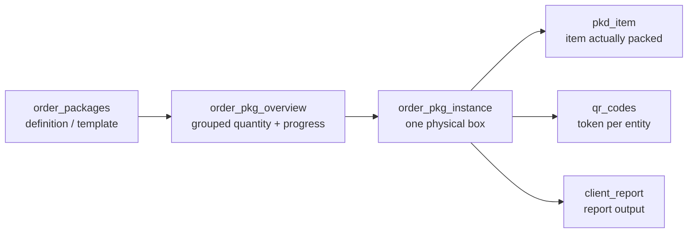

# Base de données model {#database-model}

Both applications share one Supabase project. This page describes that schema as
far as le dépôts peut establish it.

<Status
  type="verified"
  date="2026-08-20"
  sources={[
    'website:src/types/supabase.ts',
    'Mobile:supabase/migrations/20250121_add_team_lead_support.sql',
    'website:inspect_rpc.js',
    'website:inspect_instances.js',
    'Supabase project fqynbudvpvpiljdrrvem',
  ]}>
  Dépôt schema artifacts ont été vérifié against read-only live Supabase
  catalog queries. le generated types snapshot est confirmed stale; actuel
  live counts, RLS, Storage et trigger summaries sont recorded dans
  [Live backend verification](./live-verification).
</Status>

## Inventory {#inventory}

### Generated types snapshot {#generated-types-snapshot}

| Object kind | Count | Source |
| --- | --- | --- |
| Tables | **63** | generated types |
| Views | **3** | generated types |
| Fonctions | **49** | generated types |
| Enums | **8** | generated types |
| Foreign keys | **188** | generated types |

### Live project {#live-project}

| Object kind | Count | Source |
| --- | ---: | --- |
| Tables | **67** | live Supabase catalog |
| Views | **3** | live Supabase catalog |
| Fonctions | **83** | live Supabase catalog |
| Enums | **11** | live Supabase catalog |
| Non-internal triggers | **17** | live Supabase catalog |

Utilisé par application code but absent depuis le generated types et confirmed live:
`order_item_allocation`, `destinations`, `allocation_increase_requests`,
`signatures`.

Utilisé par `Mobile` but **ne** found live as a Storage bucket ou table:
`order_media`.

## le three views {#the-three-views}

`packer_availability_status`, `task_status_view`, `user_effective_permissions`.

`user_effective_permissions` est notable: non application code lit it directly,
but live RLS et helper fonctions do use le permission-flag system.

## Enums {#enums}

le only value sets le base de données itself constrains:

| Enum | Values |
| --- | --- |
| `project_type` | standard, maintenance, survey |
| `task_status` | in_progress, paused, completed |
| `packer_status` | available, busy, break |
| `maintenance_task_category` | survey, unpack, repack |
| `maintenance_package_type` | defensor, standard_box |
| `request_type` | material, material_variant, supplier_pricing |
| `request_action` | approved, rejected |
| `securing_side` | big_sides, small_sides, lid, base |

Live has three additional enums ne present dans le generated types:
`MediaCategory`, `maintenance_task_status`, et `material_type`. Live
`request_type` also inclut `allocation_increase`.

There est **non rôle enum**. Rôles sont rows dans a `roles` table — see
[Rôles et permissions](/docs/website/roles-and-permissions).

## Order lifecycle: two statut columns, neither constrained {#order-lifecycle-two-status-columns-neither-constrained}

`orders` has **non `status` column**. It has two:

```text
orders.production_status   plain string, no enum, no check constraint
orders.commercial_status   plain string, no enum, no check constraint
```

Parce que both sont unconstrained strings, **le base de données does ne enforce le
vocabulary**. Live values observed on 2026-08-20:

| Column | Live values |
| --- | --- |
| `production_status` | `completed`, `in_progress`, `on_hold`, `pending` |
| `commercial_status` | `approved`, `draft`, `invoiced` |

:::warning Cette correspondance est déduite de l usage; elle n est déclarée nulle part

le live vocabulary est now connu, but legal transitions sont still ne declared
anywhere. See [OQ-012](/docs/reference/open-questions#oq-012).

:::

## Key table shapes {#key-table-shapes}

Lu depuis le generated types snapshot.

```text
profiles(id, role_id NOT NULL, status NOT NULL, client_id, current_order_id,
         packer_status, username, full_name, phone_number, avatar_url,
         created_at, updated_at)

roles(id, name, can_manage_roles, can_ban_users, can_block_users,
      can_delete_profiles, can_reset_passwords, can_unblock_users,
      created_at, updated_at)

orders(id, client_id, order_name, reference, production_status,
       commercial_status, project_type, project_lead_id, description,
       start_date, completion_date, total_estimated_cost, total_actual_cost,
       total_transportation_cost, created_by, created_at, updated_at)

order_team_members(id, order_id, packer_id, is_team_lead, created_at)

packer_sessions(id, order_id, packer_id, session_active, team_selected,
                attendance_completed, packaging_started,
                order_name, client_name, project_lead_name,
                created_at, updated_at)

attendance_logs(id, order_id, packer_id, log_date, shift_period,
                start_time, end_time, status, is_project_start,
                toolbox_briefing_completed, created_at, updated_at)

temporary_privileges(id, user_id, granted_role_id, granted_by, granted_at,
                     expires_at, is_active, reason, created_at, updated_at)

qr_codes(id, token, entity_type, entity_id, is_active, created_at)

audit_log(id, entity_type, entity_id, action_type, column_name,
          old_value, new_value, changed_by, change_time,
          order_id, order_package_id, is_critical_alert, notes)

media(id, image_url, designation, notes, order_package_id,
      order_pkg_instance_id, package_item_id, pkd_item_id,
      task_log_id, maintenance_task_log_id, created_at)
```

Three things worth internalising:

- **`profiles.current_order_id`** exists, which est how "one active order per
  packer" peut be enforced at le row level. Whether a trigger enforces it est
  **unverified**.
- **`media` has six nullable parent columns.** It attaches vers whichever entity
  est set — a loose polymorphic pattern avec non discriminator column.
- **`packer_sessions` denormalises** `order_name`, `client_name` et
  `project_lead_name`. Those copies peut drift depuis their sources; nothing dans
  source shows what keeps them fresh.

## le package model — four distinct layers {#the-package-model-four-distinct-layers}

Conflating these est le most common source de reporting bugs.



`order_pkg_instance` carries `ipac_reference`, `instance_number`,
`destination`, `tag`, `packed_at` et `packed_by` — vérifié depuis
<SourceRef repo="website" path="inspect_instances.js" /> and from the report
conflict log. `packed_at` est le field le reporting date logic hinges on; see
[W6](/docs/workflows/w6-packing-evidence).

## Relationships {#relationships}

188 foreign keys sont declared. le most-referenced parents indicate where le
schema's gravity lies:

| Parent | Inbound FKs |
| --- | --- |
| `profiles` | 28 |
| `order_packages` | 16 |
| `orders` | 12 |
| `clients` | 7 |
| `material_variants` | 6 |
| `client_report` | 6 |
| `units_of_measure` | 6 |

`profiles` being le most-referenced table, et being lu par both applications
on every sign-dans, makes it le highest-risk table dans le system vers change.

## Fonctions {#functions}

49 sont declared. **24 de them sont called par neither application:**

`approve_material_variant_request`, `approve_supplier_pricing_request`,
`can_be_project_lead`, `complete_assignments_for_packers`,
`count_order_team_leads`, `deactivate_expired_privileges`, `debug_user_info`,
`decrement_item_packed_qty`, `delete_tasks_for_order_packages`,
`get_active_tasks_for_packers`, `get_busy_packers`, `get_order_progress`,
`get_order_team_leads`, `get_user_role`, `increment_item_packed_qty`,
`mark_order_package_packed`, `order_has_team_lead`,
`packer_needs_daily_attendance`, `refresh_order_pkg_overview_rollup`,
`remove_self_from_order`, `unpack_order_package`, `user_assigned_to_order`,
`user_has_permission`, `validate_box_completion`.

Some sont plausibly trigger bodies ou scheduled jobs — `deactivate_expired_privileges`
et `refresh_order_pkg_overview_rollup` lu that way. **This est inference, ne
preuve.** Their statut est [OQ-013](/docs/reference/open-questions#oq-013).

Source-era signature, depuis <SourceRef repo="website" path="inspect_rpc.js" />:

```text
fetch_report_instances(p_client_id, p_order_ids, p_date_from, p_date_to,
                       p_date_mode, p_destinations, p_has_items_only, p_tag_ids)
```

le live project has three overloads. le newest overload adds `p_tag_ids` et
utilise `COALESCE(order_pkg_instance.packed_at, MAX(pkd_item.created_at))` pour
completion-style date modes. `item_packed_at` est retained as a legacy alias pour
completion; `packing_started_at` utilise le first packed item timestamp. See
[Live backend verification](./live-verification#report-date-logic).

## le only RLS et fonctions written down anywhere {#the-only-rls-and-functions-written-down-anywhere}

depuis <SourceRef repo="Mobile" path="supabase/migrations/20250121_add_team_lead_support.sql" />
— exact, et le only such preuve dans either dépôt:

**Schema:** `order_team_members.is_team_lead BOOLEAN DEFAULT FALSE`, plus a
partial index `idx_order_team_members_team_lead (order_id, packer_id) WHERE is_team_lead = TRUE`.
An `ON CONFLICT (order_id, packer_id)` clause implies a unique constraint on
that pair.

**Three `SECURITY DEFINER` fonctions**, each `GRANT EXECUTE ... TO authenticated`:
`is_team_lead_for_order`, `assign_team_lead`, `can_user_mark_attendance`.

`can_user_mark_attendance` grants quand le caller's rôle est `admin` ou
`director` **et** `profiles.status = 'active'`, ou quand le caller est team lead
pour that order.

**RLS policies pour two tables** — `attendance_logs` et `packer_sessions`:
manage pour admin/director/team-lead, `SELECT` own rows pour packers.

:::warning La policy source diffère de la production

le `packer_sessions` manage policy est predicated on
`orders.status IN ('pending','in_progress')`. `orders` has non `status` column dans
le schema snapshot, et non application code lit one. Live verification shows
production differs depuis le fichier: le live policy utilise
`orders.production_status IN ('pending','in_progress')`.

This proves le dépôt migration est ne le full source de truth pour RLS.
Avant changing packer session behaviour, lu
[Live backend verification](./live-verification#high-signal-live-policy-facts).

:::

## What est deliberately ne on this page {#what-is-deliberately-not-on-this-page}

Non table-par-table column reference et non full policy body catalogue. Those would
rot quickly si copied into prose. Regenerating them depuis le base de données est le right
answer — see [Schema provenance](./schema-provenance).

