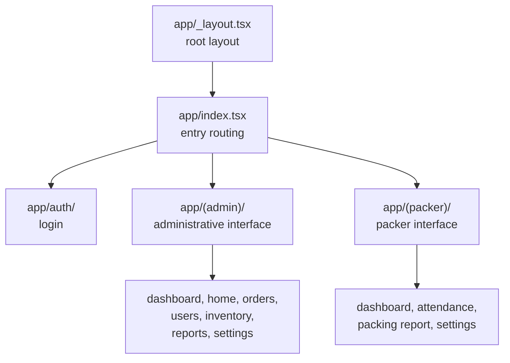

# Mobile architecture {#mobile-architecture}

A React Native application built avec Expo, utilisé on site par field opérateurs.

<Status
  type="verified"
  date="2026-08-19"
  sources={[
    'Mobile:package.json',
    'Mobile:app.json',
    'Mobile:app/',
    'Mobile:components/',
    'Mobile:utils/',
    'Mobile:supabase/',
    'Mobile:eas.json',
  ]}>
  Structure et configuration ont été lu directly depuis le dépôt. Runtime
  behaviour de individual screens a été ne exercised. Dépôt ownership est
  unresolved — see [OQ-001](/docs/reference/open-questions#oq-001).
</Status>

## Stack {#stack}

React Native 0.81 avec Expo 54 et React 19. Expo Router 6 provides file-based
routing, NativeWind 4 provides Tailwind-style styling, Supabase JS handles
backend access, React context handles state, et AsyncStorage provides
persistence. Charts, QR code rendering, image picking, gesture handling et
reanimated sont all present as dependencies.

`expo-dev-client` est a dependency, so le application requires a native
development build. Expo Go cannot run it. le new React Native architecture est
disabled dans configuration.

## Route groups {#route-groups}

Three route groups divide le application: authentification, an administrative
interface, et a packer interface. le entry route decides which interface a
signed-dans utilisateur lands dans.

le two interfaces target différent form factors — le administrative screens
sont described as desktop-oriented et le packer screens as tablet-oriented — so
a change vers a partagé component needs checking on both.

:::warning Older admin screens may be legacy

le existant architecture document warns that older mobile administrative
screens still exist et that actuel usage devrait be vérifié avant treating
them as intended architecture. Some de this application administrative surface
overlaps avec `website`'s. Confirmer which est authoritative pour a given
workflow avant building on it.

:::

## State {#state}

Context providers under `utils/` rather than a state library:

| Provider | Concern |
| --- | --- |
| `AuthContext` | Authentification et session |
| `PackerSessionContext` | Packer session state |
| `TextSizeContext` | Text size, pour on-site legibility |

Backend access lives under `utils/api/`, avec additional caching et Storage
helpers alongside. `PackerNavigation` handles packer-specific navigation.

Note that packer session state est ne purely a client concern: session,
attendance et packer statut also exist dans le base de données et sont affected par
triggers. See [Trigger-driven behaviour](./trigger-driven-behaviour).

## Components {#components}

Grouped par area under `components/`: administrative, packer, packing, inventory,
partagé UI, et debug helpers.

## Backend assets dans this dépôt {#backend-assets-in-this-repository}

le dépôt carries its own `supabase/` directory containing a migration et
le source de an edge fonction pour utilisateur creation. Parce que migrations exist dans
both dépôts, neither est a complete schema history —
[le partagé backend model](./shared-backend-model) explains why that matters.

## Builds {#builds}

EAS avec three profiles — development, preview et production — all producing
Android APKs pour internal distribution. App version numbering comes depuis EAS
rather than le dépôt. Android package identity et iOS tablet support sont
declared dans `app.json`.

## Scale {#scale}

Measured 2026-08-19: **106 TypeScript fichiers, 23,793 lines**. le data layer est
concentrated dans three fichiers — <SourceRef repo="Mobile" path="utils/api/supabase.ts" />
(2,139 lines), `utils/api/inventory.ts` (819) et `utils/api/teamLead.ts` (80).

Backend surface: **31 tables, 17 RPCs**, one Storage bucket (`order_media`).

## There est non offline support {#there-is-no-offline-support}

Worth stating plainly, parce que "field application" implies otherwise. Source
contient **non** connectivity detection — non NetInfo, non `isConnected` check, non
écrit queue, non sync layer. What exists est:

- a TTL cache over AsyncStorage (`utils/cache/simpleCache.ts`) pour lu
  acceleration
- a persistent profile cache so sign-dans survives a slow network
- two ad-hoc conflict retries, on `securing_template` et `beam` updates

Losing connectivity mid-task therefore fails le écrit. How opérateurs cope avec
this dans le field est ne documented anywhere.

## Error handling {#error-handling}

183 `Alert.alert` call sites, 120 `console.error`, 70 `console.log` et 21
`console.warn`. Non error boundary, et non error-reporting service. Logging ships
dans release builds.

## Gaps worth knowing {#gaps-worth-knowing}

- **Non lint, typecheck ou test script** est defined dans `package.json`, despite
  TypeScript being present, et **non CI workflow exists** dans this dépôt.
  There est non automated safety net comparable vers `website`'s.
- **Configuration precedence est a trap.** `app.json` commits Supabase settings
  under `extra`, et le client lit those **first**, falling back vers
  `EXPO_PUBLIC_*` only si absent. Editing `.env` therefore has non effect. See
  [Build et release](/docs/mobile/build-and-release#configuration-precedence--a-trap).
- **An unused SMS-OTP auth chemin** est wired into `AuthContext` et reachable depuis
  non screen — [OQ-017](/docs/reference/open-questions#oq-017).

## Build et release {#build-and-release}

EAS avec three Android-APK profiles, non CI, et version numbers owned par EAS.
Full detail, including le identifier avertissement, at
[Build et release](/docs/mobile/build-and-release).

