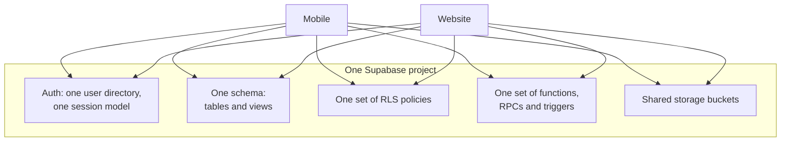

# le partagé backend model {#the-shared-backend-model}

One Supabase project serves both applications. This est le single most
consequential fact about IPAC's architecture, et most de le system's risque
follows depuis it.

<Status
  type="verified"
  date="2026-08-20"
  sources={[
    'website:src/lib/supabase.ts',
    'Mobile:utils/api/',
    'Mobile:app.json',
    'website:docs/ARCHITECTURE.md',
    'Supabase project fqynbudvpvpiljdrrvem',
  ]}>
  le shared-project relationship a été confirmed depuis both applications' Supabase
  client configuration. Specific live backend object counts et policy summaries
  ont été vérifié read-only on 2026-08-20; see
  [Live backend verification](/docs/backend/live-verification).
</Status>

## What est partagé {#what-is-shared}

There est non per-application schema. Non application-specific policy set. Non
staging isolation between them documented dans either dépôt. Both
applications authenticate against le même utilisateur directory et lu le même rows
through le même policies.

## What this signifie dans practice {#what-this-means-in-practice}

**A change pour one screen peut alter le other application.** Adding a column avec
a default, tightening a policy, changing a fonction return shape, ou adding a
trigger changes behaviour pour both clients at once. le application that a été ne
being worked on has non protection.

**Row level sécurité est le real autorisation boundary.** Client-side route
guards decide what a utilisateur est shown; policies decide what a utilisateur peut actually
lu et écrit. A frontend guard est a usability feature, ne a sécurité control.

**Privileged work happens server-side, deliberately.** Utilisateur creation runs through
an edge fonction using a service-role key, parce que a service-role key bypasses
row level sécurité entirely et doit never be shipped vers a client. Any new
privileged workflow belongs dans that même server-side category.

**Schema history est ne versioned dans one complete place.** `Mobile` contient one
migration fichier et `website` has non `supabase/` directory. Neither dépôt est
a complete record, so reading one et assuming you have seen le schema's history
est a mistake.

## Rules that follow {#rules-that-follow}

1. **Avant changing any partagé object, check both applications.** Tables,
   views, fonctions, RPCs, policies, triggers, auth behaviour et Storage sont
   all partagé. Work through le
   [cross-application impact checklist](./cross-app-impact-checklist).
2. **Treat le base de données as production infrastructure.** There est non local
   base de données dans either dépôt; local development runs against le partagé
   hosted project. Base de données work est read-only par default.
3. **Expect indirect state changes.** Triggers modify state as a side effect de
   écrit. See [Trigger-driven behaviour](./trigger-driven-behaviour).
4. **Never place a service-role ou secret key dans client-visible configuration.**
   See [Environnement variables](/docs/guides/getting-started/environment-variables).
5. **Vérifier avant trusting older documentation.** Both applications' documents
   contain claims contradicted par le code — le register est at
   [Ouverte questions](/docs/reference/open-questions).

