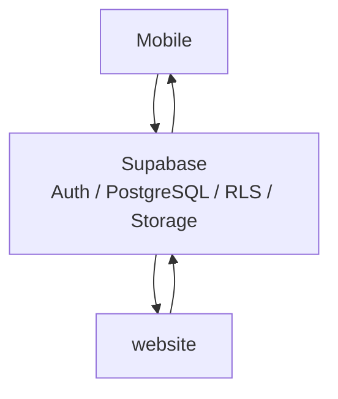

<header>
# Architecture système
</header>

<Status type="verified" date="2026-08-19">
  Cette page localisée garde les diagrammes et identifiants techniques inchangés.
</Status>

IPAC combine deux clients applicatifs avec un backend Supabase partagé :

| Couche | Responsabilité |
| --- | --- |
| Mobile | Opérations terrain, écrans admin et packer. |
| website | Gestion, administration et vues client restreintes. |
| Supabase | Auth, PostgreSQL, RLS, Storage, RPC / Functions. |

## Point central

Le backend partagé est la contrainte architecturale principale. Les changements de schema, RLS, RPC, Storage ou roles doivent être considérés comme cross-app par défaut.

