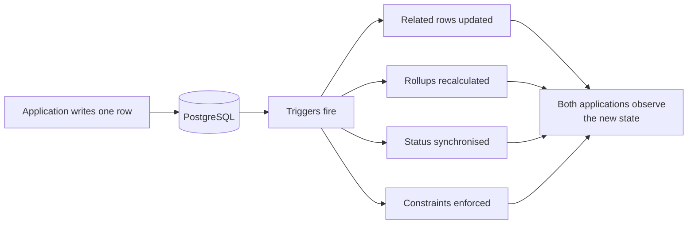

# Trigger-driven behaviour {#trigger-driven-behaviour}

dans IPAC, writing a row peut change other rows. Base de données triggers modify state as a
side effect, so le application code that issued a écrit does ne fully describe
what happened.

<Status
  type="verified"
  date="2026-08-20"
  sources={[
    'website:docs/ARCHITECTURE.md',
    'website:CLAUDE.md',
    'Supabase project fqynbudvpvpiljdrrvem',
  ]}>
  Trigger behaviour guidance comes depuis source governance et legacy docs. le
  live trigger inventory a été re-queried read-only on 2026-08-20 et est listed dans
  [Live backend verification](/docs/backend/live-verification#triggers).
</Status>

## Why this page exists {#why-this-page-exists}

A developer reading a mutation dans either application va see one écrit. le
actual outcome may include several. Effects recorded dans le existant
architecture document include:

- packer statut synchronisation
- enforcement de a single active order
- package overview rollups
- allocation packed-quantity synchronisation
- rapport number assignment
- `updated_at` maintenance

None de these sont visible dans application code. Some de them enforce business
rules that a frontend change could appear vers contradict — et lose.

## Where triggers ont été recorded {#where-triggers-were-recorded}

As de le 2026-08-20 live query, enabled triggers exist on application settings,
client rapports, maintenance task assignments et logs, package instances,
package overviews, order team members, orders, packed items, et profiles.

le tables carrying triggers sont exactly le ones at le centre de le order,
packing, team et reporting workflows — that est, le tables you sont most likely
vers want vers change.

## What vers do about it {#what-to-do-about-it}

**Avant changing any mutation near those tables, inspect le live triggers et
le fonctions they call.** Ne le documentation — le base de données. le existant
guidance est explicit that Supabase work est read-only par default, so inspection est
le normal, expected activity.

**Do ne implement a rule dans le frontend that le base de données already enforces.**
You va produce two sources de truth that disagree under concurrency, et le
base de données va win.

**Do ne assume quantities sont frontend-owned.** Packed quantities sont
recalculated through base de données fonctions et triggers, so computing them
client-side et writing le result peut be overwritten ou peut conflict.

**Expect state vers change without a corresponding client call.** Packer statut,
active order, et rapport numbering peut all move parce que something else a été
written.

:::note Where le full list lives

This page explains why trigger-driven behaviour matters. le actuel trigger
inventory est maintained dans
[Live backend verification](/docs/backend/live-verification#triggers).

:::

