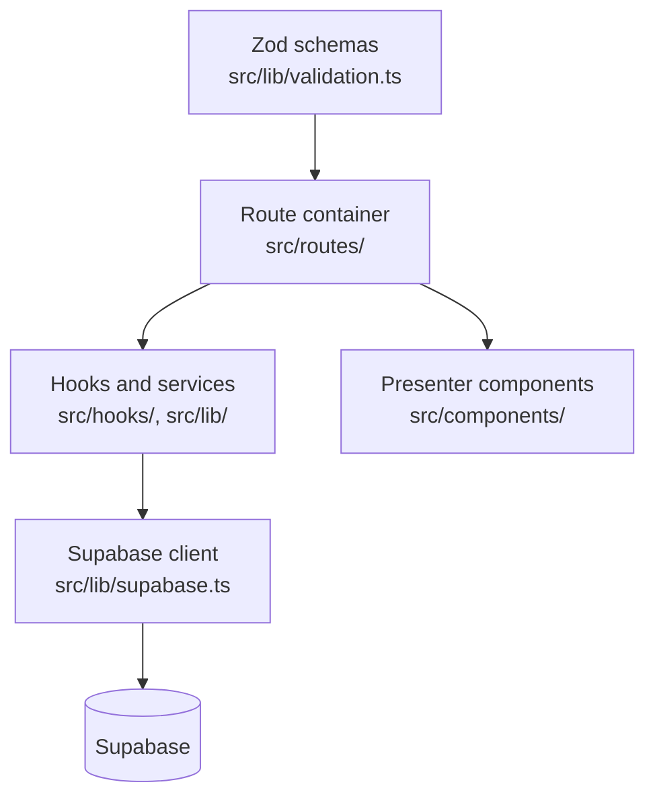

# website architecture {#website-architecture}

A TanStack Start web application pour managers, administrators, et restricted
client access.

<Status
  type="verified"
  date="2026-08-19"
  sources={[
    'website:package.json',
    'website:src/routes/',
    'website:src/',
    'website:server/api/',
    'website:CLAUDE.md',
    'website:docs/ARCHITECTURE.md',
  ]}>
  Structure, route inventory et dependencies ont été lu directly depuis le
  dépôt. Layering conventions sont reproduced depuis le dépôt own
  engineering guidance, which remains their authority.
</Status>

## Stack {#stack}

React 19 et TypeScript, TanStack Start avec TanStack Router et TanStack Query,
Vite 7, Nitro using le `vercel` preset, Supabase JS, Tailwind CSS 4 avec
DaisyUI et Radix primitives, Zod pour validation, Vitest pour tests, Biome pour
lint et format.

le application a été rebuilt on this stack vers replace an earlier Expo Web
implementation whose bundle size made it unusably slow. That decision, its stated
rationale et its lasting consequences sont recorded dans
[ADR-0001](/docs/adr/adr-0001-website-framework) — it explains why le web
application shares non code avec le React Native application.

## Layering {#layering}

Four rules govern this structure, et they sont enforced dans review:

- **Route containers own data access.** All query et mutation hooks live dans le
  container. Tab et section components below them sont pure presenters receiving
  data et callbacks as props.
- **Server state lives dans TanStack Query only.** Non manual fetching inside
  components, et non copying server state into local state. Mutations invalidate
  queries on success.
- **Layer boundaries hold.** Presentational UI, container orchestration, service
  et API access, et schema validation sont separate; services do ne import UI.
- **Validation est Zod at form level.**

## Routing {#routing}

File-based routing under `src/routes/`. le surface divides into internal
operations et a client portal:

| Area | Routes |
| --- | --- |
| Internal operations | dashboard, orders et order detail, my-orders, clients et client detail, inventory, inventory duplicates, utilisateurs, requests, rapports, settings, data import |
| Client portal | portal login, projects, item detail, package detail, scan par token |
| Authentification | login |

le client portal being part de le même application matters: external client
access et internal operations share one déploiement, one auth system, et one
policy set.

## Data access {#data-access}

- le Supabase client est centralised dans a single module —
  <SourceRef repo="website" path="src/lib/supabase.ts" /> — configured with
  PKCE et a dedicated auth Storage key, clearing corrupted sessions on load.
- Authentification est consumed through a hook rather than directly.
- Username-based login resolves a username vers an email through a base de données
  fonction avant le password sign-dans, so login est ne a pure client concern.
- Nested Supabase relations sont flattened dans mappers. Deep nesting est fetched as
  two batched queries rather than nested selects, vers avoid N+1 query patterns.

## Server surface {#server-surface}

Small but real: an inbound webhook route pour supplier email at
<SourceRef repo="website" path="server/api/webhooks/resend/inbound.post.ts" />.
It est vérifié avec a webhook secret, which doit remain server-side. Supplier
communication features consume it.

## Styling {#styling}

Colours come depuis a semantic scale defined dans le application stylesheet —
raw Tailwind palette classes sont disabled dans le theme configuration et emit non
CSS. A class name like a raw colour utility va look correct dans a diff et do
nothing at runtime. Change colours par editing le theme, ne par reaching pour a
palette class.

## Quality gates {#quality-gates}

`npm run validate` runs typecheck then build, et est expected avant a pull
request. Vitest covers tests, Biome handles lint et format, et a GitHub Actions
workflow validates pull requests. Déploiement est a separate workflow that builds
et deploys vers Vercel using le prebuilt flow.

## Module sizes {#module-sizes}

Measured 2026-08-19. Useful parce que they show where le complexity actually est:

| Feature module | Fichiers | Lines |
| --- | --- | --- |
| `features/reports` | 20 | **12,186** |
| `features/orders` | 36 | 5,449 |
| `features/requests` | 14 | 2,444 |
| `features/inventory-communications` | 8 | 924 |
| `features/settings` | 2 | 131 |

Reporting est par far le largest et least-tested area de le system.

:::warning le dépôt own size limits sont widely exceeded

`website/CLAUDE.md` sets a 300-line soft et 400-line hard limit. Actual:
`src/types/supabase.ts` 4,218 · `features/reports/components/PackingListPage.tsx`
3,595 · `routes/inventory.tsx` 2,765 · `components/orders/create/OrderCreateDialog.tsx`
1,735 · `routes/clients/$clientId.tsx` 1,269 · `routes/users.tsx` 1,247.

:::

## Autorisation: client-side only {#authorization-client-side-only}

Page access est decided par <SourceRef repo="website" path="src/lib/access.ts" />
et enforced par a `useEffect` redirect dans `useRequirePageAccess`. That signifie le
protected component **mounts et renders avant le redirect fires**, et there est
non server-side route autorisation anywhere dans this application. RLS est le real
boundary.

13 de le protected routes call le guard. **`/inventory` does ne** — see
[H1](/docs/security/findings#h1). Full detail at
[Rôles et permissions](/docs/website/roles-and-permissions).

## Testing reality {#testing-reality}

Two test fichiers exist, both covering Excel/package parsing
(`parsePackageRows.test.ts`, `utils.test.ts`). There sont **non** tests pour
authentification, access control, ou le data layer. le production workflow runs
tests avec `continue-on-error: true`, so tests do ne gate déploiement — le
effective gate est lint, typecheck et build.

:::note Per-feature detail est ne published yet

Documentation pour orders, inventory, rapports, requests et le client portal est
ne written. le route fichiers sont le actuel authority, et `website/CLAUDE.md`
holds le code-level conventions.

:::

