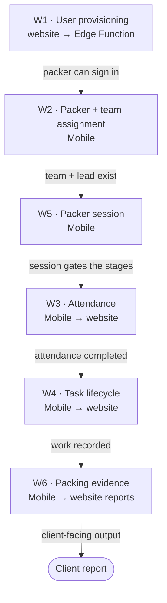

# Workflows {#workflows}

Six workflows sont documented here. Each one **crosses both applications** —
either an actor dans one produces state le other consumes, ou le même table est
written par one et remediated par le other. These sont le processes nobody peut
reconstruct depuis a single dépôt.

<Status
  type="partial"
  date="2026-08-19"
  sources={[
    'Mobile:utils/api/supabase.ts',
    'Mobile:utils/PackerSessionContext.tsx',
    'Mobile:supabase/functions/create-user/index.ts',
    'website:src/features/orders/',
    'website:src/features/reports/',
    'website:Trail/packed-date-report-conflict-log.md',
  ]}>
  Each workflow est reconstructed depuis le base de données calls both applications
  actually make. **Actors sont inferred depuis route guards**, which est source
  preuve, ne a statement de company process. Where a business rule est asserted,
  it est cited. Nothing here describes intent that source does ne show.
</Status>

## How vers lu these pages {#how-to-read-these-pages}

Every workflow page utilise le même six-part structure:

```text
Actor      →  who initiates it, per the route guards that let them in
Application→  which app the action happens in
Action     →  what the user does
Database   →  tables and RPCs touched
Result     →  the business outcome
Cross-app  →  what the other application now sees, and what can break
```

## le chain {#the-chain}



`W5` est le spine on le Mobile side: le packer session tracks which stage de le
day a packer est dans, et le other Mobile workflows advance it.

## le six workflows {#the-six-workflows}

| | Workflow | Actor | Direction |
| --- | --- | --- | --- |
| [W1](./w1-user-provisioning) | Utilisateur provisioning | admin / director | website → backend → Mobile |
| [W2](./w2-packer-team-assignment) | Packer et team assignment | admin / director / sales | Mobile ↔ website |
| [W3](./w3-attendance) | Attendance | packer, team lead | Mobile → website |
| [W4](./w4-task-lifecycle) | Task lifecycle | packer | Mobile → website |
| [W5](./w5-packer-session) | Packer session | packer | Mobile (website peut force-release) |
| [W6](./w6-packing-evidence) | Packing preuve et rapport dates | packer, then reporting utilisateur | Mobile → website |

## Workflows deliberately ne documented yet {#workflows-deliberately-not-documented-yet}

These exist dans source but sont **website-only** et ont été ne part de this pass:
item allocation, package instances et packed items, le client portal et QR
scanning, material/pricing request approvals, et supplier email ingestion.

Also absent, et **ne vers be written without live verification ou product input**:
le maintenance subsystem (its tables et enums exist but neither application
calls them), cost calculation, et le `transportation`, `services` et
`report_batch` tables.

