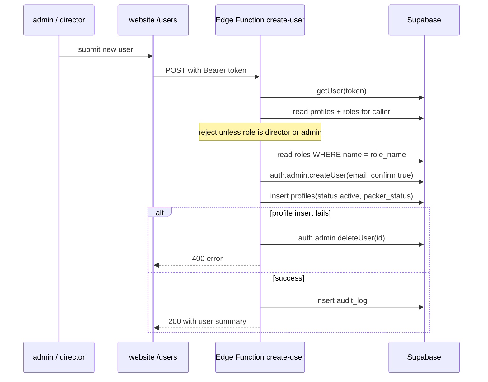

# W1 — Utilisateur provisioning {#w1-user-provisioning}

le only workflow that creates le identity both applications depend on.

<Status
  type="verified"
  date="2026-08-19"
  sources={[
    'Mobile:supabase/functions/create-user/index.ts',
    'website:src/routes/users.tsx',
    'Mobile:Trail/login-hashir-1.md',
  ]}>
  le Edge Function a été lu line par line. le failure mode documented at le
  bottom est reproduced depuis an incident log written par le developer who
  diagnosed it.
</Status>

## le flow {#the-flow}

| Step | Detail |
| --- | --- |
| **Actor** | `admin` ou `director` — enforced par le Edge Function, ne just le UI |
| **Application** | `website`, `/users` |
| **Action** | Submit a new utilisateur: email, password, full name, username, phone number, rôle name |
| **Base de données** | Edge Function `create-user` using a **service-role key**: `auth.admin.createUser` → `profiles` insert → `audit_log` insert. Lit `roles` vers resolve le rôle name vers an id |
| **Result** | An account that peut sign dans vers either application, avec a rôle that determines where it lands |
| **Cross-app** | le new `profiles` row est immediately authoritative pour **both** applications. A packer créé here peut sign dans vers Mobile avec non further step |

## What le fonction sets {#what-the-function-sets}

- `email_confirm: true` — non verification email; le account est usable immediately.
- `profiles.status = 'active'`.
- `profiles.packer_status = 'available'` quand le rôle est `packer`, otherwise null.
- An `audit_log` row avec `entity_type: 'profile'`, `action_type: 'INSERT'`,
  `changed_by` = le caller, et a note naming le creating utilisateur.

## Autorisation {#authorization}

le fonction permits **`director` ou `admin` only**. Notably it also selects
`roles.can_manage_roles` et then **never utilise it** — le decision est a hardcoded
role-name comparison. See
[Rôles et permissions](/docs/website/roles-and-permissions#permission-flags-are-database-side-only).

Any rôle name present dans le `roles` table peut be **assigned**, parce que le
fonction looks le name up rather than validating against a list. Live assignable
rôles sont `admin`, `client`, `executive`, `packer`, et `sales`; `director` est
vérifié as a creator rôle dans source but does ne exist as a live rôle row.

## Direct SQL provisioning breaks sign-dans {#direct-sql-provisioning-breaks-sign-in}

:::danger Do ne create utilisateurs avec raw SQL

An account créé par inserting directly into `auth.users` **va fail vers sign
dans**, avec le misleading error `Database error querying schema` — et only quand
le *correct* username est utilisé. A wrong username still returns "invalid
credentials", which makes it look like a password problem rather than a malformed
account.

:::

le root cause est a manquant `auth.identities` row plus two columns left `NULL`
where GoTrue requires empty strings. le full diagnosis, le fix that worked, et
le fixes vers avoid sont documented as a dépannage entry:

**→ [Dépannage A1 — Login fails avec "Base de données error querying schema"](/docs/troubleshooting/authentication#a1)**

le point pour this workflow est narrower: **use le Edge Function.** It est le only
chemin that applies le rôle check et écrit `audit_log`.

## Why this matters beyond one incident {#why-this-matters-beyond-one-incident}

Provisioning outside le Edge Function skips its rôle check **et** its
`audit_log` écrit. `audit_log` therefore cannot be trusted as a complete record
de utilisateur creation — at least one account est connu vers have bypassed it. Recorded as
[H5](/docs/security/findings#h5)
et [OQ-019](/docs/reference/open-questions#oq-019).

## Next action {#next-action}

A newly créé packer cannot do anything until assigned vers an order —
[W2](./w2-packer-team-assignment).

