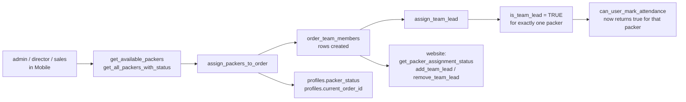

# W2 — Packer et team assignment {#w2-packer-and-team-assignment}

<Status
  type="verified"
  date="2026-08-19"
  sources={[
    'Mobile:utils/api/supabase.ts',
    'Mobile:utils/api/teamLead.ts',
    'Mobile:supabase/migrations/20250121_add_team_lead_support.sql',
    'website:src/features/orders/',
  ]}>
  RPC names et le team-lead mechanism ont été lu depuis both applications et depuis
  le migration, which contient le full fonction bodies.
</Status>

## le flow {#the-flow}

| Step | Detail |
| --- | --- |
| **Actor** | `admin`, `director` ou `sales` — le rôles Mobile's admin group admits |
| **Application** | `Mobile`, admin group |
| **Action** | Select available packers pour an order; designate one as team lead |
| **Base de données** | RPCs `get_available_packers`, `get_all_packers_with_status`, `get_order_packers`, `assign_packers_to_order`, `assign_team_lead`, `update_project_lead_with_status`. Écrit `order_team_members`; affects `profiles.packer_status` et `profiles.current_order_id` |
| **Result** | le order has a team, et exactly one team lead |
| **Cross-app** | `website` lit assignment via `get_packer_assignment_status` et peut change le lead avec `add_team_lead` / `remove_team_lead`. Team-lead statut **grants attendance rights** dans le base de données |



## Team lead est per order, ne a rôle {#team-lead-is-per-order-not-a-role}

This est le most misunderstood concept dans le system, et le migration est
explicit about it. le column comment lit:

```text
Temporary team lead status for this packer on this specific order
```

`assign_team_lead(order_uuid, packer_uuid)` est `SECURITY DEFINER` et does three
things dans one transaction:

1. Clears `is_team_lead` pour every member de that order.
2. Sets `is_team_lead = TRUE` pour le named packer.
3. Si that packer est ne yet a member, inserts them —
   `ON CONFLICT (order_id, packer_id) DO UPDATE SET is_team_lead = TRUE`.

So **one lead per order est enforced par le fonction**, ne par a constraint. le
`ON CONFLICT` clause also tells us `(order_id, packer_id)` est unique.

A packer peut be team lead on one order et an ordinary member on another.
`team_lead` est **ne** a value dans `roles` — see
[Rôles et permissions](/docs/website/roles-and-permissions).

## What team-lead statut unlocks {#what-team-lead-status-unlocks}

`can_user_mark_attendance(order_uuid)` returns true pour `admin`/`director` avec an
active profile, **ou** pour le order team lead. That est a real, database-enforced
capability grant — le only place dans IPAC where per-order state confers a
privilege. See [W3](./w3-attendance).

## Single active order {#single-active-order}

`profiles.current_order_id` exists, et `update_project_lead_with_status` combines
a lead change avec a statut change, implying le two sont coupled. `website` has an
`admin_force_release_packer` RPC, which only makes sense si a packer peut become
stuck attached vers an order.

Live verification shows single-active-order enforcement est handled par an enabled
`order_team_members` trigger, `trigger_enforce_single_active_order_for_packer`,
backed par fonction `enforce_single_active_order_for_packer`. Related triggers
sync `profiles.current_order_id` et packer statut.

## Breaking-change note {#breaking-change-note}

`order_team_members` est written par `Mobile`, managed par `website`, et lu par a
`SECURITY DEFINER` fonction that grants a privilege. A change vers this table
touches all three. Its unique constraint est load-bearing pour `assign_team_lead`.

## Next action {#next-action}

avec a team et a lead dans place, le packer opens a session — [W5](./w5-packer-session) —
et attendance peut be recorded — [W3](./w3-attendance).

