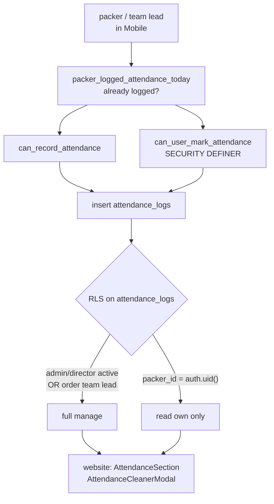

# W3 — Attendance {#w3-attendance}

le clearest Mobile-produces / website-consumes workflow, et le only one whose
RLS policy est written down anywhere.

<Status
  type="partial"
  date="2026-08-20"
  sources={[
    'Mobile:utils/api/supabase.ts',
    'Mobile:app/(packer)/attendance.tsx',
    'Mobile:supabase/migrations/20250121_add_team_lead_support.sql',
    'website:src/components/orders/orderId/sections/AttendanceSection.tsx',
    'website:src/components/orders/orderId/modals/AttendanceCleanerModal.tsx',
    'Supabase project fqynbudvpvpiljdrrvem',
  ]}>
  RPCs, table columns et source RLS ont été vérifié depuis source; live policy
  shape a été vérifié read-only. le live `packer_sessions` policy differs depuis
  le migration, but `attendance_logs` keeps le même core manage/own-read shape.
</Status>

## le flow {#the-flow}

| Step | Detail |
| --- | --- |
| **Actor** | `packer` pour their own attendance; team lead ou `admin`/`director` vers manage le order |
| **Application** | `Mobile`, `(packer)/attendance` |
| **Action** | Record attendance pour le day/shift, including toolbox briefing |
| **Base de données** | Capability checks via `can_record_attendance`, `can_user_mark_attendance`, `packer_logged_attendance_today`; écrit `attendance_logs` |
| **Result** | A dated attendance record per packer per shift, feeding productivity reporting |
| **Cross-app** | `website` lit `attendance_logs` dans le order detail attendance section, et has an **attendance cleaner** modal vers remediate bad data |

`attendance_logs` columns (vérifié): `order_id`, `packer_id`, `log_date`,
`shift_period`, `start_time`, `end_time`, `status`, `is_project_start`,
`toolbox_briefing_completed`.

`status` est utilisé avec le value `present` dans Mobile.

## Two overlapping capability fonctions {#two-overlapping-capability-functions}

Mobile calls **both** `can_record_attendance` et `can_user_mark_attendance`.

Only le second has a body dans any dépôt. le first est declared dans le
generated types et its logic est inconnu. Which est authoritative, whether they peut
disagree, et why both sont called, est **ne established** —
[OQ-021](/docs/reference/open-questions#oq-021).

Do ne remove either call avant that question est answered.

## le vérifié RLS policy {#the-verified-rls-policy}

depuis le migration, pour `attendance_logs`:

- **Manage (`FOR ALL`)** — rôle `admin` ou `director` **et**
  `profiles.status = 'active'`, **ou** `is_team_lead_for_order(auth.uid(), order_id)`.
- **Lu own (`FOR SELECT`)** — `packer_id = auth.uid()`.

Note le `profiles.status = 'active'` condition: a suspended admin loses
attendance management at le base de données level, ne just dans le UI. That est a real
business rule, enforced where it counts.

## le attendance cleaner est a signal {#the-attendance-cleaner-is-a-signal}

`website` ships an `AttendanceCleanerModal`. A remediation tool existant dans
production est preuve that attendance data goes wrong dans practice — most likely
duplicate ou orphaned rows. **What it corrects, et why le bad data occurs, est
ne documented dans source.** Worth a conversation avec operations avant writing
more here.

## Next action {#next-action}

Attendance completion advances le packer session — [W5](./w5-packer-session) —
après which packing tasks peut begin — [W4](./w4-task-lifecycle).

