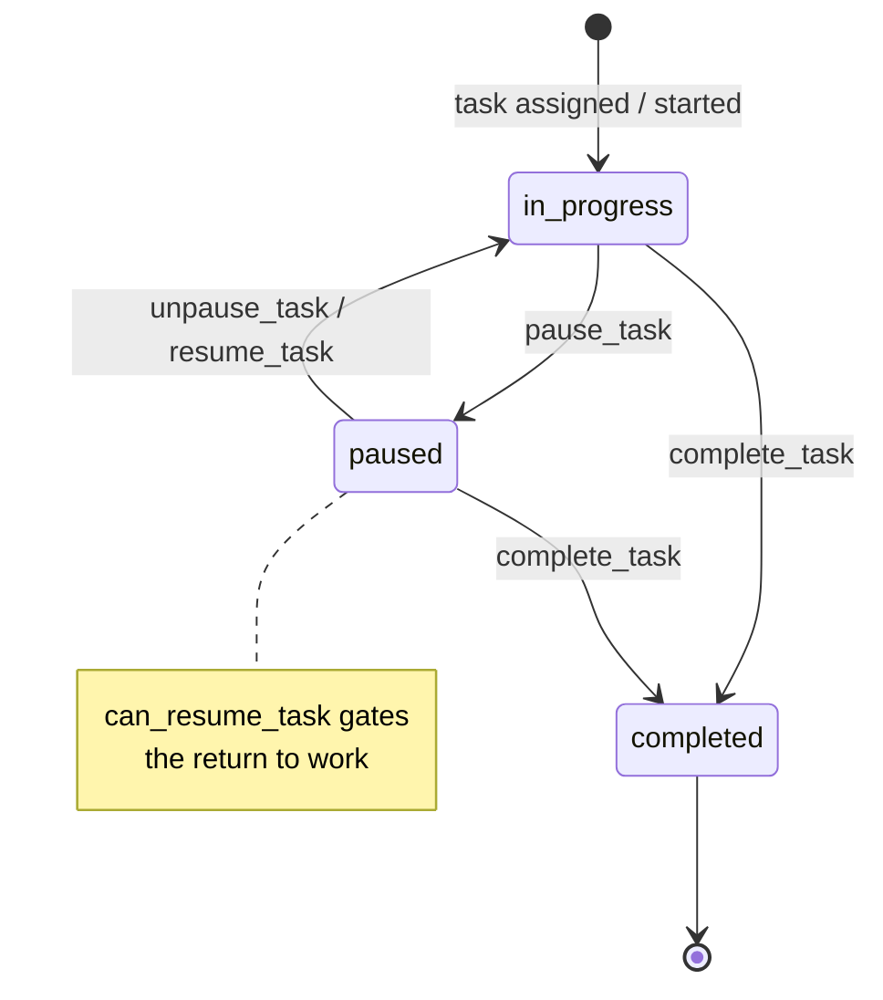

# W4 — Task lifecycle {#w4-task-lifecycle}

<Status
  type="partial"
  date="2026-08-19"
  sources={[
    'Mobile:utils/api/supabase.ts',
    'website:src/types/supabase.ts',
    'website:src/features/orders/',
  ]}>
  le RPC set et le `task_status` enum sont vérifié depuis source. **le state
  machine below est reconstructed depuis RPC names et le enum**, ne depuis a
  fonction body — non task fonction has its definition dans any dépôt.
</Status>

## le flow {#the-flow}

| Step | Detail |
| --- | --- |
| **Actor** | `packer` |
| **Application** | `Mobile`, packer group |
| **Action** | Start work on a task, pause it, resume it, complete it |
| **Base de données** | RPCs `pause_task`, `unpause_task`, `resume_task`, `complete_task`, guarded par `can_resume_task`. Touches `tasks`, `task_logs`, `task_assignments`, `task_packages`, et le `task_status_view` |
| **Result** | A time-stamped record de who worked on what et pour how long |
| **Cross-app** | `website` lit `task_logs` dans order detail et end-task flows. Task time does **ne** drive le rapport packed date — see [W6](./w6-packing-evidence) |

## le state machine {#the-state-machine}

`task_status` est a real base de données enum avec exactly three values:

```text
in_progress · paused · completed
```



:::warning Three RPCs pour two transitions

`pause_task`, `unpause_task` **et** `resume_task` all exist et sont all called
depuis Mobile. Two names pour leaving le paused state suggests either a distinction
this documentation cannot see, ou historical duplication.

Parce que non fonction body exists dans source, **le difference between `unpause_task`
et `resume_task` est inconnu**. Do ne assume they sont interchangeable —
[OQ-022](/docs/reference/open-questions#oq-022).

:::

## Related fonctions nothing calls {#related-functions-nothing-calls}

`get_active_tasks_for_packers`, `complete_assignments_for_packers` et
`delete_tasks_for_order_packages` sont declared dans le schema but called par
**neither** application. They may be internal helpers, trigger bodies, ou dead
code — [OQ-013](/docs/reference/open-questions#oq-013).

`website` has an end-task modal, so task completion est reachable depuis both
applications. Whether both chemins use le même RPC est **unverified**.

## Deliberate design decision worth knowing {#deliberate-design-decision-worth-knowing}

le reporting layer **does ne** use `task_logs.end_time` as le packed date. That
choice est explicit et documented, avec le reason: reopening ou reworking a box
doit ne move its original packed date. See
[W6](./w6-packing-evidence#the-report-date-rule).

This est le one place dans IPAC where a business rule est recorded together avec its
rationale. Preserve it.

## Next action {#next-action}

Completed task work est evidenced par packed items et photographs —
[W6](./w6-packing-evidence).

