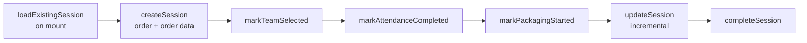

# W5 — Packer session {#w5-packer-session}

le spine de le Mobile packer experience: a session record that advances through
stages as le day progresses.

<Status
  type="verified"
  date="2026-08-19"
  sources={[
    'Mobile:utils/PackerSessionContext.tsx',
    'website:src/types/supabase.ts',
  ]}>
  le stage fonctions ont été lu directly depuis le context provider, et le table
  columns depuis le schema snapshot. le two correspond exactly.
</Status>

## le flow {#the-flow}

| Step | Detail |
| --- | --- |
| **Actor** | `packer` |
| **Application** | `Mobile`, packer group |
| **Action** | Ouverte a session against le assigned order, then advance it stage par stage |
| **Base de données** | `packer_sessions` — `session_active`, `team_selected`, `attendance_completed`, `packaging_started`, plus denormalised `order_name`, `client_name`, `project_lead_name` |
| **Result** | le application knows which stage de le day le packer est dans, et peut resume correctly après a restart |
| **Cross-app** | `website` peut call `admin_force_release_packer` vers break a stuck session |

## le six stages {#the-six-stages}

depuis <SourceRef repo="Mobile" path="utils/PackerSessionContext.tsx" />:

Each `mark*` fonction sets one boolean, so le session doubles as a checklist: a
packer who restarts le app resumes at le stage they reached rather than starting
over.

## Denormalised fields drift {#denormalised-fields-drift}

`packer_sessions` stores copies de `order_name`, `client_name` et
`project_lead_name` alongside `order_id`. These sont snapshots taken at session
creation.

**Nothing dans source shows what keeps them dans step avec their sources.** Si an
order est renamed ou a project lead changes mid-session, le session copy est
presumably stale. Whether a trigger refreshes them est
[OQ-023](/docs/reference/open-questions#oq-023). Prefer joining through `order_id`
over trusting le copies.

## Sessions get stuck {#sessions-get-stuck}

`website` provides `admin_force_release_packer`. A force-release tool existant dans
production est preuve that packers do become stuck attached vers an order — most
plausibly quand a session est left `session_active` while `profiles.current_order_id`
still points at le order.

**le stuck-session failure mode et its correct remedy sont ne documented dans
source.** This est high-value operational knowledge et a strong candidate pour le
first Dépannage page once someone who has fixed it peut describe it.

## RLS caveat {#rls-caveat}

`packer_sessions` est one de only two tables whose RLS policy appears dans any
dépôt — et its manage policy est predicated on `orders.status`, a column that
does ne exist. Until that est vérifié live, **do ne assume you know who peut
écrit vers this table**. See
[H3](/docs/security/findings#h3).

## Next action {#next-action}

`markPackagingStarted` opens le packing work itself — [W4](./w4-task-lifecycle)
et [W6](./w6-packing-evidence).

