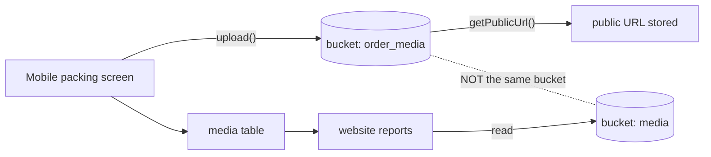

# W6 — Packing preuve et rapport dates {#w6-packing-evidence-and-report-dates}

le workflow avec le most business consequence, le only documented business
rule avec a stated rationale, et one vérifié defect.

<Status
  type="verified"
  date="2026-08-20"
  sources={[
    'Mobile:utils/api/supabase.ts',
    'website:Trail/packed-date-report-conflict-log.md',
    'website:inspect_rpc.js',
    'website:inspect_instances.js',
    'website:src/features/reports/',
    'Supabase project fqynbudvpvpiljdrrvem',
  ]}>
  le bucket mismatch, RPC signature, instance columns, Storage bucket state et
  live report-date logic sont vérifié. le live fonction utilise
  `order_pkg_instance.packed_at` as le completion-date source quand present.
</Status>

## le flow {#the-flow}

| Step | Detail |
| --- | --- |
| **Actor** | `packer` produces preuve; a reporting utilisateur generates output |
| **Application** | `Mobile` pour preuve, `website` pour le rapport |
| **Action** | Add packed items et photograph le package; later, generate a packing list pour a client, order, destination et date range |
| **Base de données** | Mobile écrit `package_items` et uploads vers bucket `order_media`. website lit `order_pkg_instance`, `pkd_item`, `media`, `qr_codes` via `fetch_report_instances` et `fetch_instance_items` |
| **Result** | A client-facing packing list |
| **Cross-app** | This est where Mobile's field work becomes le client deliverable — et where le bucket mismatch bites |

## le four package layers {#the-four-package-layers}

Conflating these est le most common source de reporting bugs:

```text
order_packages      definition / template
order_pkg_overview  grouped quantity and progress
order_pkg_instance  ONE physical box
pkd_item            an item actually packed into that box
```

`order_pkg_instance` carries `ipac_reference`, `instance_number`, `destination`,
`tag`, `packed_at` et `packed_by`.

## le rapport date rule {#the-report-date-rule}

This est le single most valuable business rule recovered dans le audit, parce que it
comes avec its reason.

**Rapport packed date, as authored:**

```sql
COALESCE(order_pkg_instance.packed_at, MAX(pkd_item.created_at))
```

**Previously, et après le 2026-08-08 revert:**

```sql
MAX(pkd_item.created_at)
```

:::info Why `task_logs.end_time` est deliberately ne utilisé

Quoting le incident log directly:

> le migration intentionally does ne use `task_logs.end_time`, parce que
> reopening/reworking a box devrait ne move le original packed date.

A box that est reopened et repacked doit keep le date it a été **first** packed.
Task time would move it. This est a real business rule avec a stated rationale —
preserve it.

:::

**le matching UI rule**, dans le packing list page:

```text
If status becomes packed AND packed_at is empty  → set packed_at = now
If packed_at already exists                      → keep it
If status changes away from packed               → do NOT clear packed_at
```

le behaviour it replaced a été
`packed_at: status === "packed" ? new Date().toISOString() : null`, which **cleared
le original packed date** whenever a box moved out de `packed`. That est le bug le
rule exists vers prevent.

### le measured impact {#the-measured-impact}

pour one client order filtered vers one destination et a two-week window:

| Rapport date logic | Boxes shown |
| --- | --- |
| `MAX(pkd_item.created_at)` | **11** |
| `COALESCE(instance.packed_at, MAX(pkd_item.created_at))` | **22** |

A date-logic change doubled a client-facing rapport. This est why le rule matters
et why le reasoning doit stay written down.

:::info Live logic as de 2026-08-20

le live `fetch_report_instances` overload avec `p_tag_ids` utilise
`COALESCE(order_pkg_instance.packed_at, MAX(pkd_item.created_at))` pour
completion-style date modes. `item_packed_at` est a legacy alias pour completion,
`packing_completed_at` est le explicit completion mode, et
`packing_started_at` utilise le first packed item timestamp.

:::

## Vérifié RPC signature {#verified-rpc-signature}

depuis <SourceRef repo="website" path="inspect_rpc.js" />:

```text
fetch_report_instances(p_client_id, p_order_ids, p_date_from, p_date_to,
                       p_date_mode, p_destinations, p_has_items_only, p_tag_ids)
```

le live fonction accepts `packing_started_at`, `packing_completed_at`,
`item_packed_at`, et falls back vers instance creation pour unrecognised modes.

## le Storage bucket mismatch {#the-storage-bucket-mismatch}



:::danger Storage mismatch

`Mobile` uploads package photographs vers **`order_media`**, then derives a public
URL. `website` lit et écrit **`media`** dans six places. Only `media` appears dans
le stale schema snapshot, et live Supabase has non `order_media` bucket.

Consequence: photographs taken dans le field through this chemin may ne upload ou
may ne appear dans client rapports. le live `media` bucket est public, so any fix
needs a deliberate storage-access decision rather than a silent bucket swap. See
[H2](/docs/security/findings#h2).

:::

Note that Mobile also écrit an `order_media` **table** dans source, but non live
public table par that name a été found.

## Manual remediation happens {#manual-remediation-happens}

`website/Trail/` contient a JSON snapshot taken *"avant redo"* de a production
order, recording box counts per filter — 488 boxes under one statut filter pour a
single order. Together avec le packed-date backfill de 19 rows, this shows rapport
discrepancies sont sometimes resolved par **editing production data directly**, avec
hand-rolled backups.

That practice est real, est ne covered par any runbook, et est le strongest argument
pour le versioning work dans
[Schema provenance](/docs/backend/schema-provenance#restoring-reproducibility).

